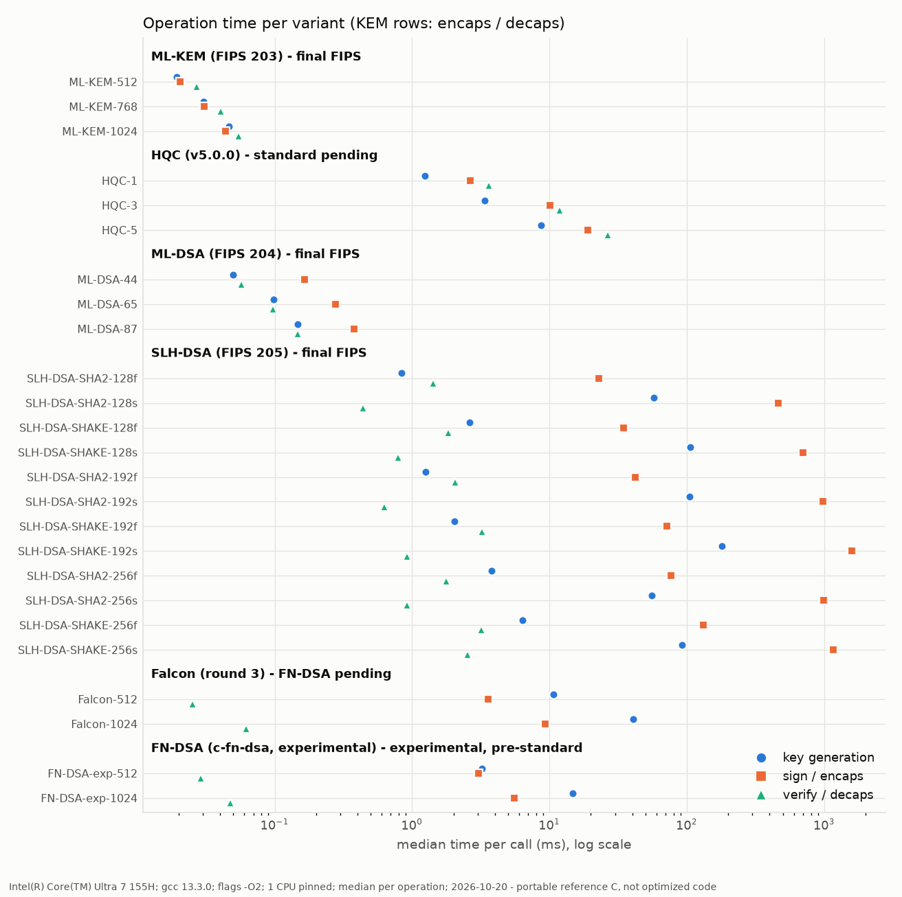
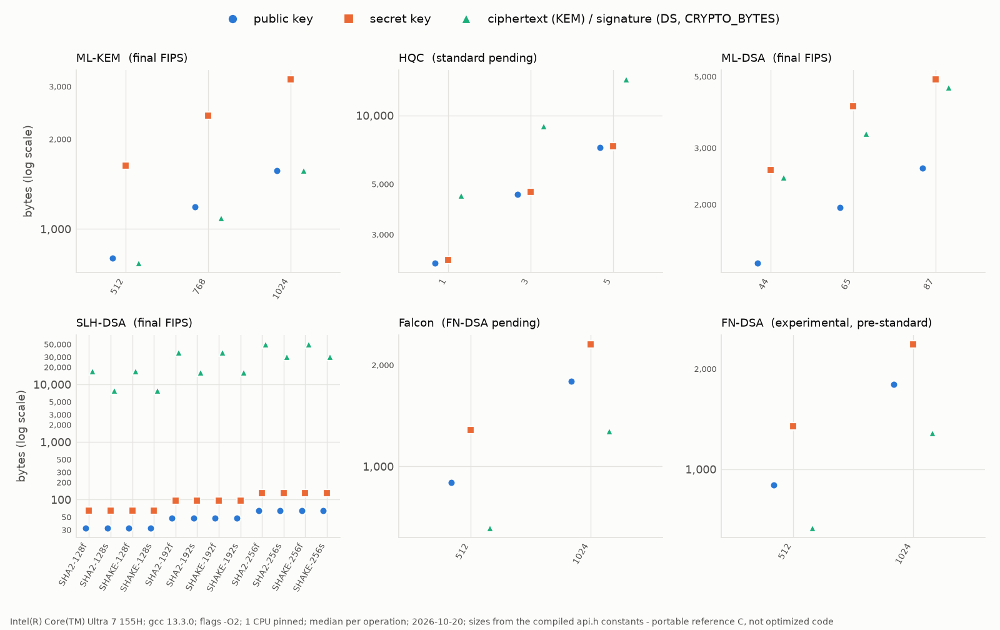

# VLSPQC — post-quantum KAT golden model and bare-metal test suite

VLSPQC is the software side of a hardware/software co-design effort on post-quantum cryptography: a collection of reference implementations
(portable C, no external libraries), one KAT (Known Answer Test) framework around all of them, and a generator that turns every test into a
self-contained, no-file-I/O program, which prepares the code for later bare-metal programs. This repository is software-only: nothing here depends on or measures hardware. A single top-level `Makefile` generates deterministic `.rsp` vectors,
replays them byte for byte, builds the static tests, and runs the host benchmark.

> **Status wording.** Only ML-KEM (FIPS 203), ML-DSA (FIPS 204) and SLH-DSA (FIPS 205) are final standards here. Falcon (→ FN-DSA, FIPS 206) and HQC are
> *selected, standard pending*; the NIST additional-signature schemes are *candidates*. The code is labelled accordingly everywhere. Status checked on
> NIST's CSRC pages on 2026-10-20; see [`algorithms/README.md`](algorithms/README.md).

## What is covered

| Family | Category | Spec and status | Variants | Upstream (pinned) | In `test-all`? |
|---|---|---|---:|---|---|
| ML-KEM | [KEM](algorithms/kem/README.md) | FIPS 203, **final** | 3 | [mlkem-native](https://github.com/pq-code-package/mlkem-native) `v2.0.0` (`d1b2fe78`) | yes |
| ML-DSA | [standard signatures](algorithms/signatures/standard/README.md) | FIPS 204, **final** | 3 | [mldsa-native](https://github.com/pq-code-package/mldsa-native) `v2.0.0` (`834a90d5`) | yes |
| SLH-DSA | standard signatures | FIPS 205, **final** | 12 | [slhdsa-c](https://github.com/pq-code-package/slhdsa-c) `174c02e4` | yes |
| HQC | KEM | selected 2025, **standard pending** (no draft number confirmed) | 3 | [pqc-hqc/hqc](https://gitlab.com/pqc-hqc/hqc) `v5.0.0` (`f46e542`) | yes (labelled pending) |
| Falcon | standard signatures | round 3, **basis of FN-DSA (FIPS 206, not final)** | 2 | [falcon-round3](https://falcon-sign.info/falcon-round3.zip) (package SHA-256 `d625407d`) | yes (labelled pending) |
| FN-DSA (experimental) | standard signatures | pre-standard best guess, **not FIPS 206** | 2 | [c-fn-dsa](https://github.com/pornin/c-fn-dsa) `1b858880` | no |
| FAEST, MAYO, MQOM, QR-UOV, SDitH, SNOVA, SQIsign, UOV | [on-ramp](algorithms/signatures/onramp/README.md) | NIST additional signatures: **round-3 candidates** | 232 across all on-ramp rows (+ 12 FAEST-decoupled) | per family, see the on-ramp README | no |
| HAWK | on-ramp | round-3 candidate, **withdrawn by its team** (NIST page) | 3 | [hawk-sign/dev](https://github.com/hawk-sign/dev) (closest match `1b9fef52`) | no |
| CROSS, LESS | on-ramp, `round2-only/` | round 2 only (not among the nine round-3 candidates) | 18 + 7 | [CROSS](https://github.com/CROSS-signature/CROSS-implementation) (closest match `v2.0`), [LESS](https://github.com/less-sig/LESS) (closest match `v2.0.0`) | no |
| XMSS, LMS, HSS | [stateful](algorithms/signatures/stateful/README.md) | NIST SP 800-208, final | 3 defaults (+134 via sweeps) | [xmss-reference](https://github.com/XMSS/xmss-reference), Cisco [hash-sigs](https://github.com/cisco/hash-sigs) (closest matches, not verified pins) | no |
| ASCON | [symmetric](algorithms/symmetric/README.md) | Ascon **v1.2** code; SP 800-232 (final) defines different functions | 7 | [ascon-c](https://github.com/ascon/ascon-c) (closest match `v1.2.5`) | no |
| Kyber, Dilithium, SPHINCS+ round 3; SPHINCS+ Haraka | [legacy](algorithms/legacy/README.md) | pre-standard, kept for comparison | — | tag `pre-fips-migration` | no |

`make test-all` covers exactly 23 variants: ML-KEM 3, ML-DSA 3, SLH-DSA 12, Falcon 2, HQC 3 (plus the two replays of the official Falcon round-3 KAT files).
Everything else has its own aggregate target (`test-onramp-ds`, `test-stateful-ds`, `test-ascon`, `test-fndsa-exp`; see [`docs/makefile-flags.md`](docs/makefile-flags.md)).

## Sizes

Generated from the compiled `api.h` constants of every variant (`tools/gen_size_table.py`, [`results/sizes.csv`](results/sizes.csv)); bytes. The last column is the ciphertext
(KEM) or `CRYPTO_BYTES` (signature; for Falcon the maximum).

<!-- BEGIN sizes:root -->
| Variant | pk (B) | sk (B) | ct / sig (B) |
|---|---:|---:|---:|
| ml-kem-512 | 800 | 1632 | 768 |
| ml-kem-768 | 1184 | 2400 | 1088 |
| ml-kem-1024 | 1568 | 3168 | 1568 |
| ML-DSA-44 | 1312 | 2560 | 2420 |
| ML-DSA-65 | 1952 | 4032 | 3309 |
| ML-DSA-87 | 2592 | 4896 | 4627 |
| falcon-512 | 897 | 1281 | 690 |
| falcon-1024 | 1793 | 2305 | 1330 |
| SLH-DSA-SHA2-128s | 32 | 64 | 7856 |
| SLH-DSA-SHA2-128f | 32 | 64 | 17088 |
| SLH-DSA-SHA2-192s | 48 | 96 | 16224 |
| SLH-DSA-SHA2-192f | 48 | 96 | 35664 |
| SLH-DSA-SHA2-256s | 64 | 128 | 29792 |
| SLH-DSA-SHA2-256f | 64 | 128 | 49856 |
| SLH-DSA-SHAKE-128s | 32 | 64 | 7856 |
| SLH-DSA-SHAKE-128f | 32 | 64 | 17088 |
| SLH-DSA-SHAKE-192s | 48 | 96 | 16224 |
| SLH-DSA-SHAKE-192f | 48 | 96 | 35664 |
| SLH-DSA-SHAKE-256s | 64 | 128 | 29792 |
| SLH-DSA-SHAKE-256f | 64 | 128 | 49856 |
| HQC2025_1 | 2241 | 2321 | 4433 |
| HQC2025_3 | 4514 | 4602 | 8978 |
| HQC2025_5 | 7237 | 7333 | 14421 |
| fndsa-exp-512 | 897 | 1345 | 666 |
| fndsa-exp-1024 | 1793 | 2369 | 1280 |
<!-- END sizes:root -->

## Results

Host benchmark of the portable reference C (no SIMD, no assembly): Intel Core Ultra 7 155H under WSL2, gcc 13.3 `-O2`, one CPU pinned, 2026-10-20, machine about 94 % idle,
median of up to 1000 calls within 3 s per operation, **single run** (run-to-run variation not quantified for these families). Raw data and method:
[`results/benchmark.csv`](results/benchmark.csv), [`results/benchmark_meta.json`](results/benchmark_meta.json), [`bench/README.md`](bench/README.md); every command that was run is in
[`results/validation.md`](results/validation.md). These numbers are for the reference code and are not comparable with optimized (AVX2) packages. The earlier level-1 benchmark of the Round-3 on-ramp families (39 variants, median of 3 runs, 2026-10-14, not rerun after the migration) is
in [`algorithms/signatures/onramp/README.md`](algorithms/signatures/onramp/README.md#benchmark-of-the-round-3-families-level-1) and [`results/benchmark_onramp_l1.csv`](results/benchmark_onramp_l1.csv).





<!-- BEGIN results:root -->
| Variant | NIST cat. | keygen (ms) | sign / encaps (ms) | verify / decaps (ms) | peak stack (B) | peak heap (B) | code (B) |
|---|---:|---:|---:|---:|---:|---:|---:|
| ML-KEM-512 | 1 | 0.019 | 0.021 | 0.027 | 12288 | 0 | 22921 |
| ML-KEM-768 | 3 | 0.030 | 0.031 | 0.040 | 16384 | 0 | 22665 |
| ML-KEM-1024 | 5 | 0.047 | 0.044 | 0.055 | 24576 | 0 | 24017 |
| HQC-1 | 1 | 1.232 | 2.647 | 3.625 | 65536 | 0 | 30854 |
| HQC-3 | 3 | 3.364 | 10.1 | 11.8 | 131072 | 0 | 32945 |
| HQC-5 | 5 | 8.678 | 19.0 | 26.4 | 208896 | 0 | 39274 |
| ML-DSA-44 | 2 | 0.050 | 0.166 | 0.057 | 49152 | 0 | 32601 |
| ML-DSA-65 | 3 | 0.098 | 0.277 | 0.097 | 73728 | 0 | 33041 |
| ML-DSA-87 | 5 | 0.146 | 0.377 | 0.146 | 110592 | 0 | 33505 |
| SLH-DSA-SHA2-128f | 1 | 0.838 | 22.9 | 1.427 | 4096 | 0 | 35448 |
| SLH-DSA-SHA2-128s | 1 | 57.7 | 461.0 | 0.441 | 4096 | 0 | 35448 |
| SLH-DSA-SHAKE-128f | 1 | 2.608 | 34.6 | 1.828 | 4096 | 0 | 35448 |
| SLH-DSA-SHAKE-128s | 1 | 105.5 | 702.1 | 0.791 | 4096 | 0 | 35448 |
| SLH-DSA-SHA2-192f | 3 | 1.249 | 42.0 | 2.049 | 4096 | 0 | 35448 |
| SLH-DSA-SHA2-192s | 3 | 105.1 | 976.3 | 0.628 | 4096 | 0 | 35448 |
| SLH-DSA-SHAKE-192f | 3 | 2.037 | 71.2 | 3.232 | 4096 | 0 | 35448 |
| SLH-DSA-SHAKE-192s | 3 | 180.8 | 1585.6 | 0.923 | 4096 | 0 | 35448 |
| SLH-DSA-SHA2-256f | 5 | 3.778 | 76.3 | 1.763 | 4096 | 0 | 35448 |
| SLH-DSA-SHA2-256s | 5 | 55.2 | 989.5 | 0.922 | 4096 | 0 | 35448 |
| SLH-DSA-SHAKE-256f | 5 | 6.401 | 132.3 | 3.192 | 4096 | 0 | 35448 |
| SLH-DSA-SHAKE-256s | 5 | 91.8 | 1160.9 | 2.544 | 4096 | 0 | 35448 |
| Falcon-512 | 1 | 10.7 | 3.583 | 0.025 | 45056 | 0 | 90938 |
| Falcon-1024 | 5 | 40.7 | 9.257 | 0.062 | 86016 | 0 | 90946 |
| FN-DSA-exp-512 | 1 | 3.212 | 3.060 | 0.029 | 32768 | 0 | 107405 |
| FN-DSA-exp-1024 | 5 | 14.8 | 5.523 | 0.048 | 61440 | 0 | 107405 |
<!-- END results:root -->

Peak stack is measured in 4 KiB pages (so 4096 means "at most 4 KiB"); heap is peak `malloc` use (0 means none of these implementations allocates). Code size is the
algorithm objects only. Regenerate with `make bench-fips` (idle machine) and `make results-update`.

## Quick start

```bash
make test-all                # the 23 standardized / standard-pending variants, 100 vectors each
make test-ml-kem-512         # one variant (names: see the category READMEs)
make gen-all                 # only (re)generate the .rsp files into vectors/rsp/
make static-test-all         # bare-metal style static tests into vectors/static/
tools/run_all_static_kat.sh  # build + run + log every static test (add --benchmark-all for the extra families)
make test-onramp-ds          # on-ramp candidates (very long: the pre-migration baseline run was stopped after 90 min unfinished; try KATNUM=10)
make bench-fips && make results-update   # host benchmark and tables / figures (idle machine)
make distclean               # remove build/, vectors/rsp/, vectors/static/
```

## Documentation map

| Where | What |
|---|---|
| [`algorithms/README.md`](algorithms/README.md) | category map, status groups and the provenance table of every family |
| [`algorithms/kem/`](algorithms/kem/README.md), [`signatures/standard/`](algorithms/signatures/standard/README.md), [`signatures/onramp/`](algorithms/signatures/onramp/README.md), [`signatures/stateful/`](algorithms/signatures/stateful/README.md), [`symmetric/`](algorithms/symmetric/README.md), [`legacy/`](algorithms/legacy/README.md) | per category: scope, spec references, per-family details, `make` targets, `.rsp` fields, limitations |
| each family's `UPSTREAM.md` | upstream URL, tag, commit, import date, removals, local patches, verification |
| [`harness/README.md`](harness/README.md) | the `.rsp` parser, generators and test runners |
| [`docs/kat-format.md`](docs/kat-format.md) | the two-phase generate / test model and the `.rsp` format |
| [`docs/static-tests.md`](docs/static-tests.md) | the static-test generator, the batch runner, cycle-counter profiling |
| [`docs/makefile-flags.md`](docs/makefile-flags.md) | Makefile flags and aggregate targets |
| [`docs/adding-an-algorithm.md`](docs/adding-an-algorithm.md) | checklist for new variants and families |
| [`tools/README.md`](tools/README.md) | the scripts (registry, generators, benchmark, table / figure / link-check tools) |
| [`results/README.md`](results/README.md), [`results/validation.md`](results/validation.md) | measured data and the record of every validation command |

```
VLSPQC/
├── Makefile
├── algorithms/        kem/  signatures/{standard,onramp,stateful}/  symmetric/  legacy/
├── harness/           kat_parser.*  gen/ (PQCgenKAT_*.c generators, main_*.c runners, rng.c)
├── vectors/           rsp/ and static/  (generated, git-ignored)
├── tools/             algo_registry.json, static-test generator, benchmark, report scripts
├── docs/              format and tool documentation, figures/
├── results/           sizes, benchmark and validation records
└── bench/             benchmark run outputs (git-ignored)
```

## Changelog — FIPS migration (what changed against the tag `pre-fips-migration`, and why)

A review pointed out that the repository labelled round-3 Kyber, Dilithium and SPHINCS+ code as ML-KEM, ML-DSA and SLH-DSA. Those are **not** byte-compatible with FIPS 203 / 204 / 205
(different hashing and domain separation, no context string), so their KATs were not FIPS KATs. What was done:

- **Replaced** the pre-standard code by FIPS-final upstream implementations, each pinned to a tag or commit and documented in an `UPSTREAM.md`: ML-KEM (mlkem-native), ML-DSA (mldsa-native, pure
  ML-DSA with an empty context), SLH-DSA (slhdsa-c, the 12 FIPS 205 sets). Cross-checked against independent references: upstream's published KAT hashes (ML-KEM, ML-DSA) and NIST ACVP vectors
  (SLH-DSA). SPHINCS+ Haraka / Haraka-AES, which are **not** in FIPS 205, left `test-all`; the old Kyber, Dilithium and SPHINCS+ code is kept in [`algorithms/legacy/`](algorithms/legacy/README.md).
- **Relabelled** Falcon ("round 3, basis of the upcoming FN-DSA"; now also tested against the package's official KAT files, 100/100 records per size) and HQC ("selected, standard pending", pinned to the released v5.0.0 and checked against its official KATs); corrected the status of
  the on-ramp schemes (round reached, HAWK withdrawn, CROSS / LESS round 2 only) and of ASCON (the code is Ascon v1.2, not the SP 800-232 functions). Added the experimental pre-standard
  FN-DSA (c-fn-dsa, integer-only build), outside `test-all`.
- **Restructured** the repository (`original/` → `algorithms/`, `common/` + `kat/gen` → `harness/`, `kat/rsp` + `kat/static` → `vectors/`), with all old `make` target names still working. The generated
  `.rsp` files are byte-identical before and after the move (66 of 66 compared).
- **Added** the generated size tables, the host benchmark of the new families and the figures above, `results/`, and these documents.
- `make test-all` went from 35 to 23 variants (the dropped ones were the pre-standard trees). All of it passes; the exact commands and outcomes, including what was **not** run (notably the default 100-vector on-ramp run and the stateful sweeps), are in [`results/validation.md`](results/validation.md).

## License

This repository follows the licensing terms of the reference implementations it contains; every family folder now carries its upstream license file or states the license in its `UPSTREAM.md`
(CC0, MIT, Apache-2.0 / ISC / MIT, BSD-style, public domain, depending on the family; see [`algorithms/README.md`](algorithms/README.md)). Two things are **unconfirmed**: the license of the
early Saarinen FIPS 205 code inside the legacy `*-s-simple` SPHINCS+ folders, and the exact upstream versions of the vendored CROSS, LESS, HAWK, XMSS, LMS, HSS and ASCON code (the
READMEs give the closest matches found, not verified import points).

## Authors

- Alessandra Dolmeta — alessandra.dolmeta@polito.it
- Valeria Piscopo — valeria.piscopo@polito.it
