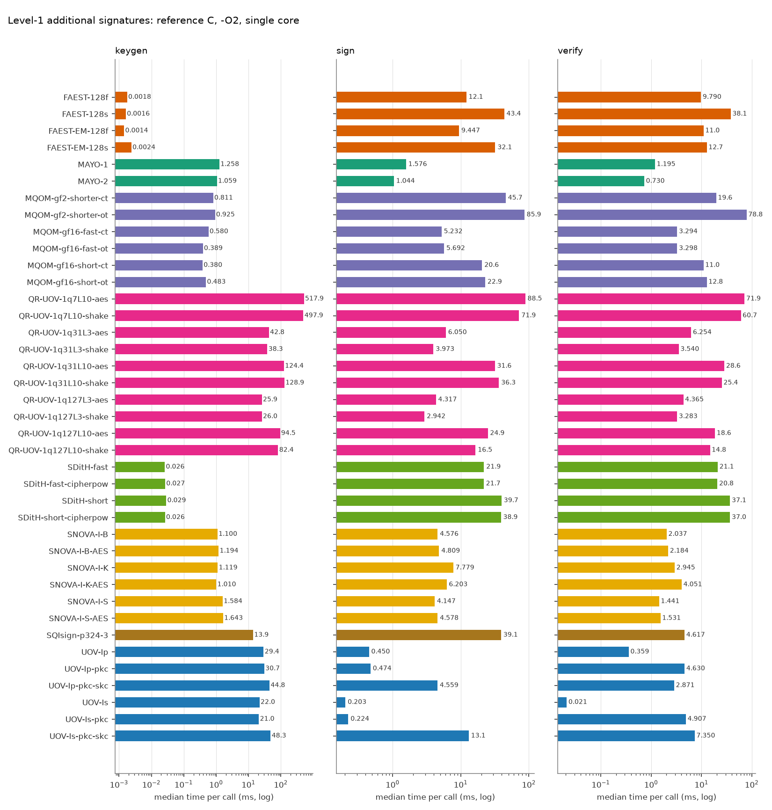
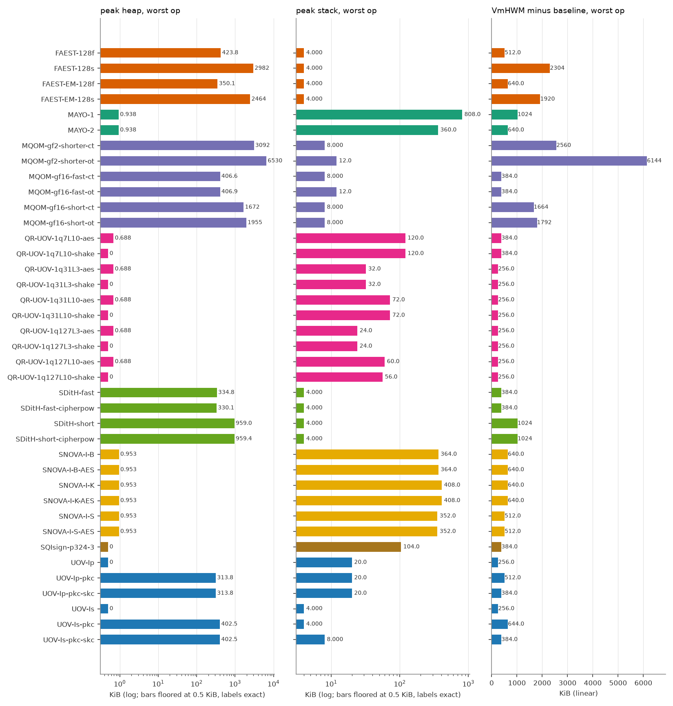
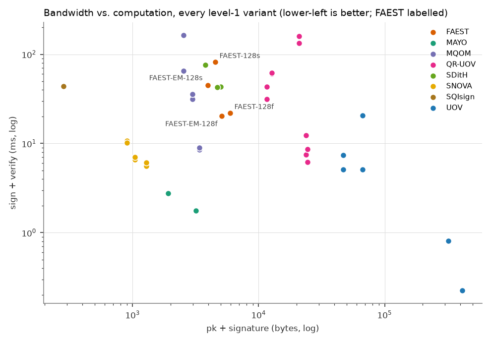

# FAEST vs. the other on-going NIST additional-signature candidates (level 1)

All numbers are produced by `tools/bench/run_bench.py` + `tools/bench/report.py` from the reference implementations in `original/Additional-DS/` (static-test folders, portable C, no SIMD/AES-NI). Regenerate with `make bench-l1`.

## Setup

| | |
|---|---|
| CPU | Intel(R) Core(TM) Ultra 7 155H |
| OS | Linux AlessandraYOGA 6.6.87.2-microsoft-standard-WSL2 #1 SMP PREEMPT_DYNAMIC Thu Jun  5 18:30:46 UTC 2025 x86_64 |
| Compiler | gcc (Ubuntu 13.3.0-6ubuntu2~24.04.1) 13.3.0, `CFLAGS=-O2 -std=gnu11 -w -Wno-psabi` (warnings suppressed), identical for every variant; the static KAT tests were built with `-std=c11` |
| Pinning | single core (CPU 2), one process per operation |
| Message | 1000 bytes (`hello world ` repeated), as in the reference paper |
| Iterations | up to 1000 per operation, within a 3.0 s budget (min 5); median reported |
| Date | 2026-10-14 12:13:34 |
| Machine load | run 1, timed phase 12:13:34-12:18:09 (vmstat, 10 s samples, 30 in window): mean CPU idle 90.3 % of 16 logical CPUs, mean user 7.6 % (one core of 16 is 6.25 %), 1 sample above 20 % user+system: the sample stamped 12:18:12 (VS Code ripgrep burst, with swap-in), overlapping only the last seconds of UOV-Is-pkc-skc. 3.5 GB of swap was in use. No pdflatex process appeared among the top CPU consumers in `ps` at 12:06-12:07 (it had been running at dispatch time). |

Metrics: **time** = wall clock (`CLOCK_MONOTONIC`) per call; **cycles** = raw TSC ticks; **heap** = peak bytes live in `malloc/calloc/realloc` (requested size, via link-time wrapping, key/message buffers of the harness excluded); **stack** = deepest touched page of a dedicated 1 GiB mmap'ed thread stack (4 KiB granularity); **VmHWM-base** = growth of the process peak resident set during the operation, `vmhwm_kb - vmhwm_base_kb` (the raw VmHWM, in `results.csv`, also contains a 2.0-2.4 MiB baseline of libc and harness pages that depends on the operation, because the preparation thread has already run sign/verify and its freed heap stays resident; pages reused from it are not counted, so this column under-reports sign/verify of heap-heavy variants and is only indicative); **code/data/bss** = `size` of the algorithm objects only (harness excluded).

> **Note on FAEST timings.** The FAEST sign and verify medians are flagged as unreliable until an idle rerun: sign/verify ratios are inconsistent among sibling variants (e.g. FAEST-EM-128f verify above sign, FAEST-EM-128s verify far below sign), the std/median of several FAEST sign/verify runs is high, and the machine is a hybrid-core CPU under WSL2 that is shared with other work. No number has been altered.

## Key and signature sizes (bytes)

| Scheme | Variant | pk | sk | signature |
|---|---|---:|---:|---:|
| FAEST | FAEST-128f | 32 | 32 | 5924 |
| FAEST | FAEST-128s | 32 | 32 | 4506 |
| FAEST | FAEST-EM-128f | 32 | 32 | 5060 |
| FAEST | FAEST-EM-128s | 32 | 32 | 3906 |
| MAYO | MAYO-1 | 1456 | 24 | 464 |
| MAYO | MAYO-2 | 2928 | 24 | 239 |
| MQOM | MQOM-gf2-shorter-ct | 52 | 72 | 2492 |
| MQOM | MQOM-gf2-shorter-ot | 52 | 72 | 2492 |
| MQOM | MQOM-gf16-fast-ct | 64 | 96 | 3316 |
| MQOM | MQOM-gf16-fast-ot | 64 | 96 | 3316 |
| MQOM | MQOM-gf16-short-ct | 64 | 96 | 2932 |
| MQOM | MQOM-gf16-short-ot | 64 | 96 | 2932 |
| QR-UOV | QR-UOV-1q7L10-aes | 20641 | 32 | 331 |
| QR-UOV | QR-UOV-1q7L10-shake | 20641 | 32 | 331 |
| QR-UOV | QR-UOV-1q31L3-aes | 23641 | 32 | 157 |
| QR-UOV | QR-UOV-1q31L3-shake | 23641 | 32 | 157 |
| QR-UOV | QR-UOV-1q31L10-aes | 12266 | 32 | 435 |
| QR-UOV | QR-UOV-1q31L10-shake | 12266 | 32 | 435 |
| QR-UOV | QR-UOV-1q127L3-aes | 24256 | 32 | 200 |
| QR-UOV | QR-UOV-1q127L3-shake | 24256 | 32 | 200 |
| QR-UOV | QR-UOV-1q127L10-aes | 11041 | 32 | 541 |
| QR-UOV | QR-UOV-1q127L10-shake | 11041 | 32 | 541 |
| SDitH | SDitH-fast | 70 | 147 | 4914 |
| SDitH | SDitH-fast-cipherpow | 70 | 147 | 4643 |
| SDitH | SDitH-short | 70 | 147 | 3721 |
| SDitH | SDitH-short-cipherpow | 70 | 147 | 3721 |
| SNOVA | SNOVA-I-B | 656 | 96 | 388 |
| SNOVA | SNOVA-I-B-AES | 656 | 96 | 388 |
| SNOVA | SNOVA-I-K | 376 | 96 | 528 |
| SNOVA | SNOVA-I-K-AES | 376 | 96 | 528 |
| SNOVA | SNOVA-I-S | 1016 | 96 | 272 |
| SNOVA | SNOVA-I-S-AES | 1016 | 96 | 272 |
| SQIsign | SQIsign-p324-3 | 83 | 270 | 200 |
| UOV | UOV-Ip | 321300 | 278087 | 135 |
| UOV | UOV-Ip-pkc | 46591 | 278087 | 135 |
| UOV | UOV-Ip-pkc-skc | 46591 | 32 | 135 |
| UOV | UOV-Is | 412160 | 348704 | 96 |
| UOV | UOV-Is-pkc | 66576 | 348704 | 96 |
| UOV | UOV-Is-pkc-skc | 66576 | 32 | 96 |

## Run time (median, ms) and TSC cycles (millions)

| Scheme | Variant | KeyGen ms | Sign ms | Verify ms | KeyGen Mcyc | Sign Mcyc | Verify Mcyc |
|---|---|---:|---:|---:|---:|---:|---:|
| FAEST | FAEST-128f | 0.0018 | 12.1 | 9.790 | 0.01 | 34.29 | 27.83 |
| FAEST | FAEST-128s | 0.0016 | 43.4 | 38.1 | 0.00 | 123.49 | 108.41 |
| FAEST | FAEST-EM-128f | 0.0014 | 9.447 | 11.0 | 0.00 | 26.64 | 30.97 |
| FAEST | FAEST-EM-128s | 0.0024 | 32.1 | 12.7 | 0.01 | 90.44 | 36.24 |
| MAYO | MAYO-1 | 1.258 | 1.576 | 1.195 | 3.58 | 4.48 | 3.40 |
| MAYO | MAYO-2 | 1.059 | 1.044 | 0.730 | 3.00 | 2.96 | 2.07 |
| MQOM | MQOM-gf2-shorter-ct | 0.811 | 45.7 | 19.6 | 2.30 | 129.61 | 55.72 |
| MQOM | MQOM-gf2-shorter-ot | 0.925 | 85.9 | 78.8 | 2.62 | 243.09 | 223.00 |
| MQOM | MQOM-gf16-fast-ct | 0.580 | 5.232 | 3.294 | 1.64 | 14.74 | 9.26 |
| MQOM | MQOM-gf16-fast-ot | 0.389 | 5.692 | 3.298 | 1.09 | 15.92 | 9.16 |
| MQOM | MQOM-gf16-short-ct | 0.380 | 20.6 | 11.0 | 1.05 | 57.22 | 30.64 |
| MQOM | MQOM-gf16-short-ot | 0.483 | 22.9 | 12.8 | 1.39 | 65.54 | 36.57 |
| QR-UOV | QR-UOV-1q7L10-aes | 517.9 | 88.5 | 71.9 | 1426.12 | 243.75 | 205.07 |
| QR-UOV | QR-UOV-1q7L10-shake | 497.9 | 71.9 | 60.7 | 1420.69 | 205.06 | 173.02 |
| QR-UOV | QR-UOV-1q31L3-aes | 42.8 | 6.050 | 6.254 | 122.01 | 17.21 | 17.76 |
| QR-UOV | QR-UOV-1q31L3-shake | 38.3 | 3.973 | 3.540 | 108.74 | 11.16 | 9.94 |
| QR-UOV | QR-UOV-1q31L10-aes | 124.4 | 31.6 | 28.6 | 351.19 | 89.79 | 81.05 |
| QR-UOV | QR-UOV-1q31L10-shake | 128.9 | 36.3 | 25.4 | 365.43 | 103.02 | 72.15 |
| QR-UOV | QR-UOV-1q127L3-aes | 25.9 | 4.317 | 4.365 | 73.50 | 12.26 | 12.33 |
| QR-UOV | QR-UOV-1q127L3-shake | 26.0 | 2.942 | 3.283 | 72.94 | 8.27 | 9.32 |
| QR-UOV | QR-UOV-1q127L10-aes | 94.5 | 24.9 | 18.6 | 268.22 | 70.79 | 52.75 |
| QR-UOV | QR-UOV-1q127L10-shake | 82.4 | 16.5 | 14.8 | 234.41 | 47.05 | 42.15 |
| SDitH | SDitH-fast | 0.026 | 21.9 | 21.1 | 0.07 | 62.86 | 60.42 |
| SDitH | SDitH-fast-cipherpow | 0.027 | 21.7 | 20.8 | 0.08 | 62.25 | 58.84 |
| SDitH | SDitH-short | 0.029 | 39.7 | 37.1 | 0.08 | 111.72 | 104.25 |
| SDitH | SDitH-short-cipherpow | 0.026 | 38.9 | 37.0 | 0.07 | 108.09 | 102.98 |
| SNOVA | SNOVA-I-B | 1.100 | 4.576 | 2.037 | 3.06 | 13.02 | 5.82 |
| SNOVA | SNOVA-I-B-AES | 1.194 | 4.809 | 2.184 | 3.41 | 13.74 | 6.24 |
| SNOVA | SNOVA-I-K | 1.119 | 7.779 | 2.945 | 3.18 | 22.09 | 8.36 |
| SNOVA | SNOVA-I-K-AES | 1.010 | 6.203 | 4.051 | 2.86 | 17.43 | 11.39 |
| SNOVA | SNOVA-I-S | 1.584 | 4.147 | 1.441 | 4.50 | 11.77 | 4.09 |
| SNOVA | SNOVA-I-S-AES | 1.643 | 4.578 | 1.531 | 4.66 | 12.98 | 4.34 |
| SQIsign | SQIsign-p324-3 | 13.9 | 39.1 | 4.617 | 39.35 | 110.65 | 13.12 |
| UOV | UOV-Ip | 29.4 | 0.450 | 0.359 | 83.58 | 1.28 | 1.02 |
| UOV | UOV-Ip-pkc | 30.7 | 0.474 | 4.630 | 86.72 | 1.33 | 13.00 |
| UOV | UOV-Ip-pkc-skc | 44.8 | 4.559 | 2.871 | 127.25 | 12.95 | 8.15 |
| UOV | UOV-Is | 22.0 | 0.203 | 0.021 | 62.27 | 0.58 | 0.06 |
| UOV | UOV-Is-pkc | 21.0 | 0.224 | 4.907 | 59.42 | 0.63 | 13.91 |
| UOV | UOV-Is-pkc-skc | 48.3 | 13.1 | 7.350 | 137.09 | 37.25 | 20.67 |

## Memory (KiB)

| Scheme | Variant | heap KG/S/V | stack KG/S/V | VmHWM-base KG/S/V | code | data+bss |
|---|---|---|---|---|---:|---:|
| FAEST | FAEST-128f | 0.0 / 423.8 / 186.5 | 0.0 / 4.0 / 4.0 | 384 / 512 / 256 | 229.1 | 0.1 |
| FAEST | FAEST-128s | 0.0 / 2981.7 / 1285.5 | 0.0 / 4.0 / 4.0 | 256 / 2304 / 512 | 229.1 | 0.1 |
| FAEST | FAEST-EM-128f | 0.0 / 350.1 / 166.7 | 0.0 / 4.0 / 4.0 | 384 / 640 / 384 | 229.1 | 0.1 |
| FAEST | FAEST-EM-128s | 0.0 / 2464.3 / 1120.1 | 0.0 / 4.0 / 4.0 | 384 / 1920 / 512 | 229.1 | 0.1 |
| MAYO | MAYO-1 | 0.9 / 0.9 / 0.7 | 156.0 / 236.0 / 808.0 | 384 / 512 / 1024 | 40.4 | 0.1 |
| MAYO | MAYO-2 | 0.9 / 0.9 / 0.7 | 124.0 / 152.0 / 360.0 | 384 / 384 / 640 | 40.4 | 0.1 |
| MQOM | MQOM-gf2-shorter-ct | 528.6 / 3091.8 / 704.6 | 0.0 / 8.0 / 8.0 | 640 / 2560 / 256 | 529.0 | 0.4 |
| MQOM | MQOM-gf2-shorter-ot | 528.6 / 6530.4 / 5152.6 | 0.0 / 12.0 / 8.0 | 640 / 6144 / 4736 | 546.5 | 0.4 |
| MQOM | MQOM-gf16-fast-ct | 132.1 / 406.6 / 132.1 | 0.0 / 8.0 / 8.0 | 384 / 384 / 0 | 512.2 | 0.3 |
| MQOM | MQOM-gf16-fast-ot | 132.1 / 406.9 / 249.1 | 0.0 / 12.0 / 8.0 | 384 / 256 / 256 | 530.1 | 0.4 |
| MQOM | MQOM-gf16-short-ct | 134.2 / 1672.5 / 352.6 | 0.0 / 8.0 / 4.0 | 384 / 1664 / 128 | 526.9 | 0.3 |
| MQOM | MQOM-gf16-short-ot | 134.2 / 1954.5 / 1488.6 | 0.0 / 8.0 / 4.0 | 384 / 1792 / 1408 | 545.9 | 0.4 |
| QR-UOV | QR-UOV-1q7L10-aes | 0.7 / 0.7 / 0.7 | 112.0 / 120.0 / 100.0 | 256 / 384 / 256 | 38.1 | 0.1 |
| QR-UOV | QR-UOV-1q7L10-shake | 0.0 / 0.0 / 0.0 | 112.0 / 120.0 / 100.0 | 256 / 384 / 256 | 38.3 | 0.1 |
| QR-UOV | QR-UOV-1q31L3-aes | 0.7 / 0.7 / 0.7 | 32.0 / 28.0 / 24.0 | 256 / 256 / 256 | 38.3 | 0.1 |
| QR-UOV | QR-UOV-1q31L3-shake | 0.0 / 0.0 / 0.0 | 32.0 / 28.0 / 24.0 | 256 / 256 / 256 | 38.4 | 0.1 |
| QR-UOV | QR-UOV-1q31L10-aes | 0.7 / 0.7 / 0.7 | 68.0 / 72.0 / 64.0 | 256 / 256 / 256 | 38.0 | 0.1 |
| QR-UOV | QR-UOV-1q31L10-shake | 0.0 / 0.0 / 0.0 | 68.0 / 72.0 / 64.0 | 256 / 256 / 256 | 38.1 | 0.1 |
| QR-UOV | QR-UOV-1q127L3-aes | 0.7 / 0.7 / 0.7 | 24.0 / 24.0 / 20.0 | 256 / 256 / 256 | 38.1 | 0.1 |
| QR-UOV | QR-UOV-1q127L3-shake | 0.0 / 0.0 / 0.0 | 24.0 / 24.0 / 20.0 | 256 / 256 / 256 | 38.2 | 0.1 |
| QR-UOV | QR-UOV-1q127L10-aes | 0.7 / 0.7 / 0.7 | 56.0 / 60.0 / 52.0 | 256 / 128 / 256 | 38.3 | 0.1 |
| QR-UOV | QR-UOV-1q127L10-shake | 0.0 / 0.0 / 0.0 | 56.0 / 56.0 / 48.0 | 256 / 256 / 256 | 38.4 | 0.1 |
| SDitH | SDitH-fast | 0.4 / 334.8 / 328.5 | 0.0 / 4.0 / 4.0 | 384 / 384 / 384 | 190.7 | 0.1 |
| SDitH | SDitH-fast-cipherpow | 0.4 / 330.1 / 323.7 | 0.0 / 4.0 / 4.0 | 256 / 384 / 384 | 190.7 | 0.1 |
| SDitH | SDitH-short | 0.4 / 959.0 / 952.7 | 0.0 / 4.0 / 4.0 | 384 / 1024 / 1024 | 190.7 | 0.1 |
| SDitH | SDitH-short-cipherpow | 0.4 / 959.4 / 953.1 | 0.0 / 4.0 / 4.0 | 384 / 1024 / 1024 | 190.7 | 0.1 |
| SNOVA | SNOVA-I-B | 1.0 / 1.0 / 0.0 | 132.0 / 364.0 / 280.0 | 384 / 640 / 512 | 33.2 | 10.2 |
| SNOVA | SNOVA-I-B-AES | 1.0 / 1.0 / 0.7 | 132.0 / 364.0 / 280.0 | 384 / 640 / 512 | 31.7 | 10.2 |
| SNOVA | SNOVA-I-K | 1.0 / 1.0 / 0.0 | 144.0 / 408.0 / 360.0 | 384 / 640 / 640 | 32.9 | 15.3 |
| SNOVA | SNOVA-I-K-AES | 1.0 / 1.0 / 0.7 | 144.0 / 408.0 / 360.0 | 512 / 640 / 512 | 31.4 | 15.3 |
| SNOVA | SNOVA-I-S | 1.0 / 1.0 / 0.0 | 136.0 / 352.0 / 288.0 | 384 / 512 / 512 | 32.8 | 5.3 |
| SNOVA | SNOVA-I-S-AES | 1.0 / 1.0 / 0.7 | 136.0 / 352.0 / 288.0 | 384 / 512 / 512 | 31.3 | 5.3 |
| SQIsign | SQIsign-p324-3 | 0.0 / 0.0 / 0.0 | 56.0 / 104.0 / 40.0 | 384 / 384 / 256 | 250.9 | 0.4 |
| UOV | UOV-Ip | 0.0 / 0.0 / 0.0 | 20.0 / 12.0 / 4.0 | 256 / 256 / 256 | 41.6 | 0.1 |
| UOV | UOV-Ip-pkc | 0.0 / 0.0 / 313.8 | 20.0 / 12.0 / 4.0 | 256 / 256 / 512 | 41.8 | 0.1 |
| UOV | UOV-Ip-pkc-skc | 271.6 / 271.6 / 313.8 | 20.0 / 20.0 / 4.0 | 256 / 0 / 384 | 44.0 | 0.1 |
| UOV | UOV-Is | 0.0 / 0.0 / 0.0 | 4.0 / 4.0 / 0.0 | 256 / 256 / 256 | 37.1 | 0.1 |
| UOV | UOV-Is-pkc | 0.0 / 0.0 / 402.5 | 4.0 / 4.0 / 0.0 | 256 / 256 / 644 | 37.3 | 0.1 |
| UOV | UOV-Is-pkc-skc | 340.5 / 340.5 / 402.5 | 4.0 / 8.0 / 0.0 | 256 / 0 / 384 | 38.1 | 0.1 |

Stack legend: values of 0, 4 and 8 KiB are page-granularity floors (read them as "<= 4 KiB", "<= 8 KiB"), not measurements; the stack is the touched pages of the thread stack minus an empty thread.

## FAEST against the best variant of every other family

Fastest FAEST variant per operation vs. fastest variant of each other scheme (ratio > 1: FAEST slower).

| Scheme | best KeyGen | best Sign | best Verify | smallest pk+sig |
|---|---|---|---|---|
| MAYO | MAYO-2 (1.059 ms): x0.00135 | MAYO-2 (1.044 ms): x9.1 | MAYO-2 (0.730 ms): x13.4 | MAYO-1 (1920 B): x2.1 |
| MQOM | MQOM-gf16-short-ct (0.380 ms): x0.00377 | MQOM-gf16-fast-ct (5.232 ms): x1.8 | MQOM-gf16-fast-ct (3.294 ms): x3.0 | MQOM-gf2-shorter-ct (2544 B): x1.5 |
| QR-UOV | QR-UOV-1q127L3-aes (25.9 ms): x5.53e-05 | QR-UOV-1q127L3-shake (2.942 ms): x3.2 | QR-UOV-1q127L3-shake (3.283 ms): x3.0 | QR-UOV-1q127L10-aes (11.6 K B): x0.3 |
| SDitH | SDitH-fast (0.026 ms): x0.0553 | SDitH-fast-cipherpow (21.7 ms): x0.435 | SDitH-fast-cipherpow (20.8 ms): x0.471 | SDitH-short (3791 B): x1.0 |
| SNOVA | SNOVA-I-K-AES (1.010 ms): x0.00142 | SNOVA-I-S (4.147 ms): x2.3 | SNOVA-I-S (1.441 ms): x6.8 | SNOVA-I-K (904 B): x4.4 |
| SQIsign | SQIsign-p324-3 (13.9 ms): x0.000103 | SQIsign-p324-3 (39.1 ms): x0.242 | SQIsign-p324-3 (4.617 ms): x2.1 | SQIsign-p324-3 (283 B): x13.9 |
| UOV | UOV-Is-pkc (21.0 ms): x6.83e-05 | UOV-Is (0.203 ms): x46.5 | UOV-Is (0.021 ms): x465.3 | UOV-Ip-pkc (46.7 K B): x0.1 |

FAEST reference points: FAEST-EM-128f keygen 0.0014 ms, FAEST-EM-128f sign 9.447 ms, FAEST-128f verify 9.790 ms; smallest pk+sig FAEST-EM-128s (3938 B).

## Load sensitivity (run 2 measured under foreign load: NOT a spread estimate; second run: `results_run2`)

The second run was measured while other user processes were using the CPU, so the differences below show sensitivity to load, not run-to-run spread. 117 (variant, operation) medians compared as |a-b|/min(a,b); 113 of 117 differ by more than 10 % (listed); in 9 of 117 the second run is faster. Ratios between schemes below about 1.5x should not be read as significant. A clean idle second run is pending: `make bench-l1 BENCH_OUT=bench/results_run2`, then `python3 -I tools/bench/report.py --results bench/results --compare bench/results_run2`.

- second run: run 2, timed phase 12:51:02-12:55:35: NOT idle. Two user-owned CPU-bound simulation processes (Vsim_tb, ~94 % CPU each) were running on other CPUs for the whole run (and a third, obj/t, part of it); vmstat mean user 25.8 %, idle 72.7 %, all 30 samples above 20 % user+system. Their start (about 12:29) postdates run 1; they could not be waited out. Run 2 medians are systematically slower and are NOT a clean repeat.

| Variant | Op | run 1 (ms) | run 2 (ms) | diff % |
|---|---|---:|---:|---:|
| FAEST-128f | keygen | 0.0018 | 0.0030 | 68.7 |
| FAEST-128f | sign | 12.1 | 17.8 | 47.2 |
| FAEST-128f | verify | 9.790 | 12.5 | 27.9 |
| FAEST-128s | keygen | 0.0016 | 0.0018 | 11.8 |
| FAEST-128s | verify | 38.1 | 42.2 | 10.6 |
| FAEST-EM-128f | keygen | 0.0014 | 0.0024 | 66.8 |
| FAEST-EM-128f | sign | 9.447 | 12.0 | 27.4 |
| FAEST-EM-128f | verify | 11.0 | 8.547 | 28.6 |
| FAEST-EM-128s | keygen | 0.0024 | 0.0021 | 14.4 |
| FAEST-EM-128s | sign | 32.1 | 23.7 | 35.5 |
| FAEST-EM-128s | verify | 12.7 | 18.4 | 44.5 |
| MAYO-1 | keygen | 1.258 | 1.640 | 30.4 |
| MAYO-1 | sign | 1.576 | 2.286 | 45.0 |
| MAYO-1 | verify | 1.195 | 1.595 | 33.4 |
| MAYO-2 | keygen | 1.059 | 1.322 | 24.8 |
| MAYO-2 | sign | 1.044 | 1.360 | 30.3 |
| MAYO-2 | verify | 0.730 | 1.054 | 44.3 |
| MQOM-gf2-shorter-ct | keygen | 0.811 | 1.206 | 48.7 |
| MQOM-gf2-shorter-ct | sign | 45.7 | 62.2 | 36.2 |
| MQOM-gf2-shorter-ct | verify | 19.6 | 28.0 | 42.6 |
| MQOM-gf2-shorter-ot | keygen | 0.925 | 1.187 | 28.4 |
| MQOM-gf2-shorter-ot | sign | 85.9 | 104.0 | 21.1 |
| MQOM-gf2-shorter-ot | verify | 78.8 | 51.6 | 52.5 |
| MQOM-gf16-fast-ct | sign | 5.232 | 6.992 | 33.6 |
| MQOM-gf16-fast-ct | verify | 3.294 | 4.089 | 24.1 |
| MQOM-gf16-fast-ot | keygen | 0.389 | 0.556 | 42.8 |
| MQOM-gf16-fast-ot | sign | 5.692 | 7.648 | 34.4 |
| MQOM-gf16-fast-ot | verify | 3.298 | 4.763 | 44.4 |
| MQOM-gf16-short-ct | keygen | 0.380 | 0.559 | 47.2 |
| MQOM-gf16-short-ct | sign | 20.6 | 28.2 | 36.9 |
| MQOM-gf16-short-ct | verify | 11.0 | 14.9 | 35.7 |
| MQOM-gf16-short-ot | keygen | 0.483 | 0.539 | 11.6 |
| MQOM-gf16-short-ot | sign | 22.9 | 32.4 | 41.5 |
| MQOM-gf16-short-ot | verify | 12.8 | 15.7 | 23.1 |
| QR-UOV-1q7L10-aes | keygen | 517.9 | 645.7 | 24.7 |
| QR-UOV-1q7L10-aes | sign | 88.5 | 104.2 | 17.7 |
| QR-UOV-1q7L10-aes | verify | 71.9 | 91.4 | 27.1 |
| QR-UOV-1q7L10-shake | keygen | 497.9 | 765.4 | 53.7 |
| QR-UOV-1q7L10-shake | sign | 71.9 | 113.7 | 58.3 |
| QR-UOV-1q7L10-shake | verify | 60.7 | 103.4 | 70.3 |
| QR-UOV-1q31L3-aes | keygen | 42.8 | 53.4 | 24.7 |
| QR-UOV-1q31L3-aes | sign | 6.050 | 8.678 | 43.4 |
| QR-UOV-1q31L3-aes | verify | 6.254 | 7.263 | 16.1 |
| QR-UOV-1q31L3-shake | keygen | 38.3 | 54.0 | 41.0 |
| QR-UOV-1q31L3-shake | sign | 3.973 | 5.248 | 32.1 |
| QR-UOV-1q31L3-shake | verify | 3.540 | 5.497 | 55.3 |
| QR-UOV-1q31L10-aes | keygen | 124.4 | 203.5 | 63.5 |
| QR-UOV-1q31L10-aes | sign | 31.6 | 55.1 | 74.2 |
| QR-UOV-1q31L10-aes | verify | 28.6 | 46.5 | 62.7 |
| QR-UOV-1q31L10-shake | keygen | 128.9 | 182.9 | 41.9 |
| QR-UOV-1q31L10-shake | sign | 36.3 | 40.2 | 10.6 |
| QR-UOV-1q31L10-shake | verify | 25.4 | 37.3 | 46.8 |
| QR-UOV-1q127L3-aes | keygen | 25.9 | 37.9 | 46.6 |
| QR-UOV-1q127L3-aes | sign | 4.317 | 6.908 | 60.0 |
| QR-UOV-1q127L3-aes | verify | 4.365 | 6.317 | 44.7 |
| QR-UOV-1q127L3-shake | keygen | 26.0 | 41.3 | 59.0 |
| QR-UOV-1q127L3-shake | sign | 2.942 | 4.608 | 56.6 |
| QR-UOV-1q127L3-shake | verify | 3.283 | 4.373 | 33.2 |
| QR-UOV-1q127L10-aes | keygen | 94.5 | 121.5 | 28.6 |
| QR-UOV-1q127L10-aes | sign | 24.9 | 32.8 | 31.5 |
| QR-UOV-1q127L10-aes | verify | 18.6 | 27.8 | 49.3 |
| QR-UOV-1q127L10-shake | keygen | 82.4 | 139.5 | 69.3 |
| QR-UOV-1q127L10-shake | sign | 16.5 | 30.2 | 83.4 |
| QR-UOV-1q127L10-shake | verify | 14.8 | 24.9 | 68.7 |
| SDitH-fast | keygen | 0.026 | 0.051 | 95.7 |
| SDitH-fast | sign | 21.9 | 44.3 | 102.0 |
| SDitH-fast | verify | 21.1 | 38.4 | 82.1 |
| SDitH-fast-cipherpow | keygen | 0.027 | 0.048 | 81.4 |
| SDitH-fast-cipherpow | sign | 21.7 | 40.9 | 88.2 |
| SDitH-fast-cipherpow | verify | 20.8 | 38.7 | 86.2 |
| SDitH-short | keygen | 0.029 | 0.039 | 36.0 |
| SDitH-short | sign | 39.7 | 63.3 | 59.3 |
| SDitH-short | verify | 37.1 | 59.1 | 59.5 |
| SDitH-short-cipherpow | keygen | 0.026 | 0.038 | 45.1 |
| SDitH-short-cipherpow | sign | 38.9 | 61.3 | 57.8 |
| SDitH-short-cipherpow | verify | 37.0 | 70.0 | 89.0 |
| SNOVA-I-B | keygen | 1.100 | 2.235 | 103.2 |
| SNOVA-I-B | sign | 4.576 | 7.932 | 73.3 |
| SNOVA-I-B | verify | 2.037 | 3.326 | 63.3 |
| SNOVA-I-B-AES | keygen | 1.194 | 2.129 | 78.3 |
| SNOVA-I-B-AES | sign | 4.809 | 9.296 | 93.3 |
| SNOVA-I-B-AES | verify | 2.184 | 3.664 | 67.8 |
| SNOVA-I-K | keygen | 1.119 | 1.407 | 25.7 |
| SNOVA-I-K | sign | 7.779 | 9.932 | 27.7 |
| SNOVA-I-K | verify | 2.945 | 4.493 | 52.6 |
| SNOVA-I-K-AES | keygen | 1.010 | 1.571 | 55.5 |
| SNOVA-I-K-AES | sign | 6.203 | 8.334 | 34.4 |
| SNOVA-I-K-AES | verify | 4.051 | 4.581 | 13.1 |
| SNOVA-I-S | keygen | 1.584 | 2.125 | 34.1 |
| SNOVA-I-S | sign | 4.147 | 6.009 | 44.9 |
| SNOVA-I-S | verify | 1.441 | 1.992 | 38.2 |
| SNOVA-I-S-AES | keygen | 1.643 | 2.037 | 24.0 |
| SNOVA-I-S-AES | sign | 4.578 | 5.171 | 12.9 |
| SNOVA-I-S-AES | verify | 1.531 | 1.913 | 24.9 |
| SQIsign-p324-3 | keygen | 13.9 | 18.0 | 29.4 |
| SQIsign-p324-3 | sign | 39.1 | 46.6 | 19.2 |
| SQIsign-p324-3 | verify | 4.617 | 6.612 | 43.2 |
| UOV-Ip | keygen | 29.4 | 44.6 | 51.6 |
| UOV-Ip | sign | 0.450 | 0.722 | 60.4 |
| UOV-Ip | verify | 0.359 | 0.676 | 88.5 |
| UOV-Ip-pkc | keygen | 30.7 | 66.9 | 117.9 |
| UOV-Ip-pkc | sign | 0.474 | 0.707 | 49.0 |
| UOV-Ip-pkc | verify | 4.630 | 5.461 | 18.0 |
| UOV-Ip-pkc-skc | keygen | 44.8 | 63.0 | 40.4 |
| UOV-Ip-pkc-skc | sign | 4.559 | 5.383 | 18.1 |
| UOV-Ip-pkc-skc | verify | 2.871 | 4.109 | 43.1 |
| UOV-Is | sign | 0.203 | 0.274 | 34.8 |
| UOV-Is | verify | 0.021 | 0.028 | 34.5 |
| UOV-Is-pkc | keygen | 21.0 | 30.7 | 46.3 |
| UOV-Is-pkc | sign | 0.224 | 0.375 | 67.6 |
| UOV-Is-pkc-skc | keygen | 48.3 | 29.2 | 65.4 |
| UOV-Is-pkc-skc | sign | 13.1 | 5.741 | 128.4 |
| UOV-Is-pkc-skc | verify | 7.350 | 5.131 | 43.2 |

## Caveats

- Portable *reference* C for every scheme; schemes whose submission relies on AVX2/AES-NI/GFNI ship considerably faster optimized packages (not measured here), so absolute numbers are not comparable with optimized-implementation papers; the comparison among them is like-for-like.
- Cycles are TSC ticks of an x86 laptop CPU under WSL2, shown for relative comparison only.
- Stack figures have 4 KiB granularity; heap counts requested bytes only.
- Level 1 only (the lowest NIST category); variants per scheme are all Round-3 level-1 parameter sets that build in this tree. KAT status differs by family: MAYO, SNOVA, MQOM, SDitH and SQIsign match the official KAT record #0; UOV, QR-UOV (16 of the 39 variants) matched only the package's own generator on records 0-1 (no official KAT available offline); FAEST sizes were not compared to an official KAT in this run.
