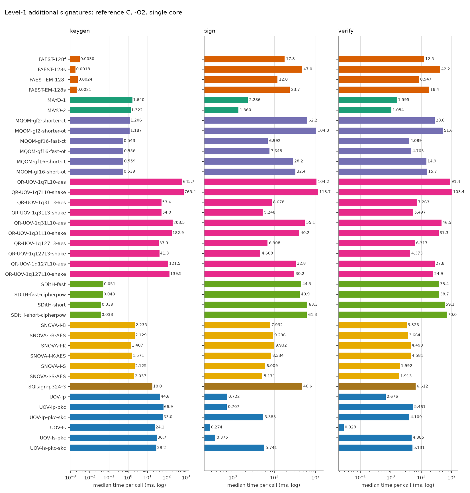
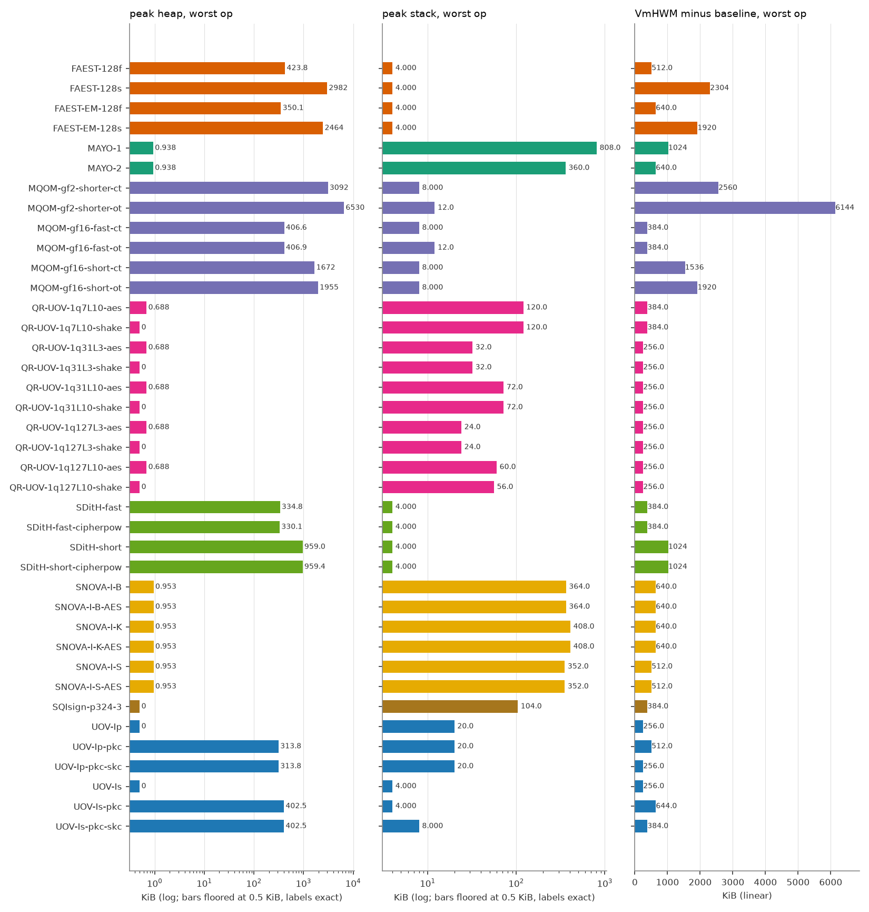
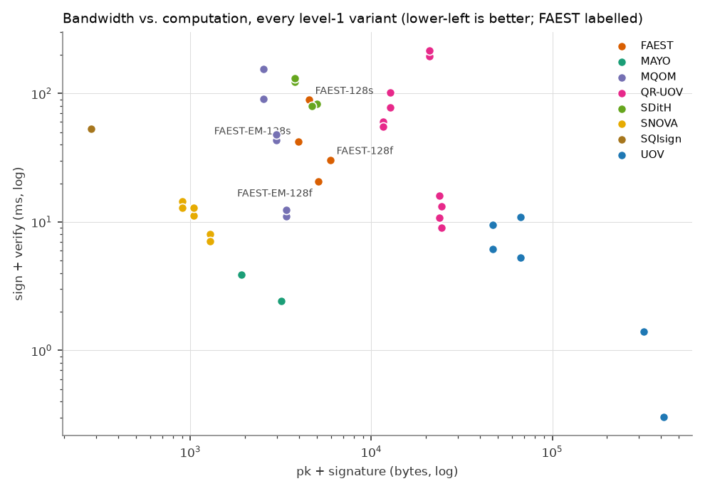

# FAEST vs. the other on-going NIST additional-signature candidates (level 1)

All numbers are produced by `tools/bench/run_bench.py` + `tools/bench/report.py` from the reference implementations in `original/Additional-DS/` (static-test folders, portable C, no SIMD/AES-NI). Regenerate with `make bench-l1`.

## Setup

| | |
|---|---|
| CPU | Intel(R) Core(TM) Ultra 7 155H |
| OS | Linux AlessandraYOGA 6.6.87.2-microsoft-standard-WSL2 #1 SMP PREEMPT_DYNAMIC Thu Jun  5 18:30:46 UTC 2025 x86_64 |
| Compiler | gcc (Ubuntu 13.3.0-6ubuntu2~24.04.1) 13.3.0, `CFLAGS=-O2 -std=gnu11 -w -Wno-psabi` (warnings suppressed), identical for every variant; the static KAT tests were built with `-std=c11` |
| Pinning | single core (CPU 2), one process per operation |
| Message | 1000 bytes (`hello world ` repeated), as in the reference paper |
| Iterations | up to 1000 per operation, within a 3.0 s budget (min 5); median reported |
| Date | 2026-10-14 12:51:02 |
| Machine load | run 2, timed phase 12:51:02-12:55:35: NOT idle. Two user-owned CPU-bound simulation processes (Vsim_tb, ~94 % CPU each) were running on other CPUs for the whole run (and a third, obj/t, part of it); vmstat mean user 25.8 %, idle 72.7 %, all 30 samples above 20 % user+system. Their start (about 12:29) postdates run 1; they could not be waited out. Run 2 medians are systematically slower and are NOT a clean repeat. |

Metrics: **time** = wall clock (`CLOCK_MONOTONIC`) per call; **cycles** = raw TSC ticks; **heap** = peak bytes live in `malloc/calloc/realloc` (requested size, via link-time wrapping, key/message buffers of the harness excluded); **stack** = deepest touched page of a dedicated 1 GiB mmap'ed thread stack (4 KiB granularity); **VmHWM-base** = growth of the process peak resident set during the operation, `vmhwm_kb - vmhwm_base_kb` (the raw VmHWM, in `results.csv`, also contains a 2.0-2.4 MiB baseline of libc and harness pages that depends on the operation, because the preparation thread has already run sign/verify and its freed heap stays resident; pages reused from it are not counted, so this column under-reports sign/verify of heap-heavy variants and is only indicative); **code/data/bss** = `size` of the algorithm objects only (harness excluded).

> **Note on FAEST timings.** The FAEST sign and verify medians are flagged as unreliable until an idle rerun: sign/verify ratios are inconsistent among sibling variants (e.g. FAEST-EM-128f verify above sign, FAEST-EM-128s verify far below sign), the std/median of several FAEST sign/verify runs is high, and the machine is a hybrid-core CPU under WSL2 that is shared with other work. No number has been altered.

## Key and signature sizes (bytes)

| Scheme | Variant | pk | sk | signature |
|---|---|---:|---:|---:|
| FAEST | FAEST-128f | 32 | 32 | 5924 |
| FAEST | FAEST-128s | 32 | 32 | 4506 |
| FAEST | FAEST-EM-128f | 32 | 32 | 5060 |
| FAEST | FAEST-EM-128s | 32 | 32 | 3906 |
| MAYO | MAYO-1 | 1456 | 24 | 464 |
| MAYO | MAYO-2 | 2928 | 24 | 239 |
| MQOM | MQOM-gf2-shorter-ct | 52 | 72 | 2492 |
| MQOM | MQOM-gf2-shorter-ot | 52 | 72 | 2492 |
| MQOM | MQOM-gf16-fast-ct | 64 | 96 | 3316 |
| MQOM | MQOM-gf16-fast-ot | 64 | 96 | 3316 |
| MQOM | MQOM-gf16-short-ct | 64 | 96 | 2932 |
| MQOM | MQOM-gf16-short-ot | 64 | 96 | 2932 |
| QR-UOV | QR-UOV-1q7L10-aes | 20641 | 32 | 331 |
| QR-UOV | QR-UOV-1q7L10-shake | 20641 | 32 | 331 |
| QR-UOV | QR-UOV-1q31L3-aes | 23641 | 32 | 157 |
| QR-UOV | QR-UOV-1q31L3-shake | 23641 | 32 | 157 |
| QR-UOV | QR-UOV-1q31L10-aes | 12266 | 32 | 435 |
| QR-UOV | QR-UOV-1q31L10-shake | 12266 | 32 | 435 |
| QR-UOV | QR-UOV-1q127L3-aes | 24256 | 32 | 200 |
| QR-UOV | QR-UOV-1q127L3-shake | 24256 | 32 | 200 |
| QR-UOV | QR-UOV-1q127L10-aes | 11041 | 32 | 541 |
| QR-UOV | QR-UOV-1q127L10-shake | 11041 | 32 | 541 |
| SDitH | SDitH-fast | 70 | 147 | 4914 |
| SDitH | SDitH-fast-cipherpow | 70 | 147 | 4643 |
| SDitH | SDitH-short | 70 | 147 | 3721 |
| SDitH | SDitH-short-cipherpow | 70 | 147 | 3721 |
| SNOVA | SNOVA-I-B | 656 | 96 | 388 |
| SNOVA | SNOVA-I-B-AES | 656 | 96 | 388 |
| SNOVA | SNOVA-I-K | 376 | 96 | 528 |
| SNOVA | SNOVA-I-K-AES | 376 | 96 | 528 |
| SNOVA | SNOVA-I-S | 1016 | 96 | 272 |
| SNOVA | SNOVA-I-S-AES | 1016 | 96 | 272 |
| SQIsign | SQIsign-p324-3 | 83 | 270 | 200 |
| UOV | UOV-Ip | 321300 | 278087 | 135 |
| UOV | UOV-Ip-pkc | 46591 | 278087 | 135 |
| UOV | UOV-Ip-pkc-skc | 46591 | 32 | 135 |
| UOV | UOV-Is | 412160 | 348704 | 96 |
| UOV | UOV-Is-pkc | 66576 | 348704 | 96 |
| UOV | UOV-Is-pkc-skc | 66576 | 32 | 96 |

## Run time (median, ms) and TSC cycles (millions)

| Scheme | Variant | KeyGen ms | Sign ms | Verify ms | KeyGen Mcyc | Sign Mcyc | Verify Mcyc |
|---|---|---:|---:|---:|---:|---:|---:|
| FAEST | FAEST-128f | 0.0030 | 17.8 | 12.5 | 0.01 | 49.46 | 35.52 |
| FAEST | FAEST-128s | 0.0018 | 47.0 | 42.2 | 0.01 | 133.38 | 119.66 |
| FAEST | FAEST-EM-128f | 0.0024 | 12.0 | 8.547 | 0.01 | 34.00 | 24.14 |
| FAEST | FAEST-EM-128s | 0.0021 | 23.7 | 18.4 | 0.01 | 66.92 | 52.03 |
| MAYO | MAYO-1 | 1.640 | 2.286 | 1.595 | 4.67 | 6.50 | 4.54 |
| MAYO | MAYO-2 | 1.322 | 1.360 | 1.054 | 3.76 | 3.86 | 2.99 |
| MQOM | MQOM-gf2-shorter-ct | 1.206 | 62.2 | 28.0 | 3.42 | 176.51 | 79.47 |
| MQOM | MQOM-gf2-shorter-ot | 1.187 | 104.0 | 51.6 | 3.34 | 292.58 | 145.35 |
| MQOM | MQOM-gf16-fast-ct | 0.543 | 6.992 | 4.089 | 1.53 | 19.85 | 11.61 |
| MQOM | MQOM-gf16-fast-ot | 0.556 | 7.648 | 4.763 | 1.58 | 21.72 | 13.32 |
| MQOM | MQOM-gf16-short-ct | 0.559 | 28.2 | 14.9 | 1.56 | 78.93 | 41.66 |
| MQOM | MQOM-gf16-short-ot | 0.539 | 32.4 | 15.7 | 1.51 | 90.72 | 44.01 |
| QR-UOV | QR-UOV-1q7L10-aes | 645.7 | 104.2 | 91.4 | 1832.99 | 295.69 | 259.41 |
| QR-UOV | QR-UOV-1q7L10-shake | 765.4 | 113.7 | 103.4 | 2189.56 | 313.72 | 281.61 |
| QR-UOV | QR-UOV-1q31L3-aes | 53.4 | 8.678 | 7.263 | 153.09 | 24.61 | 20.59 |
| QR-UOV | QR-UOV-1q31L3-shake | 54.0 | 5.248 | 5.497 | 153.19 | 14.90 | 15.61 |
| QR-UOV | QR-UOV-1q31L10-aes | 203.5 | 55.1 | 46.5 | 576.74 | 155.77 | 131.45 |
| QR-UOV | QR-UOV-1q31L10-shake | 182.9 | 40.2 | 37.3 | 513.20 | 112.76 | 105.16 |
| QR-UOV | QR-UOV-1q127L3-aes | 37.9 | 6.908 | 6.317 | 107.47 | 19.57 | 17.80 |
| QR-UOV | QR-UOV-1q127L3-shake | 41.3 | 4.608 | 4.373 | 116.35 | 12.99 | 12.39 |
| QR-UOV | QR-UOV-1q127L10-aes | 121.5 | 32.8 | 27.8 | 344.61 | 92.22 | 77.71 |
| QR-UOV | QR-UOV-1q127L10-shake | 139.5 | 30.2 | 24.9 | 390.55 | 85.77 | 70.70 |
| SDitH | SDitH-fast | 0.051 | 44.3 | 38.4 | 0.14 | 125.58 | 108.56 |
| SDitH | SDitH-fast-cipherpow | 0.048 | 40.9 | 38.7 | 0.14 | 115.58 | 109.69 |
| SDitH | SDitH-short | 0.039 | 63.3 | 59.1 | 0.11 | 179.32 | 167.56 |
| SDitH | SDitH-short-cipherpow | 0.038 | 61.3 | 70.0 | 0.11 | 172.42 | 196.10 |
| SNOVA | SNOVA-I-B | 2.235 | 7.932 | 3.326 | 6.26 | 22.45 | 9.41 |
| SNOVA | SNOVA-I-B-AES | 2.129 | 9.296 | 3.664 | 6.03 | 26.28 | 10.36 |
| SNOVA | SNOVA-I-K | 1.407 | 9.932 | 4.493 | 3.98 | 28.08 | 12.66 |
| SNOVA | SNOVA-I-K-AES | 1.571 | 8.334 | 4.581 | 4.43 | 23.48 | 12.91 |
| SNOVA | SNOVA-I-S | 2.125 | 6.009 | 1.992 | 5.99 | 16.92 | 5.61 |
| SNOVA | SNOVA-I-S-AES | 2.037 | 5.171 | 1.913 | 5.71 | 14.50 | 5.37 |
| SQIsign | SQIsign-p324-3 | 18.0 | 46.6 | 6.612 | 50.45 | 132.49 | 18.81 |
| UOV | UOV-Ip | 44.6 | 0.722 | 0.676 | 125.38 | 2.03 | 1.90 |
| UOV | UOV-Ip-pkc | 66.9 | 0.707 | 5.461 | 188.01 | 1.99 | 15.42 |
| UOV | UOV-Ip-pkc-skc | 63.0 | 5.383 | 4.109 | 177.98 | 15.22 | 11.60 |
| UOV | UOV-Is | 24.1 | 0.274 | 0.028 | 67.95 | 0.77 | 0.08 |
| UOV | UOV-Is-pkc | 30.7 | 0.375 | 4.885 | 86.52 | 1.06 | 13.85 |
| UOV | UOV-Is-pkc-skc | 29.2 | 5.741 | 5.131 | 82.75 | 16.30 | 14.34 |

## Memory (KiB)

| Scheme | Variant | heap KG/S/V | stack KG/S/V | VmHWM-base KG/S/V | code | data+bss |
|---|---|---|---|---|---:|---:|
| FAEST | FAEST-128f | 0.0 / 423.8 / 186.5 | 0.0 / 4.0 / 4.0 | 384 / 512 / 384 | 229.1 | 0.1 |
| FAEST | FAEST-128s | 0.0 / 2981.7 / 1285.5 | 0.0 / 4.0 / 4.0 | 384 / 2304 / 512 | 229.1 | 0.1 |
| FAEST | FAEST-EM-128f | 0.0 / 350.1 / 166.7 | 0.0 / 4.0 / 4.0 | 384 / 640 / 384 | 229.1 | 0.1 |
| FAEST | FAEST-EM-128s | 0.0 / 2464.3 / 1120.1 | 0.0 / 4.0 / 4.0 | 384 / 1920 / 384 | 229.1 | 0.1 |
| MAYO | MAYO-1 | 0.9 / 0.9 / 0.7 | 156.0 / 236.0 / 808.0 | 384 / 512 / 1024 | 40.4 | 0.1 |
| MAYO | MAYO-2 | 0.9 / 0.9 / 0.7 | 124.0 / 152.0 / 360.0 | 384 / 384 / 640 | 40.4 | 0.1 |
| MQOM | MQOM-gf2-shorter-ct | 528.6 / 3091.8 / 704.6 | 0.0 / 8.0 / 8.0 | 640 / 2560 / 256 | 529.0 | 0.4 |
| MQOM | MQOM-gf2-shorter-ot | 528.6 / 6530.4 / 5152.6 | 0.0 / 12.0 / 8.0 | 640 / 6144 / 4736 | 546.5 | 0.4 |
| MQOM | MQOM-gf16-fast-ct | 132.1 / 406.6 / 132.1 | 0.0 / 8.0 / 8.0 | 384 / 256 / 0 | 512.2 | 0.3 |
| MQOM | MQOM-gf16-fast-ot | 132.1 / 406.9 / 249.1 | 0.0 / 12.0 / 8.0 | 384 / 256 / 128 | 530.1 | 0.4 |
| MQOM | MQOM-gf16-short-ct | 134.2 / 1672.5 / 352.6 | 0.0 / 8.0 / 4.0 | 512 / 1536 / 256 | 526.9 | 0.3 |
| MQOM | MQOM-gf16-short-ot | 134.2 / 1954.5 / 1488.6 | 0.0 / 8.0 / 4.0 | 512 / 1920 / 1280 | 545.9 | 0.4 |
| QR-UOV | QR-UOV-1q7L10-aes | 0.7 / 0.7 / 0.7 | 112.0 / 120.0 / 100.0 | 256 / 384 / 256 | 38.1 | 0.1 |
| QR-UOV | QR-UOV-1q7L10-shake | 0.0 / 0.0 / 0.0 | 112.0 / 120.0 / 100.0 | 256 / 384 / 256 | 38.3 | 0.1 |
| QR-UOV | QR-UOV-1q31L3-aes | 0.7 / 0.7 / 0.7 | 32.0 / 28.0 / 24.0 | 256 / 256 / 256 | 38.3 | 0.1 |
| QR-UOV | QR-UOV-1q31L3-shake | 0.0 / 0.0 / 0.0 | 32.0 / 28.0 / 24.0 | 256 / 256 / 256 | 38.4 | 0.1 |
| QR-UOV | QR-UOV-1q31L10-aes | 0.7 / 0.7 / 0.7 | 68.0 / 72.0 / 64.0 | 256 / 256 / 256 | 38.0 | 0.1 |
| QR-UOV | QR-UOV-1q31L10-shake | 0.0 / 0.0 / 0.0 | 68.0 / 72.0 / 64.0 | 256 / 256 / 256 | 38.1 | 0.1 |
| QR-UOV | QR-UOV-1q127L3-aes | 0.7 / 0.7 / 0.7 | 24.0 / 24.0 / 20.0 | 256 / 256 / 256 | 38.1 | 0.1 |
| QR-UOV | QR-UOV-1q127L3-shake | 0.0 / 0.0 / 0.0 | 24.0 / 24.0 / 20.0 | 256 / 256 / 256 | 38.2 | 0.1 |
| QR-UOV | QR-UOV-1q127L10-aes | 0.7 / 0.7 / 0.7 | 56.0 / 60.0 / 52.0 | 256 / 256 / 256 | 38.3 | 0.1 |
| QR-UOV | QR-UOV-1q127L10-shake | 0.0 / 0.0 / 0.0 | 56.0 / 56.0 / 48.0 | 256 / 256 / 256 | 38.4 | 0.1 |
| SDitH | SDitH-fast | 0.4 / 334.8 / 328.5 | 0.0 / 4.0 / 4.0 | 256 / 256 / 384 | 190.7 | 0.1 |
| SDitH | SDitH-fast-cipherpow | 0.4 / 330.1 / 323.7 | 0.0 / 4.0 / 4.0 | 384 / 384 / 384 | 190.7 | 0.1 |
| SDitH | SDitH-short | 0.4 / 959.0 / 952.7 | 0.0 / 4.0 / 4.0 | 384 / 896 / 1024 | 190.7 | 0.1 |
| SDitH | SDitH-short-cipherpow | 0.4 / 959.4 / 953.1 | 0.0 / 4.0 / 4.0 | 384 / 1024 / 1024 | 190.7 | 0.1 |
| SNOVA | SNOVA-I-B | 1.0 / 1.0 / 0.0 | 132.0 / 364.0 / 280.0 | 384 / 640 / 512 | 33.2 | 10.2 |
| SNOVA | SNOVA-I-B-AES | 1.0 / 1.0 / 0.7 | 132.0 / 364.0 / 280.0 | 384 / 640 / 512 | 31.7 | 10.2 |
| SNOVA | SNOVA-I-K | 1.0 / 1.0 / 0.0 | 144.0 / 408.0 / 360.0 | 384 / 640 / 640 | 32.9 | 15.3 |
| SNOVA | SNOVA-I-K-AES | 1.0 / 1.0 / 0.7 | 144.0 / 408.0 / 360.0 | 384 / 640 / 512 | 31.4 | 15.3 |
| SNOVA | SNOVA-I-S | 1.0 / 1.0 / 0.0 | 136.0 / 352.0 / 288.0 | 384 / 512 / 512 | 32.8 | 5.3 |
| SNOVA | SNOVA-I-S-AES | 1.0 / 1.0 / 0.7 | 136.0 / 352.0 / 288.0 | 384 / 512 / 512 | 31.3 | 5.3 |
| SQIsign | SQIsign-p324-3 | 0.0 / 0.0 / 0.0 | 56.0 / 104.0 / 40.0 | 384 / 384 / 256 | 250.9 | 0.4 |
| UOV | UOV-Ip | 0.0 / 0.0 / 0.0 | 20.0 / 12.0 / 4.0 | 256 / 256 / 256 | 41.6 | 0.1 |
| UOV | UOV-Ip-pkc | 0.0 / 0.0 / 313.8 | 20.0 / 12.0 / 4.0 | 256 / 256 / 512 | 41.8 | 0.1 |
| UOV | UOV-Ip-pkc-skc | 271.6 / 271.6 / 313.8 | 20.0 / 20.0 / 4.0 | 256 / 0 / 256 | 44.0 | 0.1 |
| UOV | UOV-Is | 0.0 / 0.0 / 0.0 | 4.0 / 4.0 / 0.0 | 256 / 256 / 256 | 37.1 | 0.1 |
| UOV | UOV-Is-pkc | 0.0 / 0.0 / 402.5 | 4.0 / 4.0 / 0.0 | 256 / 256 / 644 | 37.3 | 0.1 |
| UOV | UOV-Is-pkc-skc | 340.5 / 340.5 / 402.5 | 4.0 / 8.0 / 0.0 | 256 / 0 / 384 | 38.1 | 0.1 |

Stack legend: values of 0, 4 and 8 KiB are page-granularity floors (read them as "<= 4 KiB", "<= 8 KiB"), not measurements; the stack is the touched pages of the thread stack minus an empty thread.

## FAEST against the best variant of every other family

Fastest FAEST variant per operation vs. fastest variant of each other scheme (ratio > 1: FAEST slower).

| Scheme | best KeyGen | best Sign | best Verify | smallest pk+sig |
|---|---|---|---|---|
| MAYO | MAYO-2 (1.322 ms): x0.00137 | MAYO-2 (1.360 ms): x8.8 | MAYO-2 (1.054 ms): x8.1 | MAYO-1 (1920 B): x2.1 |
| MQOM | MQOM-gf16-short-ot (0.539 ms): x0.00335 | MQOM-gf16-fast-ct (6.992 ms): x1.7 | MQOM-gf16-fast-ct (4.089 ms): x2.1 | MQOM-gf2-shorter-ct (2544 B): x1.5 |
| QR-UOV | QR-UOV-1q127L3-aes (37.9 ms): x4.77e-05 | QR-UOV-1q127L3-shake (4.608 ms): x2.6 | QR-UOV-1q127L3-shake (4.373 ms): x2.0 | QR-UOV-1q127L10-aes (11.6 K B): x0.3 |
| SDitH | SDitH-short-cipherpow (0.038 ms): x0.0474 | SDitH-fast-cipherpow (40.9 ms): x0.294 | SDitH-fast (38.4 ms): x0.222 | SDitH-short (3791 B): x1.0 |
| SNOVA | SNOVA-I-K (1.407 ms): x0.00129 | SNOVA-I-S-AES (5.171 ms): x2.3 | SNOVA-I-S-AES (1.913 ms): x4.5 | SNOVA-I-K (904 B): x4.4 |
| SQIsign | SQIsign-p324-3 (18.0 ms): x0.000101 | SQIsign-p324-3 (46.6 ms): x0.258 | SQIsign-p324-3 (6.612 ms): x1.3 | SQIsign-p324-3 (283 B): x13.9 |
| UOV | UOV-Is (24.1 ms): x7.51e-05 | UOV-Is (0.274 ms): x43.9 | UOV-Is (0.028 ms): x302.0 | UOV-Ip-pkc (46.7 K B): x0.1 |

FAEST reference points: FAEST-128s keygen 0.0018 ms, FAEST-EM-128f sign 12.0 ms, FAEST-EM-128f verify 8.547 ms; smallest pk+sig FAEST-EM-128s (3938 B).

## Caveats

- Portable *reference* C for every scheme; schemes whose submission relies on AVX2/AES-NI/GFNI ship considerably faster optimized packages (not measured here), so absolute numbers are not comparable with optimized-implementation papers; the comparison among them is like-for-like.
- Cycles are TSC ticks of an x86 laptop CPU under WSL2, shown for relative comparison only.
- Stack figures have 4 KiB granularity; heap counts requested bytes only.
- Level 1 only (the lowest NIST category); variants per scheme are all Round-3 level-1 parameter sets that build in this tree. KAT status differs by family: MAYO, SNOVA, MQOM, SDitH and SQIsign match the official KAT record #0; UOV, QR-UOV (16 of the 39 variants) matched only the package's own generator on records 0-1 (no official KAT available offline); FAEST sizes were not compared to an official KAT in this run.
