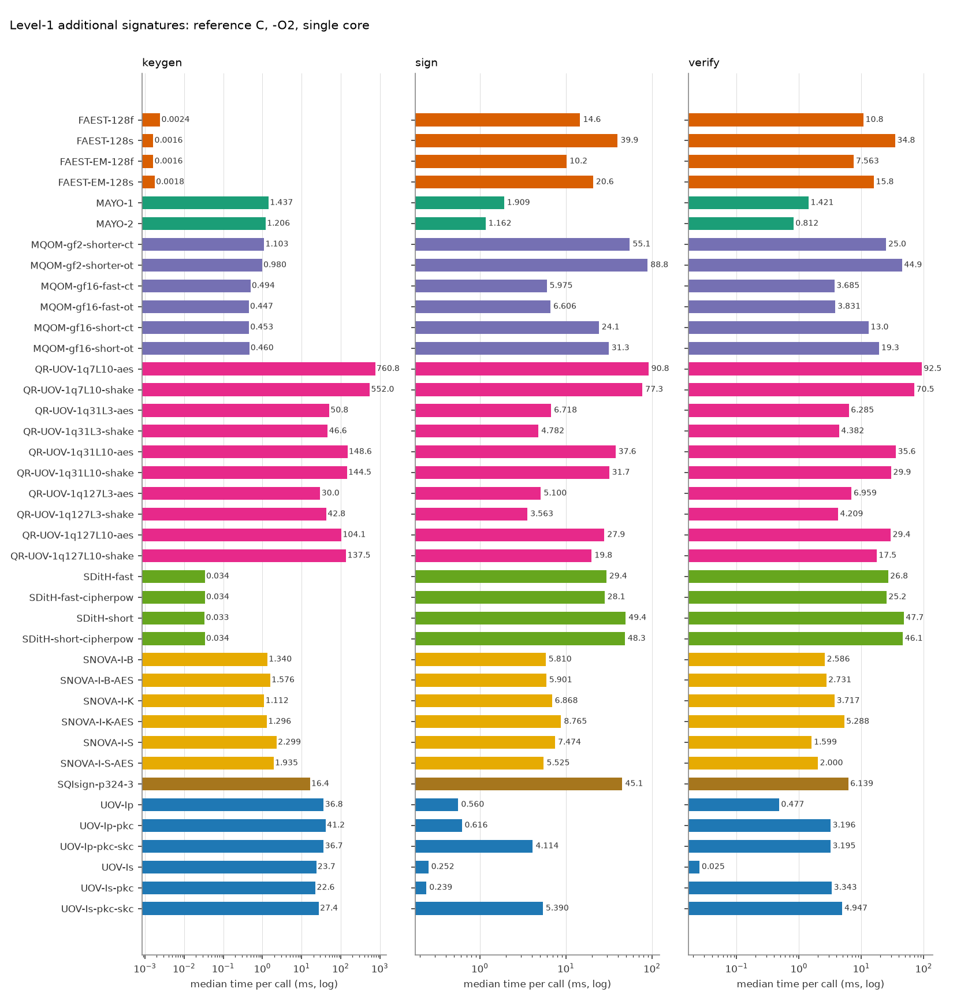
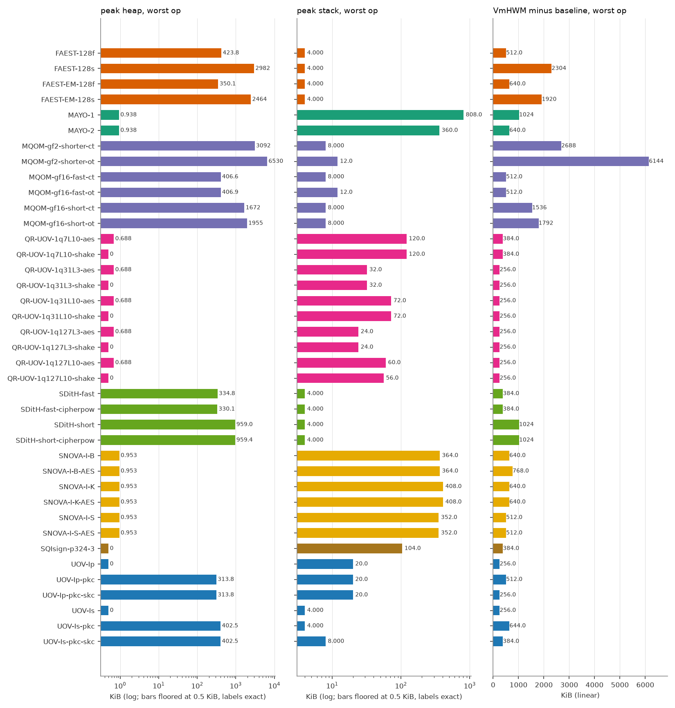
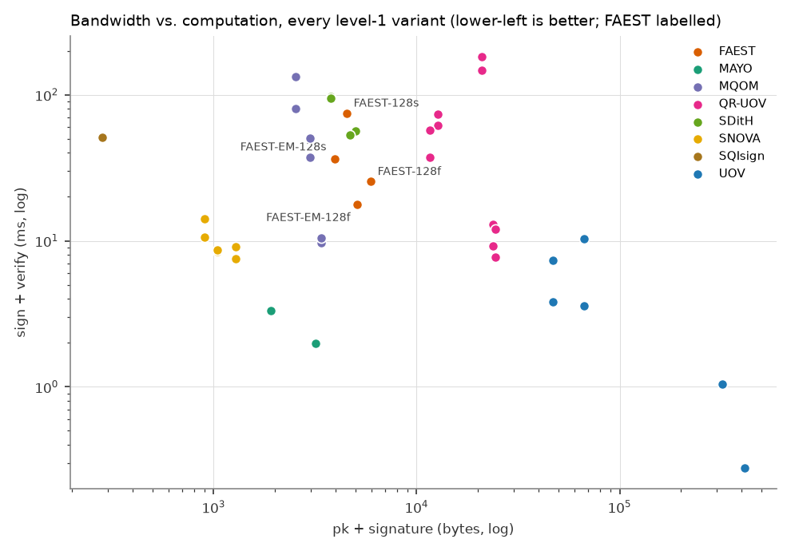

# FAEST vs. the other on-going NIST additional-signature candidates (level 1)

All numbers are produced by `tools/bench/run_bench.py` + `tools/bench/report.py` from the reference implementations in `original/Additional-DS/` (static-test folders, portable C, no SIMD/AES-NI). Regenerate with `make bench-l1`.

## Setup

| | |
|---|---|
| CPU | Intel(R) Core(TM) Ultra 7 155H |
| OS | Linux AlessandraYOGA 6.6.87.2-microsoft-standard-WSL2 #1 SMP PREEMPT_DYNAMIC Thu Jun  5 18:30:46 UTC 2025 x86_64 |
| Compiler | gcc (Ubuntu 13.3.0-6ubuntu2~24.04.1) 13.3.0, `CFLAGS=-O2 -std=gnu11 -w -Wno-psabi` (warnings suppressed), identical for every variant; the static KAT tests were built with `-std=c11` |
| Pinning | single core (CPU 2), one process per operation |
| Message | 1000 bytes (`hello world ` repeated), as in the reference paper |
| Iterations | up to 1000 per operation, within a 3.0 s budget (min 5); median reported |
| Date | 2026-10-14 14:21:23 |
| Machine load | Idle rerun 2026-10-14 (T9b), make bench-l1, timed phase ~14:21:25-14:26:09. No Vsim/verilator/pdflatex running. vmstat (10 s, 28 samples in timed window): mean user 12.7 %, sys 1.4 %, idle 86.0 %, max user 13 %: i.e. ~2 of 16 CPUs busy = the benchmark core (6.25 %) plus ~1 core of foreign VS Code cpptools IntelliSense (user-owned, not killed). No sample >20 %. Not a perfectly quiet machine. |

Metrics: **time** = wall clock (`CLOCK_MONOTONIC`) per call; **cycles** = raw TSC ticks; **heap** = peak bytes live in `malloc/calloc/realloc` (requested size, via link-time wrapping, key/message buffers of the harness excluded); **stack** = deepest touched page of a dedicated 1 GiB mmap'ed thread stack (4 KiB granularity); **VmHWM-base** = growth of the process peak resident set during the operation, `vmhwm_kb - vmhwm_base_kb` (the raw VmHWM, in `results.csv`, also contains a 2.0-2.4 MiB baseline of libc and harness pages that depends on the operation, because the preparation thread has already run sign/verify and its freed heap stays resident; pages reused from it are not counted, so this column under-reports sign/verify of heap-heavy variants and is only indicative); **code/data/bss** = `size` of the algorithm objects only (harness excluded).

> **Note on FAEST timings.** FAEST sign/verify medians moved between two back-to-back runs by 0-22 % (FAEST-128f and -128s: second run slower by 17-22 %, while most other schemes were faster by about 25 %; FAEST-EM-128f/-128s within 6 %). The sign/verify anomalies seen in an earlier run under foreign load (EM-128f verify above sign, EM-128s verify far below sign) did not reproduce on the idle reruns: verify is at or below sign for all four variants in both runs (128s: 41.8 vs 41.8 ms in run 2). Keygen of FAEST (1.6-2.4 us) is near the timer resolution and varies by up to 45 %. Read FAEST/other ratios within about 1.5x with caution. No number has been altered.

## Key and signature sizes (bytes)

| Scheme | Variant | pk | sk | signature |
|---|---|---:|---:|---:|
| FAEST | FAEST-128f | 32 | 32 | 5924 |
| FAEST | FAEST-128s | 32 | 32 | 4506 |
| FAEST | FAEST-EM-128f | 32 | 32 | 5060 |
| FAEST | FAEST-EM-128s | 32 | 32 | 3906 |
| MAYO | MAYO-1 | 1456 | 24 | 464 |
| MAYO | MAYO-2 | 2928 | 24 | 239 |
| MQOM | MQOM-gf2-shorter-ct | 52 | 72 | 2492 |
| MQOM | MQOM-gf2-shorter-ot | 52 | 72 | 2492 |
| MQOM | MQOM-gf16-fast-ct | 64 | 96 | 3316 |
| MQOM | MQOM-gf16-fast-ot | 64 | 96 | 3316 |
| MQOM | MQOM-gf16-short-ct | 64 | 96 | 2932 |
| MQOM | MQOM-gf16-short-ot | 64 | 96 | 2932 |
| QR-UOV | QR-UOV-1q7L10-aes | 20641 | 32 | 331 |
| QR-UOV | QR-UOV-1q7L10-shake | 20641 | 32 | 331 |
| QR-UOV | QR-UOV-1q31L3-aes | 23641 | 32 | 157 |
| QR-UOV | QR-UOV-1q31L3-shake | 23641 | 32 | 157 |
| QR-UOV | QR-UOV-1q31L10-aes | 12266 | 32 | 435 |
| QR-UOV | QR-UOV-1q31L10-shake | 12266 | 32 | 435 |
| QR-UOV | QR-UOV-1q127L3-aes | 24256 | 32 | 200 |
| QR-UOV | QR-UOV-1q127L3-shake | 24256 | 32 | 200 |
| QR-UOV | QR-UOV-1q127L10-aes | 11041 | 32 | 541 |
| QR-UOV | QR-UOV-1q127L10-shake | 11041 | 32 | 541 |
| SDitH | SDitH-fast | 70 | 147 | 4914 |
| SDitH | SDitH-fast-cipherpow | 70 | 147 | 4643 |
| SDitH | SDitH-short | 70 | 147 | 3721 |
| SDitH | SDitH-short-cipherpow | 70 | 147 | 3721 |
| SNOVA | SNOVA-I-B | 656 | 96 | 388 |
| SNOVA | SNOVA-I-B-AES | 656 | 96 | 388 |
| SNOVA | SNOVA-I-K | 376 | 96 | 528 |
| SNOVA | SNOVA-I-K-AES | 376 | 96 | 528 |
| SNOVA | SNOVA-I-S | 1016 | 96 | 272 |
| SNOVA | SNOVA-I-S-AES | 1016 | 96 | 272 |
| SQIsign | SQIsign-p324-3 | 83 | 270 | 200 |
| UOV | UOV-Ip | 321300 | 278087 | 135 |
| UOV | UOV-Ip-pkc | 46591 | 278087 | 135 |
| UOV | UOV-Ip-pkc-skc | 46591 | 32 | 135 |
| UOV | UOV-Is | 412160 | 348704 | 96 |
| UOV | UOV-Is-pkc | 66576 | 348704 | 96 |
| UOV | UOV-Is-pkc-skc | 66576 | 32 | 96 |

## Run time (median, ms) and TSC cycles (millions)

| Scheme | Variant | KeyGen ms | Sign ms | Verify ms | KeyGen Mcyc | Sign Mcyc | Verify Mcyc |
|---|---|---:|---:|---:|---:|---:|---:|
| FAEST | FAEST-128f | 0.0024 | 14.6 | 10.8 | 0.01 | 43.79 | 32.33 |
| FAEST | FAEST-128s | 0.0016 | 39.9 | 34.8 | 0.00 | 119.37 | 104.14 |
| FAEST | FAEST-EM-128f | 0.0016 | 10.2 | 7.563 | 0.00 | 30.54 | 22.65 |
| FAEST | FAEST-EM-128s | 0.0018 | 20.6 | 15.8 | 0.01 | 61.85 | 47.35 |
| MAYO | MAYO-1 | 1.437 | 1.909 | 1.421 | 4.30 | 5.72 | 4.26 |
| MAYO | MAYO-2 | 1.206 | 1.162 | 0.812 | 3.61 | 3.48 | 2.43 |
| MQOM | MQOM-gf2-shorter-ct | 1.103 | 55.1 | 25.0 | 3.30 | 165.04 | 74.93 |
| MQOM | MQOM-gf2-shorter-ot | 0.980 | 88.8 | 44.9 | 2.94 | 266.00 | 134.36 |
| MQOM | MQOM-gf16-fast-ct | 0.494 | 5.975 | 3.685 | 1.48 | 17.90 | 11.04 |
| MQOM | MQOM-gf16-fast-ot | 0.447 | 6.606 | 3.831 | 1.34 | 19.79 | 11.47 |
| MQOM | MQOM-gf16-short-ct | 0.453 | 24.1 | 13.0 | 1.36 | 72.06 | 39.08 |
| MQOM | MQOM-gf16-short-ot | 0.460 | 31.3 | 19.3 | 1.38 | 93.77 | 57.85 |
| QR-UOV | QR-UOV-1q7L10-aes | 760.8 | 90.8 | 92.5 | 2278.66 | 271.87 | 276.95 |
| QR-UOV | QR-UOV-1q7L10-shake | 552.0 | 77.3 | 70.5 | 1653.26 | 231.41 | 211.07 |
| QR-UOV | QR-UOV-1q31L3-aes | 50.8 | 6.718 | 6.285 | 152.29 | 20.12 | 18.83 |
| QR-UOV | QR-UOV-1q31L3-shake | 46.6 | 4.782 | 4.382 | 139.59 | 14.32 | 13.13 |
| QR-UOV | QR-UOV-1q31L10-aes | 148.6 | 37.6 | 35.6 | 445.14 | 112.66 | 106.65 |
| QR-UOV | QR-UOV-1q31L10-shake | 144.5 | 31.7 | 29.9 | 432.77 | 95.03 | 89.64 |
| QR-UOV | QR-UOV-1q127L3-aes | 30.0 | 5.100 | 6.959 | 89.86 | 15.28 | 20.84 |
| QR-UOV | QR-UOV-1q127L3-shake | 42.8 | 3.563 | 4.209 | 128.14 | 10.67 | 12.61 |
| QR-UOV | QR-UOV-1q127L10-aes | 104.1 | 27.9 | 29.4 | 311.86 | 83.62 | 88.00 |
| QR-UOV | QR-UOV-1q127L10-shake | 137.5 | 19.8 | 17.5 | 411.95 | 59.44 | 52.35 |
| SDitH | SDitH-fast | 0.034 | 29.4 | 26.8 | 0.10 | 88.18 | 80.12 |
| SDitH | SDitH-fast-cipherpow | 0.034 | 28.1 | 25.2 | 0.10 | 84.04 | 75.45 |
| SDitH | SDitH-short | 0.033 | 49.4 | 47.7 | 0.10 | 147.95 | 142.95 |
| SDitH | SDitH-short-cipherpow | 0.034 | 48.3 | 46.1 | 0.10 | 144.66 | 138.19 |
| SNOVA | SNOVA-I-B | 1.340 | 5.810 | 2.586 | 4.01 | 17.40 | 7.75 |
| SNOVA | SNOVA-I-B-AES | 1.576 | 5.901 | 2.731 | 4.72 | 17.68 | 8.18 |
| SNOVA | SNOVA-I-K | 1.112 | 6.868 | 3.717 | 3.33 | 20.57 | 11.13 |
| SNOVA | SNOVA-I-K-AES | 1.296 | 8.765 | 5.288 | 3.88 | 26.25 | 15.84 |
| SNOVA | SNOVA-I-S | 2.299 | 7.474 | 1.599 | 6.89 | 22.39 | 4.79 |
| SNOVA | SNOVA-I-S-AES | 1.935 | 5.525 | 2.000 | 5.80 | 16.55 | 5.99 |
| SQIsign | SQIsign-p324-3 | 16.4 | 45.1 | 6.139 | 49.00 | 135.19 | 18.39 |
| UOV | UOV-Ip | 36.8 | 0.560 | 0.477 | 110.11 | 1.68 | 1.43 |
| UOV | UOV-Ip-pkc | 41.2 | 0.616 | 3.196 | 123.46 | 1.85 | 9.57 |
| UOV | UOV-Ip-pkc-skc | 36.7 | 4.114 | 3.195 | 109.79 | 12.32 | 9.57 |
| UOV | UOV-Is | 23.7 | 0.252 | 0.025 | 70.91 | 0.75 | 0.08 |
| UOV | UOV-Is-pkc | 22.6 | 0.239 | 3.343 | 67.77 | 0.72 | 10.01 |
| UOV | UOV-Is-pkc-skc | 27.4 | 5.390 | 4.947 | 82.14 | 16.14 | 14.82 |

## Memory (KiB)

| Scheme | Variant | heap KG/S/V | stack KG/S/V | VmHWM-base KG/S/V | code | data+bss |
|---|---|---|---|---|---:|---:|
| FAEST | FAEST-128f | 0.0 / 423.8 / 186.5 | 0.0 / 4.0 / 4.0 | 128 / 512 / 384 | 229.1 | 0.1 |
| FAEST | FAEST-128s | 0.0 / 2981.7 / 1285.5 | 0.0 / 4.0 / 4.0 | 384 / 2304 / 512 | 229.1 | 0.1 |
| FAEST | FAEST-EM-128f | 0.0 / 350.1 / 166.7 | 0.0 / 4.0 / 4.0 | 384 / 640 / 384 | 229.1 | 0.1 |
| FAEST | FAEST-EM-128s | 0.0 / 2464.3 / 1120.1 | 0.0 / 4.0 / 4.0 | 384 / 1920 / 512 | 229.1 | 0.1 |
| MAYO | MAYO-1 | 0.9 / 0.9 / 0.7 | 156.0 / 236.0 / 808.0 | 384 / 512 / 1024 | 40.4 | 0.1 |
| MAYO | MAYO-2 | 0.9 / 0.9 / 0.7 | 124.0 / 152.0 / 360.0 | 384 / 384 / 640 | 40.4 | 0.1 |
| MQOM | MQOM-gf2-shorter-ct | 528.6 / 3091.8 / 704.6 | 0.0 / 8.0 / 8.0 | 512 / 2688 / 256 | 529.0 | 0.4 |
| MQOM | MQOM-gf2-shorter-ot | 528.6 / 6530.4 / 5152.6 | 0.0 / 12.0 / 8.0 | 512 / 6144 / 4736 | 546.5 | 0.4 |
| MQOM | MQOM-gf16-fast-ct | 132.1 / 406.6 / 132.1 | 0.0 / 8.0 / 8.0 | 512 / 384 / 128 | 512.2 | 0.3 |
| MQOM | MQOM-gf16-fast-ot | 132.1 / 406.9 / 249.1 | 0.0 / 12.0 / 8.0 | 512 / 384 / 256 | 530.1 | 0.4 |
| MQOM | MQOM-gf16-short-ct | 134.2 / 1672.5 / 352.6 | 0.0 / 8.0 / 4.0 | 384 / 1536 / 128 | 526.9 | 0.3 |
| MQOM | MQOM-gf16-short-ot | 134.2 / 1954.5 / 1488.6 | 0.0 / 8.0 / 4.0 | 512 / 1792 / 1408 | 545.9 | 0.4 |
| QR-UOV | QR-UOV-1q7L10-aes | 0.7 / 0.7 / 0.7 | 112.0 / 120.0 / 100.0 | 256 / 384 / 256 | 38.1 | 0.1 |
| QR-UOV | QR-UOV-1q7L10-shake | 0.0 / 0.0 / 0.0 | 112.0 / 120.0 / 100.0 | 256 / 384 / 256 | 38.3 | 0.1 |
| QR-UOV | QR-UOV-1q31L3-aes | 0.7 / 0.7 / 0.7 | 32.0 / 28.0 / 24.0 | 256 / 256 / 256 | 38.3 | 0.1 |
| QR-UOV | QR-UOV-1q31L3-shake | 0.0 / 0.0 / 0.0 | 32.0 / 28.0 / 24.0 | 256 / 256 / 256 | 38.4 | 0.1 |
| QR-UOV | QR-UOV-1q31L10-aes | 0.7 / 0.7 / 0.7 | 68.0 / 72.0 / 64.0 | 256 / 256 / 256 | 38.0 | 0.1 |
| QR-UOV | QR-UOV-1q31L10-shake | 0.0 / 0.0 / 0.0 | 68.0 / 72.0 / 64.0 | 256 / 256 / 256 | 38.1 | 0.1 |
| QR-UOV | QR-UOV-1q127L3-aes | 0.7 / 0.7 / 0.7 | 24.0 / 24.0 / 20.0 | 256 / 256 / 256 | 38.1 | 0.1 |
| QR-UOV | QR-UOV-1q127L3-shake | 0.0 / 0.0 / 0.0 | 24.0 / 24.0 / 20.0 | 256 / 256 / 256 | 38.2 | 0.1 |
| QR-UOV | QR-UOV-1q127L10-aes | 0.7 / 0.7 / 0.7 | 56.0 / 60.0 / 52.0 | 256 / 256 / 256 | 38.3 | 0.1 |
| QR-UOV | QR-UOV-1q127L10-shake | 0.0 / 0.0 / 0.0 | 56.0 / 56.0 / 48.0 | 256 / 256 / 256 | 38.4 | 0.1 |
| SDitH | SDitH-fast | 0.4 / 334.8 / 328.5 | 0.0 / 4.0 / 4.0 | 384 / 384 / 256 | 190.7 | 0.1 |
| SDitH | SDitH-fast-cipherpow | 0.4 / 330.1 / 323.7 | 0.0 / 4.0 / 4.0 | 384 / 384 / 384 | 190.7 | 0.1 |
| SDitH | SDitH-short | 0.4 / 959.0 / 952.7 | 0.0 / 4.0 / 4.0 | 384 / 1024 / 1024 | 190.7 | 0.1 |
| SDitH | SDitH-short-cipherpow | 0.4 / 959.4 / 953.1 | 0.0 / 4.0 / 4.0 | 384 / 1024 / 1024 | 190.7 | 0.1 |
| SNOVA | SNOVA-I-B | 1.0 / 1.0 / 0.0 | 132.0 / 364.0 / 280.0 | 384 / 640 / 512 | 33.2 | 10.2 |
| SNOVA | SNOVA-I-B-AES | 1.0 / 1.0 / 0.7 | 132.0 / 364.0 / 280.0 | 384 / 768 / 512 | 31.7 | 10.2 |
| SNOVA | SNOVA-I-K | 1.0 / 1.0 / 0.0 | 144.0 / 408.0 / 360.0 | 384 / 640 / 640 | 32.9 | 15.3 |
| SNOVA | SNOVA-I-K-AES | 1.0 / 1.0 / 0.7 | 144.0 / 408.0 / 360.0 | 384 / 640 / 512 | 31.4 | 15.3 |
| SNOVA | SNOVA-I-S | 1.0 / 1.0 / 0.0 | 136.0 / 352.0 / 288.0 | 384 / 512 / 512 | 32.8 | 5.3 |
| SNOVA | SNOVA-I-S-AES | 1.0 / 1.0 / 0.7 | 136.0 / 352.0 / 288.0 | 384 / 512 / 512 | 31.3 | 5.3 |
| SQIsign | SQIsign-p324-3 | 0.0 / 0.0 / 0.0 | 56.0 / 104.0 / 40.0 | 384 / 384 / 256 | 250.9 | 0.4 |
| UOV | UOV-Ip | 0.0 / 0.0 / 0.0 | 20.0 / 12.0 / 4.0 | 256 / 256 / 256 | 41.6 | 0.1 |
| UOV | UOV-Ip-pkc | 0.0 / 0.0 / 313.8 | 20.0 / 12.0 / 4.0 | 256 / 256 / 512 | 41.8 | 0.1 |
| UOV | UOV-Ip-pkc-skc | 271.6 / 271.6 / 313.8 | 20.0 / 20.0 / 4.0 | 256 / 0 / 256 | 44.0 | 0.1 |
| UOV | UOV-Is | 0.0 / 0.0 / 0.0 | 4.0 / 4.0 / 0.0 | 256 / 256 / 256 | 37.1 | 0.1 |
| UOV | UOV-Is-pkc | 0.0 / 0.0 / 402.5 | 4.0 / 4.0 / 0.0 | 256 / 256 / 644 | 37.3 | 0.1 |
| UOV | UOV-Is-pkc-skc | 340.5 / 340.5 / 402.5 | 4.0 / 8.0 / 0.0 | 256 / 0 / 384 | 38.1 | 0.1 |

Stack legend: values of 0, 4 and 8 KiB are page-granularity floors (read them as "<= 4 KiB", "<= 8 KiB"), not measurements; the stack is the touched pages of the thread stack minus an empty thread.

## FAEST against the best variant of every other family

Fastest FAEST variant per operation vs. fastest variant of each other scheme (ratio > 1: FAEST slower).

| Scheme | best KeyGen | best Sign | best Verify | smallest pk+sig |
|---|---|---|---|---|
| MAYO | MAYO-2 (1.206 ms): x0.00134 | MAYO-2 (1.162 ms): x8.8 | MAYO-2 (0.812 ms): x9.3 | MAYO-1 (1920 B): x2.1 |
| MQOM | MQOM-gf16-fast-ot (0.447 ms): x0.00362 | MQOM-gf16-fast-ct (5.975 ms): x1.7 | MQOM-gf16-fast-ct (3.685 ms): x2.1 | MQOM-gf2-shorter-ct (2544 B): x1.5 |
| QR-UOV | QR-UOV-1q127L3-aes (30.0 ms): x5.4e-05 | QR-UOV-1q127L3-shake (3.563 ms): x2.9 | QR-UOV-1q127L3-shake (4.209 ms): x1.8 | QR-UOV-1q127L10-aes (11.6 K B): x0.3 |
| SDitH | SDitH-short (0.033 ms): x0.0486 | SDitH-fast-cipherpow (28.1 ms): x0.363 | SDitH-fast-cipherpow (25.2 ms): x0.3 | SDitH-short (3791 B): x1.0 |
| SNOVA | SNOVA-I-K (1.112 ms): x0.00146 | SNOVA-I-S-AES (5.525 ms): x1.8 | SNOVA-I-S (1.599 ms): x4.7 | SNOVA-I-K (904 B): x4.4 |
| SQIsign | SQIsign-p324-3 (16.4 ms): x9.9e-05 | SQIsign-p324-3 (45.1 ms): x0.226 | SQIsign-p324-3 (6.139 ms): x1.2 | SQIsign-p324-3 (283 B): x13.9 |
| UOV | UOV-Is-pkc (22.6 ms): x7.16e-05 | UOV-Is-pkc (0.239 ms): x42.6 | UOV-Is (0.025 ms): x297.4 | UOV-Ip-pkc (46.7 K B): x0.1 |

FAEST reference points: FAEST-128s keygen 0.0016 ms, FAEST-EM-128f sign 10.2 ms, FAEST-EM-128f verify 7.563 ms; smallest pk+sig FAEST-EM-128s (3938 B).

## Run-to-run spread (two back-to-back runs, second run: `results_run2`)

117 (variant, operation) medians compared as |a-b|/min(a,b): median difference 26.8 %, maximum 82.3 %; 104 of 117 differ by more than 10 % (listed); in 104 of 117 the second run is faster. The machine is a laptop (hybrid-core CPU, WSL2, no frequency control) and was not perfectly quiet (see the load notes): differences between schemes below about 1.5x should not be read as significant, and the differences are largely a common shift of most schemes rather than independent noise.

- second run: Idle rerun 2026-10-14 (T9b), make bench-l1 BENCH_OUT=bench/results_run2, timed phase ~14:29:00-14:33:36, back to back after run 1. No Vsim/verilator/pdflatex. vmstat (28 samples): mean user 7.5 %, sys 1.1 %, idle 92.1 %, max user 12 %; benchmark core (6.25 %) plus ~0.2 core foreign (cpptools bursts). No sample >20 %.

| Variant | Op | run 1 (ms) | run 2 (ms) | diff % |
|---|---|---:|---:|---:|
| FAEST-128f | keygen | 0.0024 | 0.0019 | 29.7 |
| FAEST-128f | sign | 14.6 | 17.1 | 17.3 |
| FAEST-128f | verify | 10.8 | 13.2 | 22.4 |
| FAEST-128s | keygen | 0.0016 | 0.0018 | 10.1 |
| FAEST-128s | verify | 34.8 | 41.8 | 20.2 |
| FAEST-EM-128f | keygen | 0.0016 | 0.0024 | 45.0 |
| MAYO-1 | keygen | 1.437 | 1.186 | 21.2 |
| MAYO-1 | sign | 1.909 | 1.558 | 22.5 |
| MAYO-1 | verify | 1.421 | 1.276 | 11.3 |
| MAYO-2 | keygen | 1.206 | 0.990 | 21.8 |
| MAYO-2 | sign | 1.162 | 0.981 | 18.5 |
| MQOM-gf2-shorter-ct | sign | 55.1 | 40.5 | 36.0 |
| MQOM-gf2-shorter-ct | verify | 25.0 | 18.6 | 34.3 |
| MQOM-gf2-shorter-ot | keygen | 0.980 | 0.778 | 26.0 |
| MQOM-gf2-shorter-ot | sign | 88.8 | 69.3 | 28.2 |
| MQOM-gf2-shorter-ot | verify | 44.9 | 36.0 | 24.7 |
| MQOM-gf16-fast-ct | keygen | 0.494 | 0.349 | 41.8 |
| MQOM-gf16-fast-ct | sign | 5.975 | 4.720 | 26.6 |
| MQOM-gf16-fast-ct | verify | 3.685 | 2.837 | 29.9 |
| MQOM-gf16-fast-ot | keygen | 0.447 | 0.357 | 25.2 |
| MQOM-gf16-fast-ot | sign | 6.606 | 5.141 | 28.5 |
| MQOM-gf16-fast-ot | verify | 3.831 | 3.019 | 26.9 |
| MQOM-gf16-short-ct | keygen | 0.453 | 0.379 | 19.6 |
| MQOM-gf16-short-ct | sign | 24.1 | 18.8 | 28.2 |
| MQOM-gf16-short-ct | verify | 13.0 | 11.0 | 18.7 |
| MQOM-gf16-short-ot | sign | 31.3 | 27.9 | 12.3 |
| MQOM-gf16-short-ot | verify | 19.3 | 14.8 | 30.4 |
| QR-UOV-1q7L10-aes | keygen | 760.8 | 453.4 | 67.8 |
| QR-UOV-1q7L10-aes | verify | 92.5 | 63.7 | 45.1 |
| QR-UOV-1q7L10-shake | keygen | 552.0 | 435.7 | 26.7 |
| QR-UOV-1q7L10-shake | sign | 77.3 | 59.7 | 29.4 |
| QR-UOV-1q7L10-shake | verify | 70.5 | 53.7 | 31.3 |
| QR-UOV-1q31L3-aes | keygen | 50.8 | 38.2 | 33.2 |
| QR-UOV-1q31L3-aes | sign | 6.718 | 5.169 | 30.0 |
| QR-UOV-1q31L3-aes | verify | 6.285 | 4.844 | 29.8 |
| QR-UOV-1q31L3-shake | keygen | 46.6 | 35.5 | 31.1 |
| QR-UOV-1q31L3-shake | sign | 4.782 | 4.250 | 12.5 |
| QR-UOV-1q31L3-shake | verify | 4.382 | 3.250 | 34.8 |
| QR-UOV-1q31L10-aes | keygen | 148.6 | 133.2 | 11.6 |
| QR-UOV-1q31L10-aes | sign | 37.6 | 29.5 | 27.3 |
| QR-UOV-1q31L10-aes | verify | 35.6 | 28.4 | 25.4 |
| QR-UOV-1q31L10-shake | keygen | 144.5 | 113.9 | 26.8 |
| QR-UOV-1q31L10-shake | sign | 31.7 | 27.8 | 14.1 |
| QR-UOV-1q31L10-shake | verify | 29.9 | 23.1 | 29.7 |
| QR-UOV-1q127L3-aes | keygen | 30.0 | 23.2 | 29.3 |
| QR-UOV-1q127L3-aes | sign | 5.100 | 3.988 | 27.9 |
| QR-UOV-1q127L3-aes | verify | 6.959 | 4.020 | 73.1 |
| QR-UOV-1q127L3-shake | keygen | 42.8 | 23.6 | 81.3 |
| QR-UOV-1q127L3-shake | sign | 3.563 | 2.700 | 32.0 |
| QR-UOV-1q127L3-shake | verify | 4.209 | 2.705 | 55.6 |
| QR-UOV-1q127L10-aes | keygen | 104.1 | 78.8 | 32.2 |
| QR-UOV-1q127L10-aes | sign | 27.9 | 20.1 | 38.6 |
| QR-UOV-1q127L10-aes | verify | 29.4 | 16.5 | 78.3 |
| QR-UOV-1q127L10-shake | keygen | 137.5 | 80.5 | 70.9 |
| QR-UOV-1q127L10-shake | sign | 19.8 | 16.0 | 24.4 |
| QR-UOV-1q127L10-shake | verify | 17.5 | 13.5 | 29.8 |
| SDitH-fast | keygen | 0.034 | 0.030 | 13.6 |
| SDitH-fast | sign | 29.4 | 22.0 | 33.6 |
| SDitH-fast | verify | 26.8 | 20.4 | 31.1 |
| SDitH-fast-cipherpow | keygen | 0.034 | 0.026 | 32.3 |
| SDitH-fast-cipherpow | sign | 28.1 | 21.8 | 28.8 |
| SDitH-fast-cipherpow | verify | 25.2 | 20.6 | 22.5 |
| SDitH-short | keygen | 0.033 | 0.027 | 24.4 |
| SDitH-short | sign | 49.4 | 39.2 | 25.9 |
| SDitH-short-cipherpow | sign | 48.3 | 38.9 | 24.0 |
| SDitH-short-cipherpow | verify | 46.1 | 39.8 | 15.8 |
| SNOVA-I-B | sign | 5.810 | 4.909 | 18.4 |
| SNOVA-I-B | verify | 2.586 | 2.011 | 28.6 |
| SNOVA-I-B-AES | keygen | 1.576 | 1.185 | 33.1 |
| SNOVA-I-B-AES | sign | 5.901 | 4.640 | 27.2 |
| SNOVA-I-B-AES | verify | 2.731 | 2.067 | 32.1 |
| SNOVA-I-K | keygen | 1.112 | 0.853 | 30.4 |
| SNOVA-I-K | sign | 6.868 | 5.505 | 24.8 |
| SNOVA-I-K | verify | 3.717 | 2.948 | 26.1 |
| SNOVA-I-K-AES | keygen | 1.296 | 0.986 | 31.4 |
| SNOVA-I-K-AES | sign | 8.765 | 5.602 | 56.4 |
| SNOVA-I-K-AES | verify | 5.288 | 3.016 | 75.3 |
| SNOVA-I-S | keygen | 2.299 | 1.381 | 66.5 |
| SNOVA-I-S | sign | 7.474 | 4.792 | 56.0 |
| SNOVA-I-S | verify | 1.599 | 2.622 | 63.9 |
| SNOVA-I-S-AES | keygen | 1.935 | 1.494 | 29.5 |
| SNOVA-I-S-AES | sign | 5.525 | 3.951 | 39.8 |
| SNOVA-I-S-AES | verify | 2.000 | 1.391 | 43.8 |
| SQIsign-p324-3 | keygen | 16.4 | 13.4 | 21.9 |
| SQIsign-p324-3 | sign | 45.1 | 38.4 | 17.4 |
| SQIsign-p324-3 | verify | 6.139 | 4.924 | 24.7 |
| UOV-Ip | keygen | 36.8 | 29.5 | 24.8 |
| UOV-Ip | sign | 0.560 | 0.451 | 24.2 |
| UOV-Ip | verify | 0.477 | 0.382 | 25.0 |
| UOV-Ip-pkc | keygen | 41.2 | 29.2 | 41.2 |
| UOV-Ip-pkc | sign | 0.616 | 0.484 | 27.3 |
| UOV-Ip-pkc | verify | 3.196 | 2.473 | 29.2 |
| UOV-Ip-pkc-skc | keygen | 36.7 | 29.3 | 25.3 |
| UOV-Ip-pkc-skc | sign | 4.114 | 3.379 | 21.8 |
| UOV-Ip-pkc-skc | verify | 3.195 | 2.565 | 24.6 |
| UOV-Is | keygen | 23.7 | 18.0 | 31.8 |
| UOV-Is | sign | 0.252 | 0.203 | 24.0 |
| UOV-Is | verify | 0.025 | 0.021 | 19.6 |
| UOV-Is-pkc | keygen | 22.6 | 18.3 | 23.5 |
| UOV-Is-pkc | sign | 0.239 | 0.194 | 23.6 |
| UOV-Is-pkc | verify | 3.343 | 2.773 | 20.6 |
| UOV-Is-pkc-skc | keygen | 27.4 | 17.8 | 53.7 |
| UOV-Is-pkc-skc | sign | 5.390 | 3.141 | 71.6 |
| UOV-Is-pkc-skc | verify | 4.947 | 2.713 | 82.3 |

## Caveats

- Portable *reference* C for every scheme; schemes whose submission relies on AVX2/AES-NI/GFNI ship considerably faster optimized packages (not measured here), so absolute numbers are not comparable with optimized-implementation papers; the comparison among them is like-for-like.
- Cycles are TSC ticks of an x86 laptop CPU under WSL2, shown for relative comparison only.
- Stack figures have 4 KiB granularity; heap counts requested bytes only.
- Level 1 only (the lowest NIST category); variants per scheme are all Round-3 level-1 parameter sets that build in this tree. KAT status differs by family: MAYO, SNOVA, MQOM, SDitH and SQIsign match the official KAT record #0; UOV, QR-UOV (16 of the 39 variants) matched only the package's own generator on records 0-1 (no official KAT available offline); FAEST sizes were not compared to an official KAT in this run.
