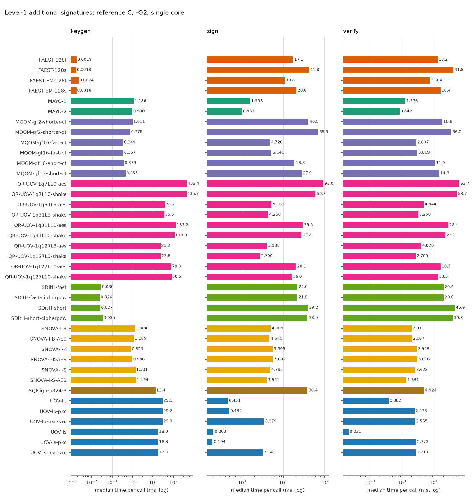
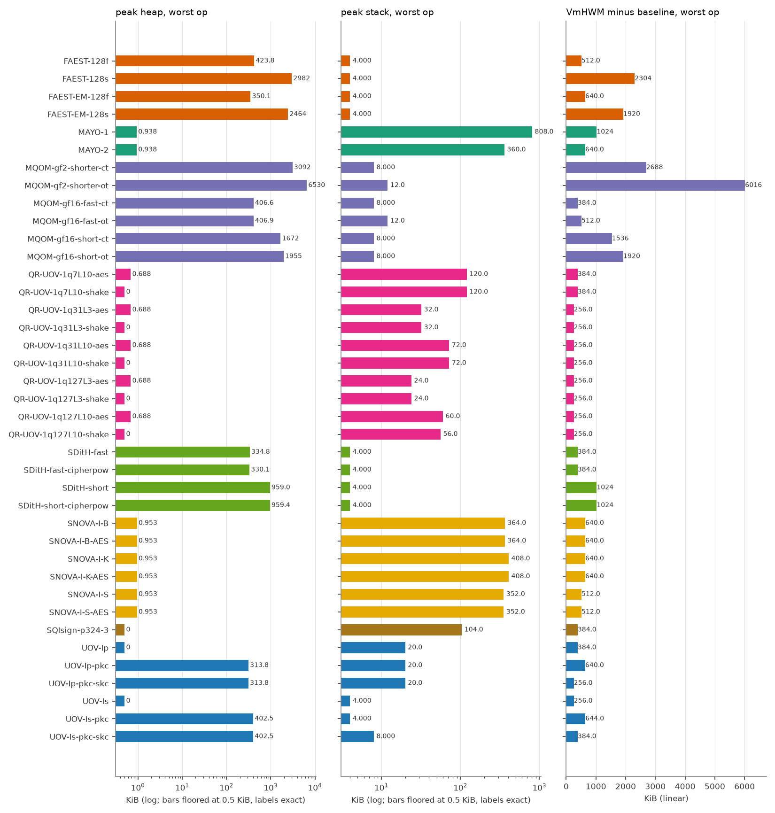
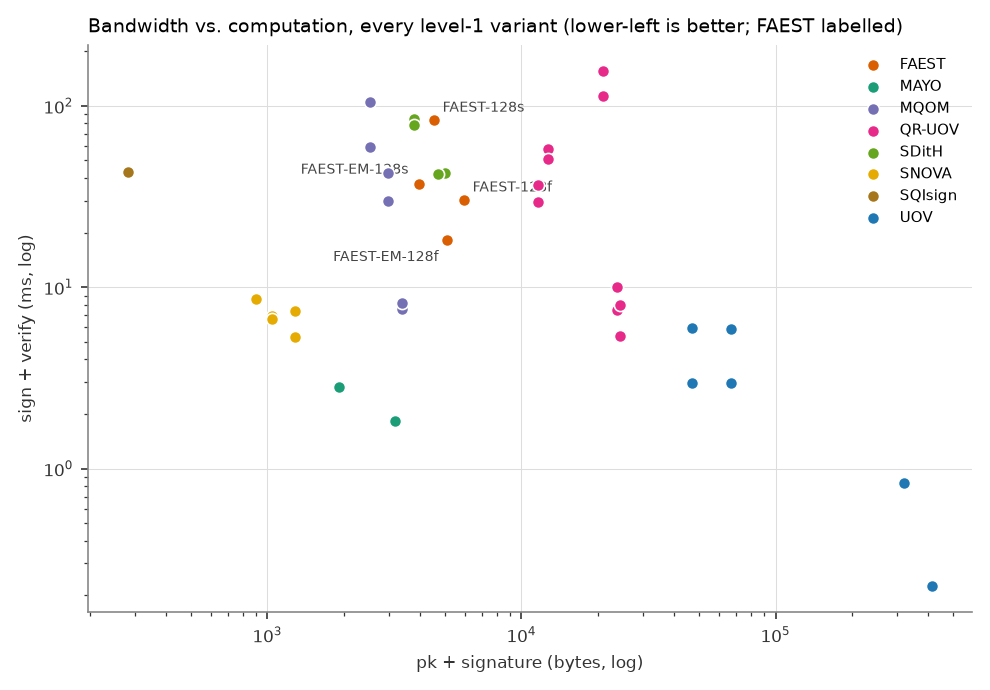

# FAEST vs. the other on-going NIST additional-signature candidates (level 1)

All numbers are produced by `tools/bench/run_bench.py` + `tools/bench/report.py` from the reference implementations in `original/Additional-DS/` (static-test folders, portable C, no SIMD/AES-NI). Regenerate with `make bench-l1`.

## Setup

| | |
|---|---|
| CPU | Intel(R) Core(TM) Ultra 7 155H |
| OS | Linux AlessandraYOGA 6.6.87.2-microsoft-standard-WSL2 #1 SMP PREEMPT_DYNAMIC Thu Jun  5 18:30:46 UTC 2025 x86_64 |
| Compiler | gcc (Ubuntu 13.3.0-6ubuntu2~24.04.1) 13.3.0, `CFLAGS=-O2 -std=gnu11 -w -Wno-psabi` (warnings suppressed), identical for every variant; the static KAT tests were built with `-std=c11` |
| Pinning | single core (CPU 2), one process per operation |
| Message | 1000 bytes (`hello world ` repeated), as in the reference paper |
| Iterations | up to 1000 per operation, within a 3.0 s budget (min 5); median reported |
| Date | 2026-10-14 14:28:57 |
| Machine load | Idle rerun 2026-10-14 (T9b), make bench-l1 BENCH_OUT=bench/results_run2, timed phase ~14:29:00-14:33:36, back to back after run 1. No Vsim/verilator/pdflatex. vmstat (28 samples): mean user 7.5 %, sys 1.1 %, idle 92.1 %, max user 12 %; benchmark core (6.25 %) plus ~0.2 core foreign (cpptools bursts). No sample >20 %. |

Metrics: **time** = wall clock (`CLOCK_MONOTONIC`) per call; **cycles** = raw TSC ticks; **heap** = peak bytes live in `malloc/calloc/realloc` (requested size, via link-time wrapping, key/message buffers of the harness excluded); **stack** = deepest touched page of a dedicated 1 GiB mmap'ed thread stack (4 KiB granularity); **VmHWM-base** = growth of the process peak resident set during the operation, `vmhwm_kb - vmhwm_base_kb` (the raw VmHWM, in `results.csv`, also contains a 2.0-2.4 MiB baseline of libc and harness pages that depends on the operation, because the preparation thread has already run sign/verify and its freed heap stays resident; pages reused from it are not counted, so this column under-reports sign/verify of heap-heavy variants and is only indicative); **code/data/bss** = `size` of the algorithm objects only (harness excluded).

> **Note on FAEST timings.** FAEST sign/verify medians moved between two back-to-back runs by 0-22 % (FAEST-128f and -128s: second run slower by 17-22 %, while most other schemes were faster by about 25 %; FAEST-EM-128f/-128s within 6 %). The sign/verify anomalies seen in an earlier run under foreign load (EM-128f verify above sign, EM-128s verify far below sign) did not reproduce on the idle reruns: verify is at or below sign for all four variants in both runs (128s: 41.8 vs 41.8 ms in run 2). Keygen of FAEST (1.6-2.4 us) is near the timer resolution and varies by up to 45 %. Read FAEST/other ratios within about 1.5x with caution. No number has been altered.

## Key and signature sizes (bytes)

| Scheme | Variant | pk | sk | signature |
|---|---|---:|---:|---:|
| FAEST | FAEST-128f | 32 | 32 | 5924 |
| FAEST | FAEST-128s | 32 | 32 | 4506 |
| FAEST | FAEST-EM-128f | 32 | 32 | 5060 |
| FAEST | FAEST-EM-128s | 32 | 32 | 3906 |
| MAYO | MAYO-1 | 1456 | 24 | 464 |
| MAYO | MAYO-2 | 2928 | 24 | 239 |
| MQOM | MQOM-gf2-shorter-ct | 52 | 72 | 2492 |
| MQOM | MQOM-gf2-shorter-ot | 52 | 72 | 2492 |
| MQOM | MQOM-gf16-fast-ct | 64 | 96 | 3316 |
| MQOM | MQOM-gf16-fast-ot | 64 | 96 | 3316 |
| MQOM | MQOM-gf16-short-ct | 64 | 96 | 2932 |
| MQOM | MQOM-gf16-short-ot | 64 | 96 | 2932 |
| QR-UOV | QR-UOV-1q7L10-aes | 20641 | 32 | 331 |
| QR-UOV | QR-UOV-1q7L10-shake | 20641 | 32 | 331 |
| QR-UOV | QR-UOV-1q31L3-aes | 23641 | 32 | 157 |
| QR-UOV | QR-UOV-1q31L3-shake | 23641 | 32 | 157 |
| QR-UOV | QR-UOV-1q31L10-aes | 12266 | 32 | 435 |
| QR-UOV | QR-UOV-1q31L10-shake | 12266 | 32 | 435 |
| QR-UOV | QR-UOV-1q127L3-aes | 24256 | 32 | 200 |
| QR-UOV | QR-UOV-1q127L3-shake | 24256 | 32 | 200 |
| QR-UOV | QR-UOV-1q127L10-aes | 11041 | 32 | 541 |
| QR-UOV | QR-UOV-1q127L10-shake | 11041 | 32 | 541 |
| SDitH | SDitH-fast | 70 | 147 | 4914 |
| SDitH | SDitH-fast-cipherpow | 70 | 147 | 4643 |
| SDitH | SDitH-short | 70 | 147 | 3721 |
| SDitH | SDitH-short-cipherpow | 70 | 147 | 3721 |
| SNOVA | SNOVA-I-B | 656 | 96 | 388 |
| SNOVA | SNOVA-I-B-AES | 656 | 96 | 388 |
| SNOVA | SNOVA-I-K | 376 | 96 | 528 |
| SNOVA | SNOVA-I-K-AES | 376 | 96 | 528 |
| SNOVA | SNOVA-I-S | 1016 | 96 | 272 |
| SNOVA | SNOVA-I-S-AES | 1016 | 96 | 272 |
| SQIsign | SQIsign-p324-3 | 83 | 270 | 200 |
| UOV | UOV-Ip | 321300 | 278087 | 135 |
| UOV | UOV-Ip-pkc | 46591 | 278087 | 135 |
| UOV | UOV-Ip-pkc-skc | 46591 | 32 | 135 |
| UOV | UOV-Is | 412160 | 348704 | 96 |
| UOV | UOV-Is-pkc | 66576 | 348704 | 96 |
| UOV | UOV-Is-pkc-skc | 66576 | 32 | 96 |

## Run time (median, ms) and TSC cycles (millions)

| Scheme | Variant | KeyGen ms | Sign ms | Verify ms | KeyGen Mcyc | Sign Mcyc | Verify Mcyc |
|---|---|---:|---:|---:|---:|---:|---:|
| FAEST | FAEST-128f | 0.0019 | 17.1 | 13.2 | 0.01 | 51.35 | 39.56 |
| FAEST | FAEST-128s | 0.0018 | 41.8 | 41.8 | 0.01 | 125.25 | 125.13 |
| FAEST | FAEST-EM-128f | 0.0024 | 10.8 | 7.364 | 0.01 | 32.38 | 22.06 |
| FAEST | FAEST-EM-128s | 0.0018 | 20.6 | 16.4 | 0.01 | 61.77 | 49.20 |
| MAYO | MAYO-1 | 1.186 | 1.558 | 1.276 | 3.55 | 4.67 | 3.82 |
| MAYO | MAYO-2 | 0.990 | 0.981 | 0.842 | 2.97 | 2.94 | 2.52 |
| MQOM | MQOM-gf2-shorter-ct | 1.011 | 40.5 | 18.6 | 3.03 | 121.39 | 55.78 |
| MQOM | MQOM-gf2-shorter-ot | 0.778 | 69.3 | 36.0 | 2.33 | 207.43 | 107.71 |
| MQOM | MQOM-gf16-fast-ct | 0.349 | 4.720 | 2.837 | 1.04 | 14.14 | 8.50 |
| MQOM | MQOM-gf16-fast-ot | 0.357 | 5.141 | 3.019 | 1.07 | 15.40 | 9.04 |
| MQOM | MQOM-gf16-short-ct | 0.379 | 18.8 | 11.0 | 1.13 | 56.20 | 32.92 |
| MQOM | MQOM-gf16-short-ot | 0.455 | 27.9 | 14.8 | 1.36 | 83.47 | 44.37 |
| QR-UOV | QR-UOV-1q7L10-aes | 453.4 | 93.0 | 63.7 | 1357.96 | 278.46 | 190.86 |
| QR-UOV | QR-UOV-1q7L10-shake | 435.7 | 59.7 | 53.7 | 1305.02 | 178.83 | 160.77 |
| QR-UOV | QR-UOV-1q31L3-aes | 38.2 | 5.169 | 4.844 | 114.30 | 15.48 | 14.51 |
| QR-UOV | QR-UOV-1q31L3-shake | 35.5 | 4.250 | 3.250 | 106.45 | 12.73 | 9.74 |
| QR-UOV | QR-UOV-1q31L10-aes | 133.2 | 29.5 | 28.4 | 398.90 | 88.47 | 85.02 |
| QR-UOV | QR-UOV-1q31L10-shake | 113.9 | 27.8 | 23.1 | 341.19 | 83.26 | 69.11 |
| QR-UOV | QR-UOV-1q127L3-aes | 23.2 | 3.988 | 4.020 | 69.47 | 11.95 | 12.04 |
| QR-UOV | QR-UOV-1q127L3-shake | 23.6 | 2.700 | 2.705 | 70.67 | 8.09 | 8.10 |
| QR-UOV | QR-UOV-1q127L10-aes | 78.8 | 20.1 | 16.5 | 235.92 | 60.33 | 49.35 |
| QR-UOV | QR-UOV-1q127L10-shake | 80.5 | 16.0 | 13.5 | 240.99 | 47.78 | 40.33 |
| SDitH | SDitH-fast | 0.030 | 22.0 | 20.4 | 0.09 | 66.01 | 61.13 |
| SDitH | SDitH-fast-cipherpow | 0.026 | 21.8 | 20.6 | 0.08 | 65.23 | 61.59 |
| SDitH | SDitH-short | 0.027 | 39.2 | 45.9 | 0.08 | 117.47 | 137.49 |
| SDitH | SDitH-short-cipherpow | 0.035 | 38.9 | 39.8 | 0.11 | 116.64 | 119.35 |
| SNOVA | SNOVA-I-B | 1.304 | 4.909 | 2.011 | 3.91 | 14.70 | 6.02 |
| SNOVA | SNOVA-I-B-AES | 1.185 | 4.640 | 2.067 | 3.55 | 13.90 | 6.19 |
| SNOVA | SNOVA-I-K | 0.853 | 5.505 | 2.948 | 2.55 | 16.49 | 8.83 |
| SNOVA | SNOVA-I-K-AES | 0.986 | 5.602 | 3.016 | 2.95 | 16.78 | 9.03 |
| SNOVA | SNOVA-I-S | 1.381 | 4.792 | 2.622 | 4.14 | 14.35 | 7.85 |
| SNOVA | SNOVA-I-S-AES | 1.494 | 3.951 | 1.391 | 4.48 | 11.83 | 4.17 |
| SQIsign | SQIsign-p324-3 | 13.4 | 38.4 | 4.924 | 40.20 | 115.16 | 14.75 |
| UOV | UOV-Ip | 29.5 | 0.451 | 0.382 | 88.24 | 1.35 | 1.14 |
| UOV | UOV-Ip-pkc | 29.2 | 0.484 | 2.473 | 87.41 | 1.45 | 7.41 |
| UOV | UOV-Ip-pkc-skc | 29.3 | 3.379 | 2.565 | 87.62 | 10.12 | 7.68 |
| UOV | UOV-Is | 18.0 | 0.203 | 0.021 | 53.81 | 0.61 | 0.06 |
| UOV | UOV-Is-pkc | 18.3 | 0.194 | 2.773 | 54.86 | 0.58 | 8.31 |
| UOV | UOV-Is-pkc-skc | 17.8 | 3.141 | 2.713 | 53.45 | 9.41 | 8.13 |

## Memory (KiB)

| Scheme | Variant | heap KG/S/V | stack KG/S/V | VmHWM-base KG/S/V | code | data+bss |
|---|---|---|---|---|---:|---:|
| FAEST | FAEST-128f | 0.0 / 423.8 / 186.5 | 0.0 / 4.0 / 4.0 | 256 / 512 / 384 | 229.1 | 0.1 |
| FAEST | FAEST-128s | 0.0 / 2981.7 / 1285.5 | 0.0 / 4.0 / 4.0 | 256 / 2304 / 512 | 229.1 | 0.1 |
| FAEST | FAEST-EM-128f | 0.0 / 350.1 / 166.7 | 0.0 / 4.0 / 4.0 | 384 / 640 / 384 | 229.1 | 0.1 |
| FAEST | FAEST-EM-128s | 0.0 / 2464.3 / 1120.1 | 0.0 / 4.0 / 4.0 | 384 / 1920 / 512 | 229.1 | 0.1 |
| MAYO | MAYO-1 | 0.9 / 0.9 / 0.7 | 156.0 / 236.0 / 808.0 | 384 / 512 / 1024 | 40.4 | 0.1 |
| MAYO | MAYO-2 | 0.9 / 0.9 / 0.7 | 124.0 / 152.0 / 360.0 | 384 / 384 / 640 | 40.4 | 0.1 |
| MQOM | MQOM-gf2-shorter-ct | 528.6 / 3091.8 / 704.6 | 0.0 / 8.0 / 8.0 | 512 / 2688 / 128 | 529.0 | 0.4 |
| MQOM | MQOM-gf2-shorter-ot | 528.6 / 6530.4 / 5152.6 | 0.0 / 12.0 / 8.0 | 640 / 6016 / 4736 | 546.5 | 0.4 |
| MQOM | MQOM-gf16-fast-ct | 132.1 / 406.6 / 132.1 | 0.0 / 8.0 / 8.0 | 384 / 384 / 128 | 512.2 | 0.3 |
| MQOM | MQOM-gf16-fast-ot | 132.1 / 406.9 / 249.1 | 0.0 / 12.0 / 8.0 | 512 / 256 / 256 | 530.1 | 0.4 |
| MQOM | MQOM-gf16-short-ct | 134.2 / 1672.5 / 352.6 | 0.0 / 8.0 / 4.0 | 384 / 1536 / 256 | 526.9 | 0.3 |
| MQOM | MQOM-gf16-short-ot | 134.2 / 1954.5 / 1488.6 | 0.0 / 8.0 / 4.0 | 512 / 1920 / 1408 | 545.9 | 0.4 |
| QR-UOV | QR-UOV-1q7L10-aes | 0.7 / 0.7 / 0.7 | 112.0 / 120.0 / 100.0 | 256 / 384 / 256 | 38.1 | 0.1 |
| QR-UOV | QR-UOV-1q7L10-shake | 0.0 / 0.0 / 0.0 | 112.0 / 120.0 / 100.0 | 256 / 384 / 256 | 38.3 | 0.1 |
| QR-UOV | QR-UOV-1q31L3-aes | 0.7 / 0.7 / 0.7 | 32.0 / 28.0 / 24.0 | 256 / 256 / 256 | 38.3 | 0.1 |
| QR-UOV | QR-UOV-1q31L3-shake | 0.0 / 0.0 / 0.0 | 32.0 / 28.0 / 24.0 | 256 / 256 / 256 | 38.4 | 0.1 |
| QR-UOV | QR-UOV-1q31L10-aes | 0.7 / 0.7 / 0.7 | 68.0 / 72.0 / 64.0 | 256 / 256 / 256 | 38.0 | 0.1 |
| QR-UOV | QR-UOV-1q31L10-shake | 0.0 / 0.0 / 0.0 | 68.0 / 72.0 / 64.0 | 256 / 256 / 256 | 38.1 | 0.1 |
| QR-UOV | QR-UOV-1q127L3-aes | 0.7 / 0.7 / 0.7 | 24.0 / 24.0 / 20.0 | 256 / 256 / 256 | 38.1 | 0.1 |
| QR-UOV | QR-UOV-1q127L3-shake | 0.0 / 0.0 / 0.0 | 24.0 / 24.0 / 20.0 | 256 / 256 / 256 | 38.2 | 0.1 |
| QR-UOV | QR-UOV-1q127L10-aes | 0.7 / 0.7 / 0.7 | 56.0 / 60.0 / 52.0 | 256 / 256 / 256 | 38.3 | 0.1 |
| QR-UOV | QR-UOV-1q127L10-shake | 0.0 / 0.0 / 0.0 | 56.0 / 56.0 / 48.0 | 256 / 256 / 256 | 38.4 | 0.1 |
| SDitH | SDitH-fast | 0.4 / 334.8 / 328.5 | 0.0 / 4.0 / 4.0 | 256 / 256 / 384 | 190.7 | 0.1 |
| SDitH | SDitH-fast-cipherpow | 0.4 / 330.1 / 323.7 | 0.0 / 4.0 / 4.0 | 384 / 256 / 256 | 190.7 | 0.1 |
| SDitH | SDitH-short | 0.4 / 959.0 / 952.7 | 0.0 / 4.0 / 4.0 | 384 / 1024 / 1024 | 190.7 | 0.1 |
| SDitH | SDitH-short-cipherpow | 0.4 / 959.4 / 953.1 | 0.0 / 4.0 / 4.0 | 384 / 1024 / 896 | 190.7 | 0.1 |
| SNOVA | SNOVA-I-B | 1.0 / 1.0 / 0.0 | 132.0 / 364.0 / 280.0 | 384 / 640 / 512 | 33.2 | 10.2 |
| SNOVA | SNOVA-I-B-AES | 1.0 / 1.0 / 0.7 | 132.0 / 364.0 / 280.0 | 384 / 640 / 512 | 31.7 | 10.2 |
| SNOVA | SNOVA-I-K | 1.0 / 1.0 / 0.0 | 144.0 / 408.0 / 360.0 | 384 / 640 / 640 | 32.9 | 15.3 |
| SNOVA | SNOVA-I-K-AES | 1.0 / 1.0 / 0.7 | 144.0 / 408.0 / 360.0 | 384 / 640 / 512 | 31.4 | 15.3 |
| SNOVA | SNOVA-I-S | 1.0 / 1.0 / 0.0 | 136.0 / 352.0 / 288.0 | 384 / 512 / 512 | 32.8 | 5.3 |
| SNOVA | SNOVA-I-S-AES | 1.0 / 1.0 / 0.7 | 136.0 / 352.0 / 288.0 | 384 / 512 / 512 | 31.3 | 5.3 |
| SQIsign | SQIsign-p324-3 | 0.0 / 0.0 / 0.0 | 56.0 / 104.0 / 40.0 | 384 / 384 / 256 | 250.9 | 0.4 |
| UOV | UOV-Ip | 0.0 / 0.0 / 0.0 | 20.0 / 12.0 / 4.0 | 256 / 384 / 256 | 41.6 | 0.1 |
| UOV | UOV-Ip-pkc | 0.0 / 0.0 / 313.8 | 20.0 / 12.0 / 4.0 | 256 / 256 / 640 | 41.8 | 0.1 |
| UOV | UOV-Ip-pkc-skc | 271.6 / 271.6 / 313.8 | 20.0 / 20.0 / 4.0 | 256 / 0 / 256 | 44.0 | 0.1 |
| UOV | UOV-Is | 0.0 / 0.0 / 0.0 | 4.0 / 4.0 / 0.0 | 256 / 256 / 256 | 37.1 | 0.1 |
| UOV | UOV-Is-pkc | 0.0 / 0.0 / 402.5 | 4.0 / 4.0 / 0.0 | 256 / 256 / 644 | 37.3 | 0.1 |
| UOV | UOV-Is-pkc-skc | 340.5 / 340.5 / 402.5 | 4.0 / 8.0 / 0.0 | 256 / 0 / 384 | 38.1 | 0.1 |

Stack legend: values of 0, 4 and 8 KiB are page-granularity floors (read them as "<= 4 KiB", "<= 8 KiB"), not measurements; the stack is the touched pages of the thread stack minus an empty thread.

## FAEST against the best variant of every other family

Fastest FAEST variant per operation vs. fastest variant of each other scheme (ratio > 1: FAEST slower).

| Scheme | best KeyGen | best Sign | best Verify | smallest pk+sig |
|---|---|---|---|---|
| MAYO | MAYO-2 (0.990 ms): x0.0018 | MAYO-2 (0.981 ms): x11.0 | MAYO-2 (0.842 ms): x8.7 | MAYO-1 (1920 B): x2.1 |
| MQOM | MQOM-gf16-fast-ct (0.349 ms): x0.00512 | MQOM-gf16-fast-ct (4.720 ms): x2.3 | MQOM-gf16-fast-ct (2.837 ms): x2.6 | MQOM-gf2-shorter-ct (2544 B): x1.5 |
| QR-UOV | QR-UOV-1q127L3-aes (23.2 ms): x7.69e-05 | QR-UOV-1q127L3-shake (2.700 ms): x4.0 | QR-UOV-1q127L3-shake (2.705 ms): x2.7 | QR-UOV-1q127L10-aes (11.6 K B): x0.3 |
| SDitH | SDitH-fast-cipherpow (0.026 ms): x0.0696 | SDitH-fast-cipherpow (21.8 ms): x0.496 | SDitH-fast (20.4 ms): x0.361 | SDitH-short (3791 B): x1.0 |
| SNOVA | SNOVA-I-K (0.853 ms): x0.00209 | SNOVA-I-S-AES (3.951 ms): x2.7 | SNOVA-I-S-AES (1.391 ms): x5.3 | SNOVA-I-K (904 B): x4.4 |
| SQIsign | SQIsign-p324-3 (13.4 ms): x0.000133 | SQIsign-p324-3 (38.4 ms): x0.281 | SQIsign-p324-3 (4.924 ms): x1.5 | SQIsign-p324-3 (283 B): x13.9 |
| UOV | UOV-Is-pkc-skc (17.8 ms): x9.99e-05 | UOV-Is-pkc (0.194 ms): x55.9 | UOV-Is (0.021 ms): x346.5 | UOV-Ip-pkc (46.7 K B): x0.1 |

FAEST reference points: FAEST-128s keygen 0.0018 ms, FAEST-EM-128f sign 10.8 ms, FAEST-EM-128f verify 7.364 ms; smallest pk+sig FAEST-EM-128s (3938 B).

## Caveats

- Portable *reference* C for every scheme; schemes whose submission relies on AVX2/AES-NI/GFNI ship considerably faster optimized packages (not measured here), so absolute numbers are not comparable with optimized-implementation papers; the comparison among them is like-for-like.
- Cycles are TSC ticks of an x86 laptop CPU under WSL2, shown for relative comparison only.
- Stack figures have 4 KiB granularity; heap counts requested bytes only.
- Level 1 only (the lowest NIST category); variants per scheme are all Round-3 level-1 parameter sets that build in this tree. KAT status differs by family: MAYO, SNOVA, MQOM, SDitH and SQIsign match the official KAT record #0; UOV, QR-UOV (16 of the 39 variants) matched only the package's own generator on records 0-1 (no official KAT available offline); FAEST sizes were not compared to an official KAT in this run.
