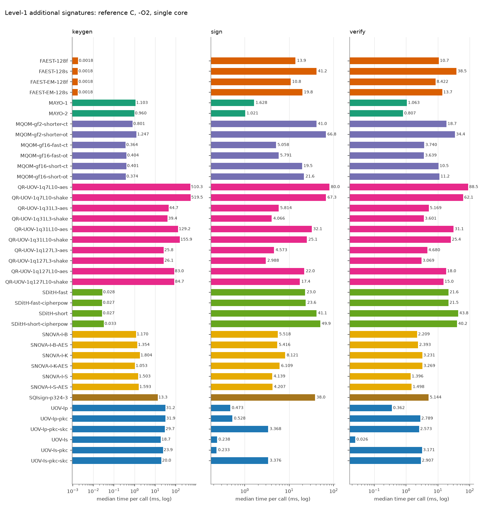
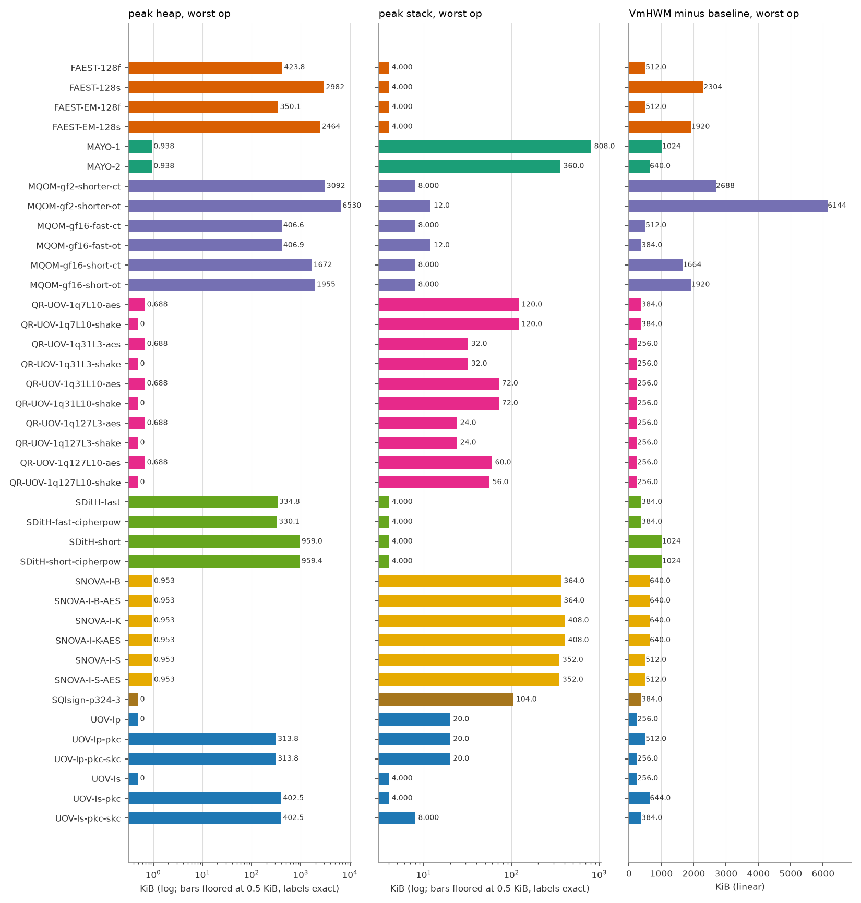
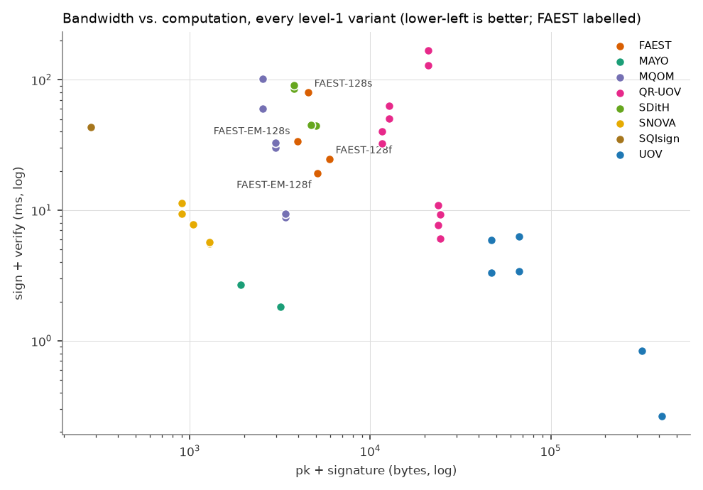

# FAEST vs. the other on-going NIST additional-signature candidates (level 1)

All numbers are produced by `tools/bench/run_bench.py` + `tools/bench/report.py` from the reference implementations in `original/Additional-DS/` (static-test folders, portable C, no SIMD/AES-NI). Regenerate with `make bench-l1`.

## Setup

| | |
|---|---|
| CPU | Intel(R) Core(TM) Ultra 7 155H |
| OS | Linux AlessandraYOGA 6.6.87.2-microsoft-standard-WSL2 #1 SMP PREEMPT_DYNAMIC Thu Jun  5 18:30:46 UTC 2025 x86_64 |
| Compiler | gcc (Ubuntu 13.3.0-6ubuntu2~24.04.1) 13.3.0, `CFLAGS=-O2 -std=gnu11 -w -Wno-psabi` (warnings suppressed), identical for every variant; the static KAT tests were built with `-std=c11` |
| Pinning | single core (CPU 2), one process per operation |
| Message | 1000 bytes (`hello world ` repeated), as in the reference paper |
| Iterations | up to 1000 per operation, within a 3.0 s budget (min 5); median reported |
| Date | 2026-10-14 14:40:35 |

Metrics: **time** = wall clock (`CLOCK_MONOTONIC`) per call; **cycles** = raw TSC ticks; **heap** = peak bytes live in `malloc/calloc/realloc` (requested size, via link-time wrapping, key/message buffers of the harness excluded); **stack** = deepest touched page of a dedicated 1 GiB mmap'ed thread stack (4 KiB granularity); **VmHWM-base** = growth of the process peak resident set during the operation, `vmhwm_kb - vmhwm_base_kb` (the raw VmHWM, in `results.csv`, also contains a 2.0-2.4 MiB baseline of libc and harness pages that depends on the operation, because the preparation thread has already run sign/verify and its freed heap stays resident; pages reused from it are not counted, so this column under-reports sign/verify of heap-heavy variants and is only indicative); **code/data/bss** = `size` of the algorithm objects only (harness excluded).

> **Note on FAEST timings.** FAEST sign/verify medians moved between two back-to-back runs by 0-22 % (FAEST-128f and -128s: second run slower by 17-22 %, while most other schemes were faster by about 25 %; FAEST-EM-128f/-128s within 6 %). The sign/verify anomalies seen in an earlier run under foreign load (EM-128f verify above sign, EM-128s verify far below sign) did not reproduce on the idle reruns: verify is at or below sign for all four variants in both runs (128s: 41.8 vs 41.8 ms in run 2). Keygen of FAEST (1.6-2.4 us) is near the timer resolution and varies by up to 45 %. Read FAEST/other ratios within about 1.5x with caution. No number has been altered.

## Key and signature sizes (bytes)

| Scheme | Variant | pk | sk | signature |
|---|---|---:|---:|---:|
| FAEST | FAEST-128f | 32 | 32 | 5924 |
| FAEST | FAEST-128s | 32 | 32 | 4506 |
| FAEST | FAEST-EM-128f | 32 | 32 | 5060 |
| FAEST | FAEST-EM-128s | 32 | 32 | 3906 |
| MAYO | MAYO-1 | 1456 | 24 | 464 |
| MAYO | MAYO-2 | 2928 | 24 | 239 |
| MQOM | MQOM-gf2-shorter-ct | 52 | 72 | 2492 |
| MQOM | MQOM-gf2-shorter-ot | 52 | 72 | 2492 |
| MQOM | MQOM-gf16-fast-ct | 64 | 96 | 3316 |
| MQOM | MQOM-gf16-fast-ot | 64 | 96 | 3316 |
| MQOM | MQOM-gf16-short-ct | 64 | 96 | 2932 |
| MQOM | MQOM-gf16-short-ot | 64 | 96 | 2932 |
| QR-UOV | QR-UOV-1q7L10-aes | 20641 | 32 | 331 |
| QR-UOV | QR-UOV-1q7L10-shake | 20641 | 32 | 331 |
| QR-UOV | QR-UOV-1q31L3-aes | 23641 | 32 | 157 |
| QR-UOV | QR-UOV-1q31L3-shake | 23641 | 32 | 157 |
| QR-UOV | QR-UOV-1q31L10-aes | 12266 | 32 | 435 |
| QR-UOV | QR-UOV-1q31L10-shake | 12266 | 32 | 435 |
| QR-UOV | QR-UOV-1q127L3-aes | 24256 | 32 | 200 |
| QR-UOV | QR-UOV-1q127L3-shake | 24256 | 32 | 200 |
| QR-UOV | QR-UOV-1q127L10-aes | 11041 | 32 | 541 |
| QR-UOV | QR-UOV-1q127L10-shake | 11041 | 32 | 541 |
| SDitH | SDitH-fast | 70 | 147 | 4914 |
| SDitH | SDitH-fast-cipherpow | 70 | 147 | 4643 |
| SDitH | SDitH-short | 70 | 147 | 3721 |
| SDitH | SDitH-short-cipherpow | 70 | 147 | 3721 |
| SNOVA | SNOVA-I-B | 656 | 96 | 388 |
| SNOVA | SNOVA-I-B-AES | 656 | 96 | 388 |
| SNOVA | SNOVA-I-K | 376 | 96 | 528 |
| SNOVA | SNOVA-I-K-AES | 376 | 96 | 528 |
| SNOVA | SNOVA-I-S | 1016 | 96 | 272 |
| SNOVA | SNOVA-I-S-AES | 1016 | 96 | 272 |
| SQIsign | SQIsign-p324-3 | 83 | 270 | 200 |
| UOV | UOV-Ip | 321300 | 278087 | 135 |
| UOV | UOV-Ip-pkc | 46591 | 278087 | 135 |
| UOV | UOV-Ip-pkc-skc | 46591 | 32 | 135 |
| UOV | UOV-Is | 412160 | 348704 | 96 |
| UOV | UOV-Is-pkc | 66576 | 348704 | 96 |
| UOV | UOV-Is-pkc-skc | 66576 | 32 | 96 |

## Run time (median, ms) and TSC cycles (millions)

| Scheme | Variant | KeyGen ms | Sign ms | Verify ms | KeyGen Mcyc | Sign Mcyc | Verify Mcyc |
|---|---|---:|---:|---:|---:|---:|---:|
| FAEST | FAEST-128f | 0.0018 | 13.9 | 10.7 | 0.01 | 41.64 | 32.08 |
| FAEST | FAEST-128s | 0.0018 | 41.2 | 38.5 | 0.01 | 123.32 | 115.24 |
| FAEST | FAEST-EM-128f | 0.0018 | 10.8 | 8.422 | 0.01 | 32.28 | 25.23 |
| FAEST | FAEST-EM-128s | 0.0018 | 19.8 | 13.7 | 0.01 | 59.40 | 40.96 |
| MAYO | MAYO-1 | 1.103 | 1.628 | 1.063 | 3.30 | 4.88 | 3.18 |
| MAYO | MAYO-2 | 0.960 | 1.021 | 0.807 | 2.88 | 3.06 | 2.42 |
| MQOM | MQOM-gf2-shorter-ct | 0.801 | 41.0 | 18.7 | 2.40 | 122.93 | 55.87 |
| MQOM | MQOM-gf2-shorter-ot | 1.247 | 66.8 | 34.4 | 3.73 | 200.20 | 103.12 |
| MQOM | MQOM-gf16-fast-ct | 0.364 | 5.058 | 3.740 | 1.09 | 15.15 | 11.20 |
| MQOM | MQOM-gf16-fast-ot | 0.404 | 5.791 | 3.639 | 1.21 | 17.35 | 10.90 |
| MQOM | MQOM-gf16-short-ct | 0.401 | 19.5 | 10.5 | 1.20 | 58.44 | 31.44 |
| MQOM | MQOM-gf16-short-ot | 0.374 | 21.6 | 11.2 | 1.12 | 64.67 | 33.61 |
| QR-UOV | QR-UOV-1q7L10-aes | 510.3 | 80.0 | 88.5 | 1528.50 | 239.73 | 264.97 |
| QR-UOV | QR-UOV-1q7L10-shake | 519.5 | 67.3 | 62.1 | 1556.15 | 201.72 | 186.14 |
| QR-UOV | QR-UOV-1q31L3-aes | 44.7 | 5.814 | 5.169 | 134.03 | 17.41 | 15.48 |
| QR-UOV | QR-UOV-1q31L3-shake | 39.4 | 4.066 | 3.601 | 118.15 | 12.18 | 10.79 |
| QR-UOV | QR-UOV-1q31L10-aes | 129.2 | 32.1 | 31.1 | 387.09 | 96.22 | 93.28 |
| QR-UOV | QR-UOV-1q31L10-shake | 155.9 | 25.1 | 25.4 | 466.93 | 75.04 | 76.11 |
| QR-UOV | QR-UOV-1q127L3-aes | 25.8 | 4.573 | 4.680 | 77.24 | 13.70 | 14.02 |
| QR-UOV | QR-UOV-1q127L3-shake | 26.1 | 2.988 | 3.069 | 78.14 | 8.95 | 9.19 |
| QR-UOV | QR-UOV-1q127L10-aes | 83.0 | 22.0 | 18.0 | 248.72 | 65.78 | 53.96 |
| QR-UOV | QR-UOV-1q127L10-shake | 84.7 | 17.4 | 15.0 | 253.64 | 52.14 | 44.98 |
| SDitH | SDitH-fast | 0.028 | 23.0 | 21.6 | 0.08 | 68.81 | 64.62 |
| SDitH | SDitH-fast-cipherpow | 0.027 | 23.6 | 21.5 | 0.08 | 70.81 | 64.38 |
| SDitH | SDitH-short | 0.027 | 41.1 | 43.8 | 0.08 | 123.17 | 131.06 |
| SDitH | SDitH-short-cipherpow | 0.033 | 49.9 | 40.2 | 0.10 | 149.51 | 120.52 |
| SNOVA | SNOVA-I-B | 1.170 | 5.518 | 2.209 | 3.51 | 16.53 | 6.62 |
| SNOVA | SNOVA-I-B-AES | 1.354 | 5.416 | 2.393 | 4.05 | 16.22 | 7.17 |
| SNOVA | SNOVA-I-K | 1.804 | 8.121 | 3.231 | 5.40 | 24.32 | 9.68 |
| SNOVA | SNOVA-I-K-AES | 1.053 | 6.109 | 3.269 | 3.15 | 18.30 | 9.79 |
| SNOVA | SNOVA-I-S | 1.503 | 4.139 | 1.396 | 4.50 | 12.40 | 4.18 |
| SNOVA | SNOVA-I-S-AES | 1.593 | 4.207 | 1.498 | 4.77 | 12.60 | 4.49 |
| SQIsign | SQIsign-p324-3 | 13.3 | 38.0 | 5.144 | 39.73 | 113.94 | 15.41 |
| UOV | UOV-Ip | 31.2 | 0.473 | 0.362 | 93.46 | 1.42 | 1.08 |
| UOV | UOV-Ip-pkc | 31.9 | 0.528 | 2.789 | 95.63 | 1.58 | 8.35 |
| UOV | UOV-Ip-pkc-skc | 29.7 | 3.368 | 2.573 | 88.93 | 10.09 | 7.71 |
| UOV | UOV-Is | 18.7 | 0.238 | 0.026 | 56.08 | 0.71 | 0.08 |
| UOV | UOV-Is-pkc | 23.9 | 0.233 | 3.171 | 71.54 | 0.70 | 9.50 |
| UOV | UOV-Is-pkc-skc | 20.0 | 3.376 | 2.907 | 59.93 | 10.11 | 8.71 |

## Memory (KiB)

| Scheme | Variant | heap KG/S/V | stack KG/S/V | VmHWM-base KG/S/V | code | data+bss |
|---|---|---|---|---|---:|---:|
| FAEST | FAEST-128f | 0.0 / 423.8 / 186.5 | 0.0 / 4.0 / 4.0 | 256 / 512 / 384 | 229.1 | 0.1 |
| FAEST | FAEST-128s | 0.0 / 2981.7 / 1285.5 | 0.0 / 4.0 / 4.0 | 384 / 2304 / 512 | 229.1 | 0.1 |
| FAEST | FAEST-EM-128f | 0.0 / 350.1 / 166.7 | 0.0 / 4.0 / 4.0 | 384 / 512 / 384 | 229.1 | 0.1 |
| FAEST | FAEST-EM-128s | 0.0 / 2464.3 / 1120.1 | 0.0 / 4.0 / 4.0 | 384 / 1920 / 512 | 229.1 | 0.1 |
| MAYO | MAYO-1 | 0.9 / 0.9 / 0.7 | 156.0 / 236.0 / 808.0 | 384 / 512 / 1024 | 40.4 | 0.1 |
| MAYO | MAYO-2 | 0.9 / 0.9 / 0.7 | 124.0 / 152.0 / 360.0 | 384 / 384 / 640 | 40.4 | 0.1 |
| MQOM | MQOM-gf2-shorter-ct | 528.6 / 3091.8 / 704.6 | 0.0 / 8.0 / 8.0 | 512 / 2688 / 128 | 529.0 | 0.4 |
| MQOM | MQOM-gf2-shorter-ot | 528.6 / 6530.4 / 5152.6 | 0.0 / 12.0 / 8.0 | 640 / 6144 / 4736 | 546.5 | 0.4 |
| MQOM | MQOM-gf16-fast-ct | 132.1 / 406.6 / 132.1 | 0.0 / 8.0 / 8.0 | 512 / 384 / 128 | 512.2 | 0.3 |
| MQOM | MQOM-gf16-fast-ot | 132.1 / 406.9 / 249.1 | 0.0 / 12.0 / 8.0 | 384 / 384 / 256 | 530.1 | 0.4 |
| MQOM | MQOM-gf16-short-ct | 134.2 / 1672.5 / 352.6 | 0.0 / 8.0 / 4.0 | 384 / 1664 / 256 | 526.9 | 0.3 |
| MQOM | MQOM-gf16-short-ot | 134.2 / 1954.5 / 1488.6 | 0.0 / 8.0 / 4.0 | 512 / 1920 / 1408 | 545.9 | 0.4 |
| QR-UOV | QR-UOV-1q7L10-aes | 0.7 / 0.7 / 0.7 | 112.0 / 120.0 / 100.0 | 256 / 384 / 256 | 38.1 | 0.1 |
| QR-UOV | QR-UOV-1q7L10-shake | 0.0 / 0.0 / 0.0 | 112.0 / 120.0 / 100.0 | 256 / 384 / 256 | 38.3 | 0.1 |
| QR-UOV | QR-UOV-1q31L3-aes | 0.7 / 0.7 / 0.7 | 32.0 / 28.0 / 24.0 | 256 / 256 / 256 | 38.3 | 0.1 |
| QR-UOV | QR-UOV-1q31L3-shake | 0.0 / 0.0 / 0.0 | 32.0 / 28.0 / 24.0 | 256 / 256 / 256 | 38.4 | 0.1 |
| QR-UOV | QR-UOV-1q31L10-aes | 0.7 / 0.7 / 0.7 | 68.0 / 72.0 / 64.0 | 256 / 256 / 256 | 38.0 | 0.1 |
| QR-UOV | QR-UOV-1q31L10-shake | 0.0 / 0.0 / 0.0 | 68.0 / 72.0 / 64.0 | 256 / 256 / 256 | 38.1 | 0.1 |
| QR-UOV | QR-UOV-1q127L3-aes | 0.7 / 0.7 / 0.7 | 24.0 / 24.0 / 20.0 | 256 / 256 / 256 | 38.1 | 0.1 |
| QR-UOV | QR-UOV-1q127L3-shake | 0.0 / 0.0 / 0.0 | 24.0 / 24.0 / 20.0 | 256 / 256 / 256 | 38.2 | 0.1 |
| QR-UOV | QR-UOV-1q127L10-aes | 0.7 / 0.7 / 0.7 | 56.0 / 60.0 / 52.0 | 256 / 256 / 256 | 38.3 | 0.1 |
| QR-UOV | QR-UOV-1q127L10-shake | 0.0 / 0.0 / 0.0 | 56.0 / 56.0 / 48.0 | 256 / 256 / 256 | 38.4 | 0.1 |
| SDitH | SDitH-fast | 0.4 / 334.8 / 328.5 | 0.0 / 4.0 / 4.0 | 384 / 256 / 384 | 190.7 | 0.1 |
| SDitH | SDitH-fast-cipherpow | 0.4 / 330.1 / 323.7 | 0.0 / 4.0 / 4.0 | 384 / 384 / 256 | 190.7 | 0.1 |
| SDitH | SDitH-short | 0.4 / 959.0 / 952.7 | 0.0 / 4.0 / 4.0 | 384 / 1024 / 896 | 190.7 | 0.1 |
| SDitH | SDitH-short-cipherpow | 0.4 / 959.4 / 953.1 | 0.0 / 4.0 / 4.0 | 256 / 1024 / 896 | 190.7 | 0.1 |
| SNOVA | SNOVA-I-B | 1.0 / 1.0 / 0.0 | 132.0 / 364.0 / 280.0 | 384 / 640 / 512 | 33.2 | 10.2 |
| SNOVA | SNOVA-I-B-AES | 1.0 / 1.0 / 0.7 | 132.0 / 364.0 / 280.0 | 384 / 640 / 512 | 31.7 | 10.2 |
| SNOVA | SNOVA-I-K | 1.0 / 1.0 / 0.0 | 144.0 / 408.0 / 360.0 | 384 / 640 / 640 | 32.9 | 15.3 |
| SNOVA | SNOVA-I-K-AES | 1.0 / 1.0 / 0.7 | 144.0 / 408.0 / 360.0 | 384 / 640 / 512 | 31.4 | 15.3 |
| SNOVA | SNOVA-I-S | 1.0 / 1.0 / 0.0 | 136.0 / 352.0 / 288.0 | 384 / 512 / 512 | 32.8 | 5.3 |
| SNOVA | SNOVA-I-S-AES | 1.0 / 1.0 / 0.7 | 136.0 / 352.0 / 288.0 | 384 / 512 / 512 | 31.3 | 5.3 |
| SQIsign | SQIsign-p324-3 | 0.0 / 0.0 / 0.0 | 56.0 / 104.0 / 40.0 | 256 / 384 / 256 | 250.9 | 0.4 |
| UOV | UOV-Ip | 0.0 / 0.0 / 0.0 | 20.0 / 12.0 / 4.0 | 256 / 256 / 256 | 41.6 | 0.1 |
| UOV | UOV-Ip-pkc | 0.0 / 0.0 / 313.8 | 20.0 / 12.0 / 4.0 | 256 / 256 / 512 | 41.8 | 0.1 |
| UOV | UOV-Ip-pkc-skc | 271.6 / 271.6 / 313.8 | 20.0 / 20.0 / 4.0 | 256 / 0 / 256 | 44.0 | 0.1 |
| UOV | UOV-Is | 0.0 / 0.0 / 0.0 | 4.0 / 4.0 / 0.0 | 256 / 256 / 256 | 37.1 | 0.1 |
| UOV | UOV-Is-pkc | 0.0 / 0.0 / 402.5 | 4.0 / 4.0 / 0.0 | 256 / 256 / 644 | 37.3 | 0.1 |
| UOV | UOV-Is-pkc-skc | 340.5 / 340.5 / 402.5 | 4.0 / 8.0 / 0.0 | 256 / 0 / 384 | 38.1 | 0.1 |

Stack legend: values of 0, 4 and 8 KiB are page-granularity floors (read them as "<= 4 KiB", "<= 8 KiB"), not measurements; the stack is the touched pages of the thread stack minus an empty thread.

## FAEST against the best variant of every other family

Fastest FAEST variant per operation vs. fastest variant of each other scheme (ratio > 1: FAEST slower).

| Scheme | best KeyGen | best Sign | best Verify | smallest pk+sig |
|---|---|---|---|---|
| MAYO | MAYO-2 (0.960 ms): x0.00184 | MAYO-2 (1.021 ms): x10.6 | MAYO-2 (0.807 ms): x10.4 | MAYO-1 (1920 B): x2.1 |
| MQOM | MQOM-gf16-fast-ct (0.364 ms): x0.00484 | MQOM-gf16-fast-ct (5.058 ms): x2.1 | MQOM-gf16-fast-ot (3.639 ms): x2.3 | MQOM-gf2-shorter-ct (2544 B): x1.5 |
| QR-UOV | QR-UOV-1q127L3-aes (25.8 ms): x6.84e-05 | QR-UOV-1q127L3-shake (2.988 ms): x3.6 | QR-UOV-1q127L3-shake (3.069 ms): x2.7 | QR-UOV-1q127L10-aes (11.6 K B): x0.3 |
| SDitH | SDitH-short (0.027 ms): x0.0656 | SDitH-fast (23.0 ms): x0.469 | SDitH-fast-cipherpow (21.5 ms): x0.392 | SDitH-short (3791 B): x1.0 |
| SNOVA | SNOVA-I-K-AES (1.053 ms): x0.00167 | SNOVA-I-S (4.139 ms): x2.6 | SNOVA-I-S (1.396 ms): x6.0 | SNOVA-I-K (904 B): x4.4 |
| SQIsign | SQIsign-p324-3 (13.3 ms): x0.000133 | SQIsign-p324-3 (38.0 ms): x0.283 | SQIsign-p324-3 (5.144 ms): x1.6 | SQIsign-p324-3 (283 B): x13.9 |
| UOV | UOV-Is (18.7 ms): x9.42e-05 | UOV-Is-pkc (0.233 ms): x46.2 | UOV-Is (0.026 ms): x329.4 | UOV-Ip-pkc (46.7 K B): x0.1 |

FAEST reference points: FAEST-128s keygen 0.0018 ms, FAEST-EM-128f sign 10.8 ms, FAEST-EM-128f verify 8.422 ms; smallest pk+sig FAEST-EM-128s (3938 B).

## Run-to-run spread (two back-to-back runs, second run: `results`)

117 (variant, operation) medians compared as |a-b|/min(a,b): median difference 18.1 %, maximum 80.6 %; 93 of 117 differ by more than 10 % (listed); in 14 of 117 the second run is faster. The machine is a laptop (hybrid-core CPU, WSL2, no frequency control) and was not perfectly quiet (see the load notes): differences between schemes below about 1.5x should not be read as significant, and the differences are largely a common shift of most schemes rather than independent noise.

- second run: Idle rerun 2026-10-14 (T9b), make bench-l1, timed phase ~14:21:25-14:26:09. No Vsim/verilator/pdflatex running. vmstat (10 s, 28 samples in timed window): mean user 12.7 %, sys 1.4 %, idle 86.0 %, max user 13 %: i.e. ~2 of 16 CPUs busy = the benchmark core (6.25 %) plus ~1 core of foreign VS Code cpptools IntelliSense (user-owned, not killed). No sample >20 %. Not a perfectly quiet machine.

| Variant | Op | run 1 (ms) | run 2 (ms) | diff % |
|---|---|---:|---:|---:|
| FAEST-128f | keygen | 0.0018 | 0.0024 | 33.6 |
| FAEST-128s | verify | 38.5 | 34.8 | 10.7 |
| FAEST-EM-128f | verify | 8.422 | 7.563 | 11.4 |
| FAEST-EM-128s | verify | 13.7 | 15.8 | 15.6 |
| MAYO-1 | keygen | 1.103 | 1.437 | 30.3 |
| MAYO-1 | sign | 1.628 | 1.909 | 17.3 |
| MAYO-1 | verify | 1.063 | 1.421 | 33.7 |
| MAYO-2 | keygen | 0.960 | 1.206 | 25.6 |
| MAYO-2 | sign | 1.021 | 1.162 | 13.9 |
| MQOM-gf2-shorter-ct | keygen | 0.801 | 1.103 | 37.7 |
| MQOM-gf2-shorter-ct | sign | 41.0 | 55.1 | 34.3 |
| MQOM-gf2-shorter-ct | verify | 18.7 | 25.0 | 34.1 |
| MQOM-gf2-shorter-ot | keygen | 1.247 | 0.980 | 27.1 |
| MQOM-gf2-shorter-ot | sign | 66.8 | 88.8 | 32.9 |
| MQOM-gf2-shorter-ot | verify | 34.4 | 44.9 | 30.3 |
| MQOM-gf16-fast-ct | keygen | 0.364 | 0.494 | 35.8 |
| MQOM-gf16-fast-ct | sign | 5.058 | 5.975 | 18.1 |
| MQOM-gf16-fast-ot | keygen | 0.404 | 0.447 | 10.7 |
| MQOM-gf16-fast-ot | sign | 5.791 | 6.606 | 14.1 |
| MQOM-gf16-short-ct | keygen | 0.401 | 0.453 | 12.9 |
| MQOM-gf16-short-ct | sign | 19.5 | 24.1 | 23.3 |
| MQOM-gf16-short-ct | verify | 10.5 | 13.0 | 24.3 |
| MQOM-gf16-short-ot | keygen | 0.374 | 0.460 | 23.1 |
| MQOM-gf16-short-ot | sign | 21.6 | 31.3 | 45.0 |
| MQOM-gf16-short-ot | verify | 11.2 | 19.3 | 72.1 |
| QR-UOV-1q7L10-aes | keygen | 510.3 | 760.8 | 49.1 |
| QR-UOV-1q7L10-aes | sign | 80.0 | 90.8 | 13.4 |
| QR-UOV-1q7L10-shake | sign | 67.3 | 77.3 | 14.7 |
| QR-UOV-1q7L10-shake | verify | 62.1 | 70.5 | 13.4 |
| QR-UOV-1q31L3-aes | keygen | 44.7 | 50.8 | 13.6 |
| QR-UOV-1q31L3-aes | sign | 5.814 | 6.718 | 15.6 |
| QR-UOV-1q31L3-aes | verify | 5.169 | 6.285 | 21.6 |
| QR-UOV-1q31L3-shake | keygen | 39.4 | 46.6 | 18.1 |
| QR-UOV-1q31L3-shake | sign | 4.066 | 4.782 | 17.6 |
| QR-UOV-1q31L3-shake | verify | 3.601 | 4.382 | 21.7 |
| QR-UOV-1q31L10-aes | keygen | 129.2 | 148.6 | 15.0 |
| QR-UOV-1q31L10-aes | sign | 32.1 | 37.6 | 17.1 |
| QR-UOV-1q31L10-aes | verify | 31.1 | 35.6 | 14.3 |
| QR-UOV-1q31L10-shake | sign | 25.1 | 31.7 | 26.6 |
| QR-UOV-1q31L10-shake | verify | 25.4 | 29.9 | 17.8 |
| QR-UOV-1q127L3-aes | keygen | 25.8 | 30.0 | 16.3 |
| QR-UOV-1q127L3-aes | sign | 4.573 | 5.100 | 11.5 |
| QR-UOV-1q127L3-aes | verify | 4.680 | 6.959 | 48.7 |
| QR-UOV-1q127L3-shake | keygen | 26.1 | 42.8 | 64.0 |
| QR-UOV-1q127L3-shake | sign | 2.988 | 3.563 | 19.2 |
| QR-UOV-1q127L3-shake | verify | 3.069 | 4.209 | 37.1 |
| QR-UOV-1q127L10-aes | keygen | 83.0 | 104.1 | 25.4 |
| QR-UOV-1q127L10-aes | sign | 22.0 | 27.9 | 27.1 |
| QR-UOV-1q127L10-aes | verify | 18.0 | 29.4 | 63.1 |
| QR-UOV-1q127L10-shake | keygen | 84.7 | 137.5 | 62.4 |
| QR-UOV-1q127L10-shake | sign | 17.4 | 19.8 | 14.0 |
| QR-UOV-1q127L10-shake | verify | 15.0 | 17.5 | 16.4 |
| SDitH-fast | keygen | 0.028 | 0.034 | 23.2 |
| SDitH-fast | sign | 23.0 | 29.4 | 28.2 |
| SDitH-fast | verify | 21.6 | 26.8 | 24.0 |
| SDitH-fast-cipherpow | keygen | 0.027 | 0.034 | 25.9 |
| SDitH-fast-cipherpow | sign | 23.6 | 28.1 | 18.7 |
| SDitH-fast-cipherpow | verify | 21.5 | 25.2 | 17.2 |
| SDitH-short | keygen | 0.027 | 0.033 | 24.0 |
| SDitH-short | sign | 41.1 | 49.4 | 20.1 |
| SDitH-short-cipherpow | verify | 40.2 | 46.1 | 14.7 |
| SNOVA-I-B | keygen | 1.170 | 1.340 | 14.5 |
| SNOVA-I-B | verify | 2.209 | 2.586 | 17.1 |
| SNOVA-I-B-AES | keygen | 1.354 | 1.576 | 16.5 |
| SNOVA-I-B-AES | verify | 2.393 | 2.731 | 14.1 |
| SNOVA-I-K | keygen | 1.804 | 1.112 | 62.3 |
| SNOVA-I-K | sign | 8.121 | 6.868 | 18.2 |
| SNOVA-I-K | verify | 3.231 | 3.717 | 15.1 |
| SNOVA-I-K-AES | keygen | 1.053 | 1.296 | 23.0 |
| SNOVA-I-K-AES | sign | 6.109 | 8.765 | 43.5 |
| SNOVA-I-K-AES | verify | 3.269 | 5.288 | 61.7 |
| SNOVA-I-S | keygen | 1.503 | 2.299 | 53.0 |
| SNOVA-I-S | sign | 4.139 | 7.474 | 80.6 |
| SNOVA-I-S | verify | 1.396 | 1.599 | 14.6 |
| SNOVA-I-S-AES | keygen | 1.593 | 1.935 | 21.5 |
| SNOVA-I-S-AES | sign | 4.207 | 5.525 | 31.3 |
| SNOVA-I-S-AES | verify | 1.498 | 2.000 | 33.5 |
| SQIsign-p324-3 | keygen | 13.3 | 16.4 | 23.4 |
| SQIsign-p324-3 | sign | 38.0 | 45.1 | 18.7 |
| SQIsign-p324-3 | verify | 5.144 | 6.139 | 19.3 |
| UOV-Ip | keygen | 31.2 | 36.8 | 17.8 |
| UOV-Ip | sign | 0.473 | 0.560 | 18.5 |
| UOV-Ip | verify | 0.362 | 0.477 | 31.8 |
| UOV-Ip-pkc | keygen | 31.9 | 41.2 | 29.1 |
| UOV-Ip-pkc | sign | 0.528 | 0.616 | 16.7 |
| UOV-Ip-pkc | verify | 2.789 | 3.196 | 14.6 |
| UOV-Ip-pkc-skc | keygen | 29.7 | 36.7 | 23.5 |
| UOV-Ip-pkc-skc | sign | 3.368 | 4.114 | 22.2 |
| UOV-Ip-pkc-skc | verify | 2.573 | 3.195 | 24.2 |
| UOV-Is | keygen | 18.7 | 23.7 | 26.4 |
| UOV-Is-pkc-skc | keygen | 20.0 | 27.4 | 37.1 |
| UOV-Is-pkc-skc | sign | 3.376 | 5.390 | 59.7 |
| UOV-Is-pkc-skc | verify | 2.907 | 4.947 | 70.2 |

## Caveats

- Portable *reference* C for every scheme; schemes whose submission relies on AVX2/AES-NI/GFNI ship considerably faster optimized packages (not measured here), so absolute numbers are not comparable with optimized-implementation papers; the comparison among them is like-for-like.
- Cycles are TSC ticks of an x86 laptop CPU under WSL2, shown for relative comparison only.
- Stack figures have 4 KiB granularity; heap counts requested bytes only.
- Level 1 only (the lowest NIST category); variants per scheme are all Round-3 level-1 parameter sets that build in this tree. KAT status differs by family: MAYO, SNOVA, MQOM, SDitH and SQIsign match the official KAT record #0; UOV, QR-UOV (16 of the 39 variants) matched only the package's own generator on records 0-1 (no official KAT available offline); FAEST sizes were not compared to an official KAT in this run.
