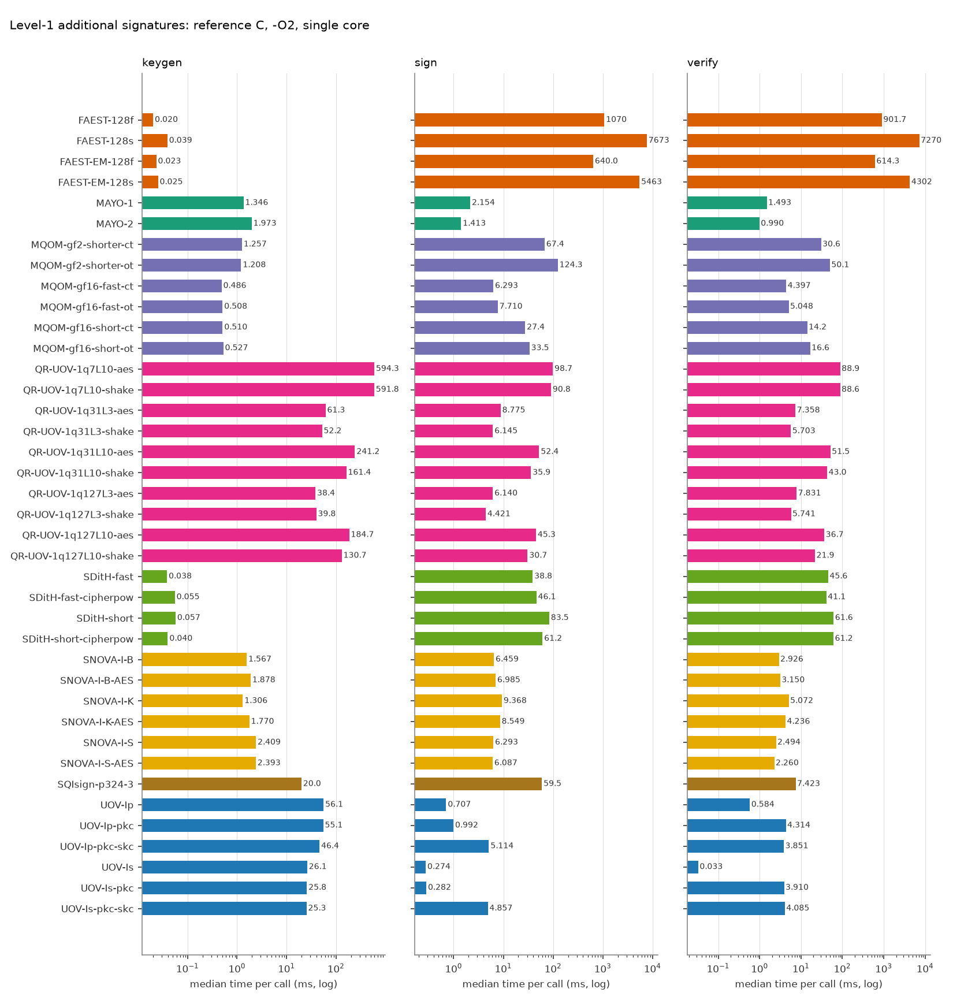
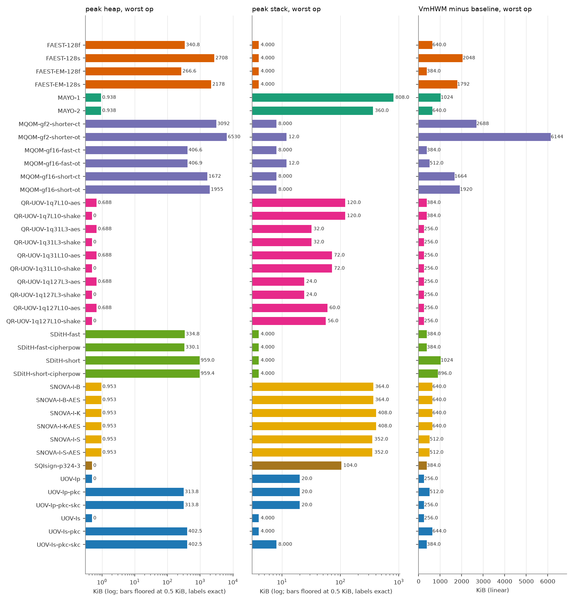
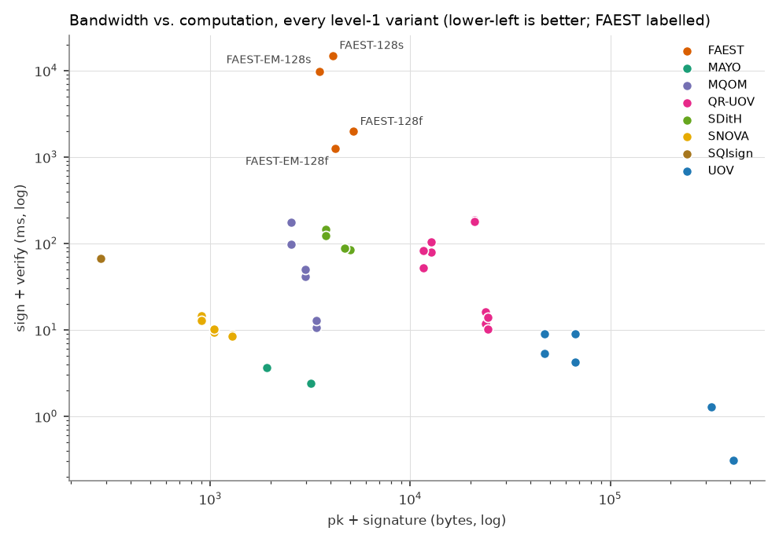

# FAEST vs. the other on-going NIST additional-signature candidates (level 1)

All numbers are produced by `tools/bench/run_bench.py` + `tools/bench/report.py` from the reference implementations in `original/Additional-DS/` (static-test folders, portable C, no SIMD/AES-NI). Regenerate with `make bench-l1`.

## Setup

| | |
|---|---|
| CPU | Intel(R) Core(TM) Ultra 7 155H |
| OS | Linux AlessandraYOGA 6.6.87.2-microsoft-standard-WSL2 #1 SMP PREEMPT_DYNAMIC Thu Jun  5 18:30:46 UTC 2025 x86_64 |
| Compiler | gcc (Ubuntu 13.3.0-6ubuntu2~24.04.1) 13.3.0, `CFLAGS=-O2 -std=gnu11 -w -Wno-psabi` (warnings suppressed), identical for every variant; the static KAT tests were built with `-std=c11` |
| Pinning | single core (CPU 2), one process per operation |
| Message | 1000 bytes (`hello world ` repeated), as in the reference paper |
| Iterations | up to 1000 per operation, within a 3.0 s budget (min 5); median reported |
| Date | 2026-10-14 17:57:45 |

Metrics: **time** = wall clock (`CLOCK_MONOTONIC`) per call; **cycles** = raw TSC ticks; **heap** = peak bytes live in `malloc/calloc/realloc` (requested size, via link-time wrapping, key/message buffers of the harness excluded); **stack** = deepest touched page of a dedicated 1 GiB mmap'ed thread stack (4 KiB granularity); **VmHWM-base** = growth of the process peak resident set during the operation, `vmhwm_kb - vmhwm_base_kb` (the raw VmHWM, in `results.csv`, also contains a 2.0-2.4 MiB baseline of libc and harness pages that depends on the operation, because the preparation thread has already run sign/verify and its freed heap stays resident; pages reused from it are not counted, so this column under-reports sign/verify of heap-heavy variants and is only indicative); **code/data/bss** = `size` of the algorithm objects only (harness excluded).

> **Note on FAEST timings.** FAEST sign/verify medians moved between two back-to-back runs by 0-22 % (FAEST-128f and -128s: second run slower by 17-22 %, while most other schemes were faster by about 25 %; FAEST-EM-128f/-128s within 6 %). The sign/verify anomalies seen in an earlier run under foreign load (EM-128f verify above sign, EM-128s verify far below sign) did not reproduce on the idle reruns: verify is at or below sign for all four variants in both runs (128s: 41.8 vs 41.8 ms in run 2). Keygen of FAEST (1.6-2.4 us) is near the timer resolution and varies by up to 45 %. Read FAEST/other ratios within about 1.5x with caution. No number has been altered.

## Key and signature sizes (bytes)

| Scheme | Variant | pk | sk | signature |
|---|---|---:|---:|---:|
| FAEST | FAEST-128f | 32 | 32 | 5170 |
| FAEST | FAEST-128s | 32 | 32 | 4066 |
| FAEST | FAEST-EM-128f | 32 | 32 | 4170 |
| FAEST | FAEST-EM-128s | 32 | 32 | 3466 |
| MAYO | MAYO-1 | 1456 | 24 | 464 |
| MAYO | MAYO-2 | 2928 | 24 | 239 |
| MQOM | MQOM-gf2-shorter-ct | 52 | 72 | 2492 |
| MQOM | MQOM-gf2-shorter-ot | 52 | 72 | 2492 |
| MQOM | MQOM-gf16-fast-ct | 64 | 96 | 3316 |
| MQOM | MQOM-gf16-fast-ot | 64 | 96 | 3316 |
| MQOM | MQOM-gf16-short-ct | 64 | 96 | 2932 |
| MQOM | MQOM-gf16-short-ot | 64 | 96 | 2932 |
| QR-UOV | QR-UOV-1q7L10-aes | 20641 | 32 | 331 |
| QR-UOV | QR-UOV-1q7L10-shake | 20641 | 32 | 331 |
| QR-UOV | QR-UOV-1q31L3-aes | 23641 | 32 | 157 |
| QR-UOV | QR-UOV-1q31L3-shake | 23641 | 32 | 157 |
| QR-UOV | QR-UOV-1q31L10-aes | 12266 | 32 | 435 |
| QR-UOV | QR-UOV-1q31L10-shake | 12266 | 32 | 435 |
| QR-UOV | QR-UOV-1q127L3-aes | 24256 | 32 | 200 |
| QR-UOV | QR-UOV-1q127L3-shake | 24256 | 32 | 200 |
| QR-UOV | QR-UOV-1q127L10-aes | 11041 | 32 | 541 |
| QR-UOV | QR-UOV-1q127L10-shake | 11041 | 32 | 541 |
| SDitH | SDitH-fast | 70 | 147 | 4914 |
| SDitH | SDitH-fast-cipherpow | 70 | 147 | 4643 |
| SDitH | SDitH-short | 70 | 147 | 3721 |
| SDitH | SDitH-short-cipherpow | 70 | 147 | 3721 |
| SNOVA | SNOVA-I-B | 656 | 96 | 388 |
| SNOVA | SNOVA-I-B-AES | 656 | 96 | 388 |
| SNOVA | SNOVA-I-K | 376 | 96 | 528 |
| SNOVA | SNOVA-I-K-AES | 376 | 96 | 528 |
| SNOVA | SNOVA-I-S | 1016 | 96 | 272 |
| SNOVA | SNOVA-I-S-AES | 1016 | 96 | 272 |
| SQIsign | SQIsign-p324-3 | 83 | 270 | 200 |
| UOV | UOV-Ip | 321300 | 278087 | 135 |
| UOV | UOV-Ip-pkc | 46591 | 278087 | 135 |
| UOV | UOV-Ip-pkc-skc | 46591 | 32 | 135 |
| UOV | UOV-Is | 412160 | 348704 | 96 |
| UOV | UOV-Is-pkc | 66576 | 348704 | 96 |
| UOV | UOV-Is-pkc-skc | 66576 | 32 | 96 |

## Run time (median, ms) and TSC cycles (millions)

| Scheme | Variant | KeyGen ms | Sign ms | Verify ms | KeyGen Mcyc | Sign Mcyc | Verify Mcyc |
|---|---|---:|---:|---:|---:|---:|---:|
| FAEST | FAEST-128f | 0.020 | 1070 | 901.7 | 0.06 | 3214.00 | 2719.15 |
| FAEST | FAEST-128s | 0.039 | 7673 | 7270 | 0.12 | 23142.66 | 21922.42 |
| FAEST | FAEST-EM-128f | 0.023 | 640.0 | 614.3 | 0.07 | 1914.99 | 1843.74 |
| FAEST | FAEST-EM-128s | 0.025 | 5463 | 4302 | 0.08 | 16490.01 | 12956.14 |
| MAYO | MAYO-1 | 1.346 | 2.154 | 1.493 | 4.06 | 6.50 | 4.51 |
| MAYO | MAYO-2 | 1.973 | 1.413 | 0.990 | 5.97 | 4.28 | 2.99 |
| MQOM | MQOM-gf2-shorter-ct | 1.257 | 67.4 | 30.6 | 3.80 | 196.65 | 90.40 |
| MQOM | MQOM-gf2-shorter-ot | 1.208 | 124.3 | 50.1 | 3.59 | 370.10 | 149.94 |
| MQOM | MQOM-gf16-fast-ct | 0.486 | 6.293 | 4.397 | 1.46 | 18.91 | 13.24 |
| MQOM | MQOM-gf16-fast-ot | 0.508 | 7.710 | 5.048 | 1.53 | 23.27 | 15.23 |
| MQOM | MQOM-gf16-short-ct | 0.510 | 27.4 | 14.2 | 1.54 | 82.78 | 42.11 |
| MQOM | MQOM-gf16-short-ot | 0.527 | 33.5 | 16.6 | 1.54 | 98.63 | 49.55 |
| QR-UOV | QR-UOV-1q7L10-aes | 594.3 | 98.7 | 88.9 | 1775.77 | 296.25 | 267.95 |
| QR-UOV | QR-UOV-1q7L10-shake | 591.8 | 90.8 | 88.6 | 1784.60 | 273.96 | 267.45 |
| QR-UOV | QR-UOV-1q31L3-aes | 61.3 | 8.775 | 7.358 | 185.14 | 25.78 | 21.85 |
| QR-UOV | QR-UOV-1q31L3-shake | 52.2 | 6.145 | 5.703 | 156.08 | 18.44 | 17.14 |
| QR-UOV | QR-UOV-1q31L10-aes | 241.2 | 52.4 | 51.5 | 726.98 | 158.08 | 155.46 |
| QR-UOV | QR-UOV-1q31L10-shake | 161.4 | 35.9 | 43.0 | 487.42 | 107.64 | 126.77 |
| QR-UOV | QR-UOV-1q127L3-aes | 38.4 | 6.140 | 7.831 | 114.27 | 18.34 | 23.52 |
| QR-UOV | QR-UOV-1q127L3-shake | 39.8 | 4.421 | 5.741 | 120.10 | 13.36 | 17.32 |
| QR-UOV | QR-UOV-1q127L10-aes | 184.7 | 45.3 | 36.7 | 557.23 | 136.61 | 107.23 |
| QR-UOV | QR-UOV-1q127L10-shake | 130.7 | 30.7 | 21.9 | 385.91 | 90.99 | 65.30 |
| SDitH | SDitH-fast | 0.038 | 38.8 | 45.6 | 0.12 | 116.61 | 137.39 |
| SDitH | SDitH-fast-cipherpow | 0.055 | 46.1 | 41.1 | 0.17 | 139.15 | 124.24 |
| SDitH | SDitH-short | 0.057 | 83.5 | 61.6 | 0.17 | 252.31 | 186.00 |
| SDitH | SDitH-short-cipherpow | 0.040 | 61.2 | 61.2 | 0.12 | 184.75 | 184.73 |
| SNOVA | SNOVA-I-B | 1.567 | 6.459 | 2.926 | 4.73 | 19.39 | 8.78 |
| SNOVA | SNOVA-I-B-AES | 1.878 | 6.985 | 3.150 | 5.67 | 20.75 | 9.16 |
| SNOVA | SNOVA-I-K | 1.306 | 9.368 | 5.072 | 3.83 | 27.78 | 15.13 |
| SNOVA | SNOVA-I-K-AES | 1.770 | 8.549 | 4.236 | 5.30 | 25.67 | 12.73 |
| SNOVA | SNOVA-I-S | 2.409 | 6.293 | 2.494 | 7.25 | 18.97 | 7.52 |
| SNOVA | SNOVA-I-S-AES | 2.393 | 6.087 | 2.260 | 7.22 | 18.04 | 6.64 |
| SQIsign | SQIsign-p324-3 | 20.0 | 59.5 | 7.423 | 59.41 | 177.53 | 22.24 |
| UOV | UOV-Ip | 56.1 | 0.707 | 0.584 | 168.46 | 2.13 | 1.76 |
| UOV | UOV-Ip-pkc | 55.1 | 0.992 | 4.314 | 165.98 | 2.99 | 13.02 |
| UOV | UOV-Ip-pkc-skc | 46.4 | 5.114 | 3.851 | 139.94 | 15.44 | 11.54 |
| UOV | UOV-Is | 26.1 | 0.274 | 0.033 | 76.98 | 0.81 | 0.10 |
| UOV | UOV-Is-pkc | 25.8 | 0.282 | 3.910 | 76.59 | 0.84 | 11.69 |
| UOV | UOV-Is-pkc-skc | 25.3 | 4.857 | 4.085 | 75.71 | 14.60 | 12.30 |

## Memory (KiB)

| Scheme | Variant | heap KG/S/V | stack KG/S/V | VmHWM-base KG/S/V | code | data+bss |
|---|---|---|---|---|---:|---:|
| FAEST | FAEST-128f | 0.0 / 340.8 / 163.5 | 0.0 / 4.0 / 4.0 | 256 / 640 / 384 | 583.6 | 1.2 |
| FAEST | FAEST-128s | 0.0 / 2708.0 / 1101.8 | 0.0 / 4.0 / 4.0 | 384 / 2048 / 512 | 583.6 | 1.2 |
| FAEST | FAEST-EM-128f | 0.0 / 266.6 / 135.8 | 0.0 / 4.0 / 4.0 | 256 / 384 / 384 | 583.6 | 1.2 |
| FAEST | FAEST-EM-128s | 0.0 / 2178.1 / 1089.3 | 0.0 / 4.0 / 4.0 | 256 / 1792 / 768 | 583.6 | 1.2 |
| MAYO | MAYO-1 | 0.9 / 0.9 / 0.7 | 156.0 / 236.0 / 808.0 | 384 / 512 / 1024 | 40.4 | 0.1 |
| MAYO | MAYO-2 | 0.9 / 0.9 / 0.7 | 124.0 / 152.0 / 360.0 | 384 / 384 / 640 | 40.4 | 0.1 |
| MQOM | MQOM-gf2-shorter-ct | 528.6 / 3091.8 / 704.6 | 0.0 / 8.0 / 8.0 | 640 / 2688 / 256 | 529.0 | 0.4 |
| MQOM | MQOM-gf2-shorter-ot | 528.6 / 6530.4 / 5152.6 | 0.0 / 12.0 / 8.0 | 640 / 6144 / 4736 | 546.5 | 0.4 |
| MQOM | MQOM-gf16-fast-ct | 132.1 / 406.6 / 132.1 | 0.0 / 8.0 / 8.0 | 384 / 256 / 0 | 512.2 | 0.3 |
| MQOM | MQOM-gf16-fast-ot | 132.1 / 406.9 / 249.1 | 0.0 / 12.0 / 8.0 | 512 / 384 / 256 | 530.1 | 0.4 |
| MQOM | MQOM-gf16-short-ct | 134.2 / 1672.5 / 352.6 | 0.0 / 8.0 / 4.0 | 512 / 1664 / 256 | 526.9 | 0.3 |
| MQOM | MQOM-gf16-short-ot | 134.2 / 1954.5 / 1488.6 | 0.0 / 8.0 / 4.0 | 512 / 1920 / 1408 | 545.9 | 0.4 |
| QR-UOV | QR-UOV-1q7L10-aes | 0.7 / 0.7 / 0.7 | 112.0 / 120.0 / 100.0 | 256 / 384 / 256 | 38.1 | 0.1 |
| QR-UOV | QR-UOV-1q7L10-shake | 0.0 / 0.0 / 0.0 | 112.0 / 120.0 / 100.0 | 256 / 384 / 256 | 38.3 | 0.1 |
| QR-UOV | QR-UOV-1q31L3-aes | 0.7 / 0.7 / 0.7 | 32.0 / 28.0 / 24.0 | 256 / 256 / 256 | 38.3 | 0.1 |
| QR-UOV | QR-UOV-1q31L3-shake | 0.0 / 0.0 / 0.0 | 32.0 / 28.0 / 24.0 | 256 / 256 / 256 | 38.4 | 0.1 |
| QR-UOV | QR-UOV-1q31L10-aes | 0.7 / 0.7 / 0.7 | 68.0 / 72.0 / 64.0 | 256 / 256 / 256 | 38.0 | 0.1 |
| QR-UOV | QR-UOV-1q31L10-shake | 0.0 / 0.0 / 0.0 | 68.0 / 72.0 / 64.0 | 256 / 256 / 256 | 38.1 | 0.1 |
| QR-UOV | QR-UOV-1q127L3-aes | 0.7 / 0.7 / 0.7 | 24.0 / 24.0 / 20.0 | 256 / 256 / 256 | 38.1 | 0.1 |
| QR-UOV | QR-UOV-1q127L3-shake | 0.0 / 0.0 / 0.0 | 24.0 / 24.0 / 20.0 | 256 / 256 / 256 | 38.2 | 0.1 |
| QR-UOV | QR-UOV-1q127L10-aes | 0.7 / 0.7 / 0.7 | 56.0 / 60.0 / 52.0 | 256 / 256 / 256 | 38.3 | 0.1 |
| QR-UOV | QR-UOV-1q127L10-shake | 0.0 / 0.0 / 0.0 | 56.0 / 56.0 / 48.0 | 256 / 256 / 256 | 38.4 | 0.1 |
| SDitH | SDitH-fast | 0.4 / 334.8 / 328.5 | 0.0 / 4.0 / 4.0 | 384 / 384 / 384 | 190.7 | 0.1 |
| SDitH | SDitH-fast-cipherpow | 0.4 / 330.1 / 323.7 | 0.0 / 4.0 / 4.0 | 256 / 384 / 384 | 190.7 | 0.1 |
| SDitH | SDitH-short | 0.4 / 959.0 / 952.7 | 0.0 / 4.0 / 4.0 | 384 / 1024 / 1024 | 190.7 | 0.1 |
| SDitH | SDitH-short-cipherpow | 0.4 / 959.4 / 953.1 | 0.0 / 4.0 / 4.0 | 256 / 896 / 896 | 190.7 | 0.1 |
| SNOVA | SNOVA-I-B | 1.0 / 1.0 / 0.0 | 132.0 / 364.0 / 280.0 | 384 / 640 / 512 | 33.2 | 10.2 |
| SNOVA | SNOVA-I-B-AES | 1.0 / 1.0 / 0.7 | 132.0 / 364.0 / 280.0 | 384 / 640 / 512 | 31.7 | 10.2 |
| SNOVA | SNOVA-I-K | 1.0 / 1.0 / 0.0 | 144.0 / 408.0 / 360.0 | 384 / 640 / 640 | 32.9 | 15.3 |
| SNOVA | SNOVA-I-K-AES | 1.0 / 1.0 / 0.7 | 144.0 / 408.0 / 360.0 | 384 / 640 / 512 | 31.4 | 15.3 |
| SNOVA | SNOVA-I-S | 1.0 / 1.0 / 0.0 | 136.0 / 352.0 / 288.0 | 384 / 512 / 512 | 32.8 | 5.3 |
| SNOVA | SNOVA-I-S-AES | 1.0 / 1.0 / 0.7 | 136.0 / 352.0 / 288.0 | 384 / 512 / 512 | 31.3 | 5.3 |
| SQIsign | SQIsign-p324-3 | 0.0 / 0.0 / 0.0 | 56.0 / 104.0 / 40.0 | 384 / 256 / 128 | 250.9 | 0.4 |
| UOV | UOV-Ip | 0.0 / 0.0 / 0.0 | 20.0 / 12.0 / 4.0 | 256 / 256 / 256 | 41.6 | 0.1 |
| UOV | UOV-Ip-pkc | 0.0 / 0.0 / 313.8 | 20.0 / 12.0 / 4.0 | 256 / 256 / 512 | 41.8 | 0.1 |
| UOV | UOV-Ip-pkc-skc | 271.6 / 271.6 / 313.8 | 20.0 / 20.0 / 4.0 | 256 / 0 / 256 | 44.0 | 0.1 |
| UOV | UOV-Is | 0.0 / 0.0 / 0.0 | 4.0 / 4.0 / 0.0 | 256 / 256 / 256 | 37.1 | 0.1 |
| UOV | UOV-Is-pkc | 0.0 / 0.0 / 402.5 | 4.0 / 4.0 / 0.0 | 256 / 256 / 644 | 37.3 | 0.1 |
| UOV | UOV-Is-pkc-skc | 340.5 / 340.5 / 402.5 | 4.0 / 8.0 / 0.0 | 256 / 0 / 384 | 38.1 | 0.1 |

Stack legend: values of 0, 4 and 8 KiB are page-granularity floors (read them as "<= 4 KiB", "<= 8 KiB"), not measurements; the stack is the touched pages of the thread stack minus an empty thread.

## FAEST against the best variant of every other family

Fastest FAEST variant per operation vs. fastest variant of each other scheme (ratio > 1: FAEST slower).

| Scheme | best KeyGen | best Sign | best Verify | smallest pk+sig |
|---|---|---|---|---|
| MAYO | MAYO-1 (1.346 ms): x0.0149 | MAYO-2 (1.413 ms): x452.8 | MAYO-2 (0.990 ms): x620.7 | MAYO-1 (1920 B): x1.8 |
| MQOM | MQOM-gf16-fast-ct (0.486 ms): x0.0413 | MQOM-gf16-fast-ct (6.293 ms): x101.7 | MQOM-gf16-fast-ct (4.397 ms): x139.7 | MQOM-gf2-shorter-ct (2544 B): x1.4 |
| QR-UOV | QR-UOV-1q127L3-aes (38.4 ms): x0.000524 | QR-UOV-1q127L3-shake (4.421 ms): x144.8 | QR-UOV-1q31L3-shake (5.703 ms): x107.7 | QR-UOV-1q127L10-aes (11.6 K B): x0.3 |
| SDitH | SDitH-fast (0.038 ms): x0.524 | SDitH-fast (38.8 ms): x16.5 | SDitH-fast-cipherpow (41.1 ms): x14.9 | SDitH-short (3791 B): x0.9 |
| SNOVA | SNOVA-I-K (1.306 ms): x0.0154 | SNOVA-I-S-AES (6.087 ms): x105.1 | SNOVA-I-S-AES (2.260 ms): x271.8 | SNOVA-I-K (904 B): x3.9 |
| SQIsign | SQIsign-p324-3 (20.0 ms): x0.001 | SQIsign-p324-3 (59.5 ms): x10.8 | SQIsign-p324-3 (7.423 ms): x82.8 | SQIsign-p324-3 (283 B): x12.4 |
| UOV | UOV-Is-pkc-skc (25.3 ms): x0.000796 | UOV-Is (0.274 ms): x2331.7 | UOV-Is (0.033 ms): x18684.1 | UOV-Ip-pkc (46.7 K B): x0.1 |

FAEST reference points: FAEST-128f keygen 0.020 ms, FAEST-EM-128f sign 640.0 ms, FAEST-EM-128f verify 614.3 ms; smallest pk+sig FAEST-EM-128s (3498 B).

## Caveats

- Portable *reference* C for every scheme; schemes whose submission relies on AVX2/AES-NI/GFNI ship considerably faster optimized packages (not measured here), so absolute numbers are not comparable with optimized-implementation papers; the comparison among them is like-for-like.
- Cycles are TSC ticks of an x86 laptop CPU under WSL2, shown for relative comparison only.
- Stack figures have 4 KiB granularity; heap counts requested bytes only.
- Level 1 only (the lowest NIST category); variants per scheme are all Round-3 level-1 parameter sets that build in this tree. KAT status differs by family: MAYO, SNOVA, MQOM, SDitH and SQIsign match the official KAT record #0; UOV, QR-UOV (16 of the 39 variants) matched only the package's own generator on records 0-1 (no official KAT available offline); FAEST is the round-3 (v3) port (FAEST-R3) and matches the official v3 KAT on 100 records.
