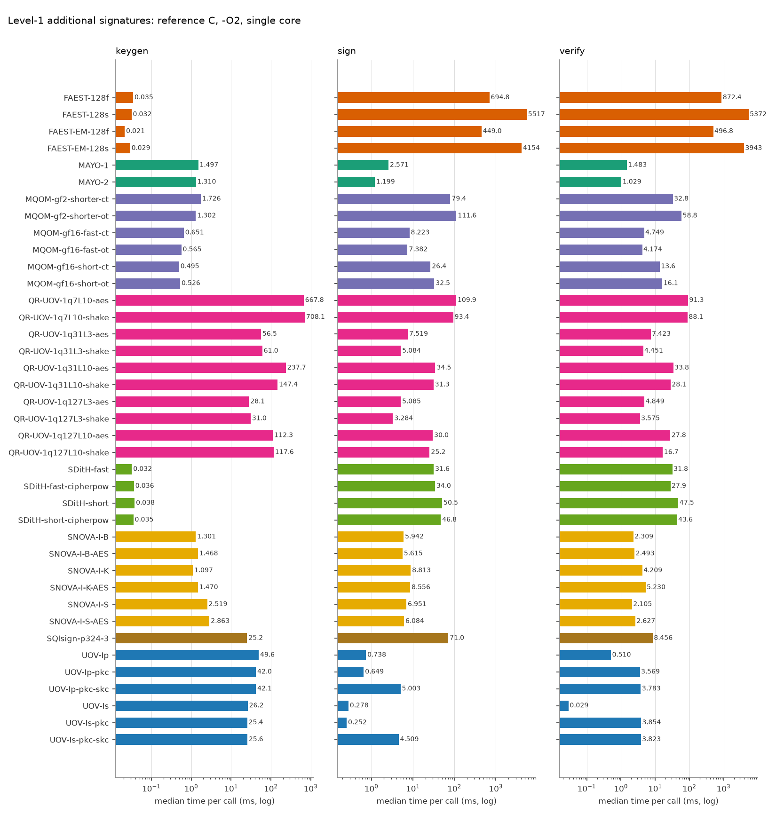
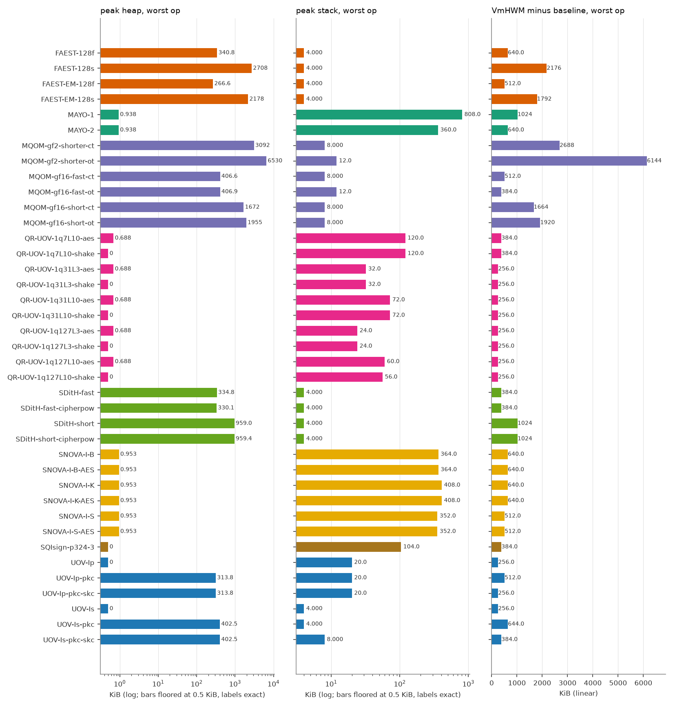
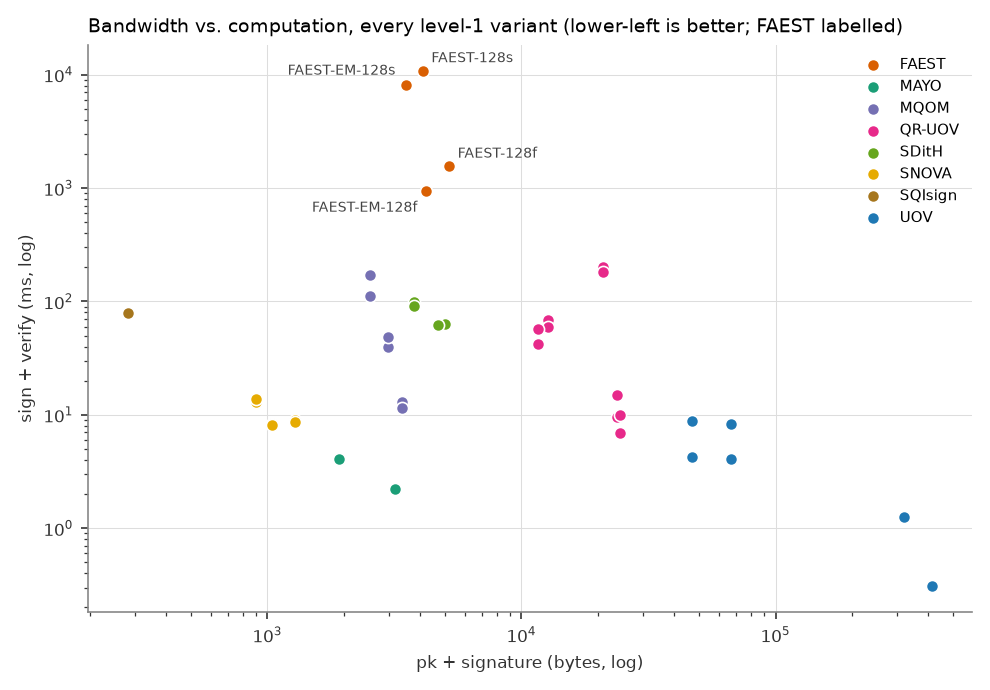

# FAEST vs. the other on-going NIST additional-signature candidates (level 1)

All numbers are produced by `tools/bench/run_bench.py` + `tools/bench/report.py` from the reference implementations in `original/Additional-DS/` (static-test folders, portable C, no SIMD/AES-NI). Regenerate with `make bench-l1`.

## Setup

| | |
|---|---|
| CPU | Intel(R) Core(TM) Ultra 7 155H |
| OS | Linux AlessandraYOGA 6.6.87.2-microsoft-standard-WSL2 #1 SMP PREEMPT_DYNAMIC Thu Jun  5 18:30:46 UTC 2025 x86_64 |
| Compiler | gcc (Ubuntu 13.3.0-6ubuntu2~24.04.1) 13.3.0, `CFLAGS=-O2 -std=gnu11 -w -Wno-psabi` (warnings suppressed), identical for every variant; the static KAT tests were built with `-std=c11` |
| Pinning | single core (CPU 2), one process per operation |
| Message | 1000 bytes (`hello world ` repeated), as in the reference paper |
| Iterations | up to 1000 per operation, within a 3.0 s budget (min 5); median reported |
| Date | 2026-10-14 18:08:26 |

Metrics: **time** = wall clock (`CLOCK_MONOTONIC`) per call; **cycles** = raw TSC ticks; **heap** = peak bytes live in `malloc/calloc/realloc` (requested size, via link-time wrapping, key/message buffers of the harness excluded); **stack** = deepest touched page of a dedicated 1 GiB mmap'ed thread stack (4 KiB granularity); **VmHWM-base** = growth of the process peak resident set during the operation, `vmhwm_kb - vmhwm_base_kb` (the raw VmHWM, in `results.csv`, also contains a 2.0-2.4 MiB baseline of libc and harness pages that depends on the operation, because the preparation thread has already run sign/verify and its freed heap stays resident; pages reused from it are not counted, so this column under-reports sign/verify of heap-heavy variants and is only indicative); **code/data/bss** = `size` of the algorithm objects only (harness excluded).

> **Note on FAEST timings.** FAEST sign/verify medians moved between two back-to-back runs by 0-22 % (FAEST-128f and -128s: second run slower by 17-22 %, while most other schemes were faster by about 25 %; FAEST-EM-128f/-128s within 6 %). The sign/verify anomalies seen in an earlier run under foreign load (EM-128f verify above sign, EM-128s verify far below sign) did not reproduce on the idle reruns: verify is at or below sign for all four variants in both runs (128s: 41.8 vs 41.8 ms in run 2). Keygen of FAEST (1.6-2.4 us) is near the timer resolution and varies by up to 45 %. Read FAEST/other ratios within about 1.5x with caution. No number has been altered.

## Key and signature sizes (bytes)

| Scheme | Variant | pk | sk | signature |
|---|---|---:|---:|---:|
| FAEST | FAEST-128f | 32 | 32 | 5170 |
| FAEST | FAEST-128s | 32 | 32 | 4066 |
| FAEST | FAEST-EM-128f | 32 | 32 | 4170 |
| FAEST | FAEST-EM-128s | 32 | 32 | 3466 |
| MAYO | MAYO-1 | 1456 | 24 | 464 |
| MAYO | MAYO-2 | 2928 | 24 | 239 |
| MQOM | MQOM-gf2-shorter-ct | 52 | 72 | 2492 |
| MQOM | MQOM-gf2-shorter-ot | 52 | 72 | 2492 |
| MQOM | MQOM-gf16-fast-ct | 64 | 96 | 3316 |
| MQOM | MQOM-gf16-fast-ot | 64 | 96 | 3316 |
| MQOM | MQOM-gf16-short-ct | 64 | 96 | 2932 |
| MQOM | MQOM-gf16-short-ot | 64 | 96 | 2932 |
| QR-UOV | QR-UOV-1q7L10-aes | 20641 | 32 | 331 |
| QR-UOV | QR-UOV-1q7L10-shake | 20641 | 32 | 331 |
| QR-UOV | QR-UOV-1q31L3-aes | 23641 | 32 | 157 |
| QR-UOV | QR-UOV-1q31L3-shake | 23641 | 32 | 157 |
| QR-UOV | QR-UOV-1q31L10-aes | 12266 | 32 | 435 |
| QR-UOV | QR-UOV-1q31L10-shake | 12266 | 32 | 435 |
| QR-UOV | QR-UOV-1q127L3-aes | 24256 | 32 | 200 |
| QR-UOV | QR-UOV-1q127L3-shake | 24256 | 32 | 200 |
| QR-UOV | QR-UOV-1q127L10-aes | 11041 | 32 | 541 |
| QR-UOV | QR-UOV-1q127L10-shake | 11041 | 32 | 541 |
| SDitH | SDitH-fast | 70 | 147 | 4914 |
| SDitH | SDitH-fast-cipherpow | 70 | 147 | 4643 |
| SDitH | SDitH-short | 70 | 147 | 3721 |
| SDitH | SDitH-short-cipherpow | 70 | 147 | 3721 |
| SNOVA | SNOVA-I-B | 656 | 96 | 388 |
| SNOVA | SNOVA-I-B-AES | 656 | 96 | 388 |
| SNOVA | SNOVA-I-K | 376 | 96 | 528 |
| SNOVA | SNOVA-I-K-AES | 376 | 96 | 528 |
| SNOVA | SNOVA-I-S | 1016 | 96 | 272 |
| SNOVA | SNOVA-I-S-AES | 1016 | 96 | 272 |
| SQIsign | SQIsign-p324-3 | 83 | 270 | 200 |
| UOV | UOV-Ip | 321300 | 278087 | 135 |
| UOV | UOV-Ip-pkc | 46591 | 278087 | 135 |
| UOV | UOV-Ip-pkc-skc | 46591 | 32 | 135 |
| UOV | UOV-Is | 412160 | 348704 | 96 |
| UOV | UOV-Is-pkc | 66576 | 348704 | 96 |
| UOV | UOV-Is-pkc-skc | 66576 | 32 | 96 |

## Run time (median, ms) and TSC cycles (millions)

| Scheme | Variant | KeyGen ms | Sign ms | Verify ms | KeyGen Mcyc | Sign Mcyc | Verify Mcyc |
|---|---|---:|---:|---:|---:|---:|---:|
| FAEST | FAEST-128f | 0.035 | 694.8 | 872.4 | 0.10 | 2088.78 | 2629.00 |
| FAEST | FAEST-128s | 0.032 | 5517 | 5372 | 0.10 | 16637.87 | 16048.63 |
| FAEST | FAEST-EM-128f | 0.021 | 449.0 | 496.8 | 0.06 | 1345.28 | 1492.40 |
| FAEST | FAEST-EM-128s | 0.029 | 4154 | 3943 | 0.09 | 12454.74 | 11782.30 |
| MAYO | MAYO-1 | 1.497 | 2.571 | 1.483 | 4.48 | 7.71 | 4.46 |
| MAYO | MAYO-2 | 1.310 | 1.199 | 1.029 | 3.94 | 3.61 | 3.10 |
| MQOM | MQOM-gf2-shorter-ct | 1.726 | 79.4 | 32.8 | 5.20 | 239.52 | 98.94 |
| MQOM | MQOM-gf2-shorter-ot | 1.302 | 111.6 | 58.8 | 3.93 | 337.18 | 173.36 |
| MQOM | MQOM-gf16-fast-ct | 0.651 | 8.223 | 4.749 | 1.91 | 24.27 | 14.13 |
| MQOM | MQOM-gf16-fast-ot | 0.565 | 7.382 | 4.174 | 1.69 | 22.08 | 12.53 |
| MQOM | MQOM-gf16-short-ct | 0.495 | 26.4 | 13.6 | 1.49 | 79.55 | 40.90 |
| MQOM | MQOM-gf16-short-ot | 0.526 | 32.5 | 16.1 | 1.59 | 98.09 | 48.73 |
| QR-UOV | QR-UOV-1q7L10-aes | 667.8 | 109.9 | 91.3 | 2016.57 | 324.90 | 271.39 |
| QR-UOV | QR-UOV-1q7L10-shake | 708.1 | 93.4 | 88.1 | 2123.72 | 280.75 | 265.91 |
| QR-UOV | QR-UOV-1q31L3-aes | 56.5 | 7.519 | 7.423 | 170.57 | 22.70 | 22.41 |
| QR-UOV | QR-UOV-1q31L3-shake | 61.0 | 5.084 | 4.451 | 180.80 | 14.94 | 13.20 |
| QR-UOV | QR-UOV-1q31L10-aes | 237.7 | 34.5 | 33.8 | 711.03 | 103.44 | 101.60 |
| QR-UOV | QR-UOV-1q31L10-shake | 147.4 | 31.3 | 28.1 | 443.97 | 94.49 | 84.93 |
| QR-UOV | QR-UOV-1q127L3-aes | 28.1 | 5.085 | 4.849 | 84.77 | 15.36 | 14.65 |
| QR-UOV | QR-UOV-1q127L3-shake | 31.0 | 3.284 | 3.575 | 93.74 | 9.92 | 10.80 |
| QR-UOV | QR-UOV-1q127L10-aes | 112.3 | 30.0 | 27.8 | 338.72 | 90.46 | 83.97 |
| QR-UOV | QR-UOV-1q127L10-shake | 117.6 | 25.2 | 16.7 | 357.14 | 76.52 | 50.39 |
| SDitH | SDitH-fast | 0.032 | 31.6 | 31.8 | 0.10 | 95.44 | 96.00 |
| SDitH | SDitH-fast-cipherpow | 0.036 | 34.0 | 27.9 | 0.11 | 102.85 | 84.24 |
| SDitH | SDitH-short | 0.038 | 50.5 | 47.5 | 0.11 | 149.43 | 139.10 |
| SDitH | SDitH-short-cipherpow | 0.035 | 46.8 | 43.6 | 0.10 | 138.76 | 130.17 |
| SNOVA | SNOVA-I-B | 1.301 | 5.942 | 2.309 | 3.89 | 17.82 | 6.94 |
| SNOVA | SNOVA-I-B-AES | 1.468 | 5.615 | 2.493 | 4.42 | 16.91 | 7.52 |
| SNOVA | SNOVA-I-K | 1.097 | 8.813 | 4.209 | 3.31 | 26.59 | 12.71 |
| SNOVA | SNOVA-I-K-AES | 1.470 | 8.556 | 5.230 | 4.44 | 25.15 | 15.46 |
| SNOVA | SNOVA-I-S | 2.519 | 6.951 | 2.105 | 7.50 | 20.78 | 6.31 |
| SNOVA | SNOVA-I-S-AES | 2.863 | 6.084 | 2.627 | 8.61 | 18.33 | 7.92 |
| SQIsign | SQIsign-p324-3 | 25.2 | 71.0 | 8.456 | 76.18 | 214.59 | 25.16 |
| UOV | UOV-Ip | 49.6 | 0.738 | 0.510 | 146.23 | 2.18 | 1.51 |
| UOV | UOV-Ip-pkc | 42.0 | 0.649 | 3.569 | 125.21 | 1.94 | 10.68 |
| UOV | UOV-Ip-pkc-skc | 42.1 | 5.003 | 3.783 | 126.38 | 15.06 | 11.41 |
| UOV | UOV-Is | 26.2 | 0.278 | 0.029 | 78.98 | 0.84 | 0.09 |
| UOV | UOV-Is-pkc | 25.4 | 0.252 | 3.854 | 76.81 | 0.76 | 11.64 |
| UOV | UOV-Is-pkc-skc | 25.6 | 4.509 | 3.823 | 75.87 | 13.29 | 11.35 |

## Memory (KiB)

| Scheme | Variant | heap KG/S/V | stack KG/S/V | VmHWM-base KG/S/V | code | data+bss |
|---|---|---|---|---|---:|---:|
| FAEST | FAEST-128f | 0.0 / 340.8 / 163.5 | 0.0 / 4.0 / 4.0 | 256 / 640 / 384 | 583.6 | 1.2 |
| FAEST | FAEST-128s | 0.0 / 2708.0 / 1101.8 | 0.0 / 4.0 / 4.0 | 256 / 2176 / 512 | 583.6 | 1.2 |
| FAEST | FAEST-EM-128f | 0.0 / 266.6 / 135.8 | 0.0 / 4.0 / 4.0 | 256 / 512 / 256 | 583.6 | 1.2 |
| FAEST | FAEST-EM-128s | 0.0 / 2178.1 / 1089.3 | 0.0 / 4.0 / 4.0 | 256 / 1792 / 640 | 583.6 | 1.2 |
| MAYO | MAYO-1 | 0.9 / 0.9 / 0.7 | 156.0 / 236.0 / 808.0 | 384 / 512 / 1024 | 40.4 | 0.1 |
| MAYO | MAYO-2 | 0.9 / 0.9 / 0.7 | 124.0 / 152.0 / 360.0 | 384 / 384 / 640 | 40.4 | 0.1 |
| MQOM | MQOM-gf2-shorter-ct | 528.6 / 3091.8 / 704.6 | 0.0 / 8.0 / 8.0 | 640 / 2688 / 256 | 529.0 | 0.4 |
| MQOM | MQOM-gf2-shorter-ot | 528.6 / 6530.4 / 5152.6 | 0.0 / 12.0 / 8.0 | 640 / 6144 / 4608 | 546.5 | 0.4 |
| MQOM | MQOM-gf16-fast-ct | 132.1 / 406.6 / 132.1 | 0.0 / 8.0 / 8.0 | 512 / 384 / 0 | 512.2 | 0.3 |
| MQOM | MQOM-gf16-fast-ot | 132.1 / 406.9 / 249.1 | 0.0 / 12.0 / 8.0 | 384 / 384 / 128 | 530.1 | 0.4 |
| MQOM | MQOM-gf16-short-ct | 134.2 / 1672.5 / 352.6 | 0.0 / 8.0 / 4.0 | 384 / 1664 / 256 | 526.9 | 0.3 |
| MQOM | MQOM-gf16-short-ot | 134.2 / 1954.5 / 1488.6 | 0.0 / 8.0 / 4.0 | 384 / 1920 / 1408 | 545.9 | 0.4 |
| QR-UOV | QR-UOV-1q7L10-aes | 0.7 / 0.7 / 0.7 | 112.0 / 120.0 / 100.0 | 256 / 384 / 256 | 38.1 | 0.1 |
| QR-UOV | QR-UOV-1q7L10-shake | 0.0 / 0.0 / 0.0 | 112.0 / 120.0 / 100.0 | 256 / 384 / 256 | 38.3 | 0.1 |
| QR-UOV | QR-UOV-1q31L3-aes | 0.7 / 0.7 / 0.7 | 32.0 / 28.0 / 24.0 | 256 / 256 / 256 | 38.3 | 0.1 |
| QR-UOV | QR-UOV-1q31L3-shake | 0.0 / 0.0 / 0.0 | 32.0 / 28.0 / 24.0 | 256 / 256 / 256 | 38.4 | 0.1 |
| QR-UOV | QR-UOV-1q31L10-aes | 0.7 / 0.7 / 0.7 | 68.0 / 72.0 / 64.0 | 256 / 256 / 256 | 38.0 | 0.1 |
| QR-UOV | QR-UOV-1q31L10-shake | 0.0 / 0.0 / 0.0 | 68.0 / 72.0 / 64.0 | 256 / 256 / 256 | 38.1 | 0.1 |
| QR-UOV | QR-UOV-1q127L3-aes | 0.7 / 0.7 / 0.7 | 24.0 / 24.0 / 20.0 | 256 / 256 / 256 | 38.1 | 0.1 |
| QR-UOV | QR-UOV-1q127L3-shake | 0.0 / 0.0 / 0.0 | 24.0 / 24.0 / 20.0 | 256 / 256 / 256 | 38.2 | 0.1 |
| QR-UOV | QR-UOV-1q127L10-aes | 0.7 / 0.7 / 0.7 | 56.0 / 60.0 / 52.0 | 256 / 256 / 256 | 38.3 | 0.1 |
| QR-UOV | QR-UOV-1q127L10-shake | 0.0 / 0.0 / 0.0 | 56.0 / 56.0 / 48.0 | 256 / 256 / 256 | 38.4 | 0.1 |
| SDitH | SDitH-fast | 0.4 / 334.8 / 328.5 | 0.0 / 4.0 / 4.0 | 384 / 384 / 256 | 190.7 | 0.1 |
| SDitH | SDitH-fast-cipherpow | 0.4 / 330.1 / 323.7 | 0.0 / 4.0 / 4.0 | 384 / 384 / 384 | 190.7 | 0.1 |
| SDitH | SDitH-short | 0.4 / 959.0 / 952.7 | 0.0 / 4.0 / 4.0 | 384 / 1024 / 1024 | 190.7 | 0.1 |
| SDitH | SDitH-short-cipherpow | 0.4 / 959.4 / 953.1 | 0.0 / 4.0 / 4.0 | 384 / 1024 / 1024 | 190.7 | 0.1 |
| SNOVA | SNOVA-I-B | 1.0 / 1.0 / 0.0 | 132.0 / 364.0 / 280.0 | 384 / 640 / 512 | 33.2 | 10.2 |
| SNOVA | SNOVA-I-B-AES | 1.0 / 1.0 / 0.7 | 132.0 / 364.0 / 280.0 | 384 / 640 / 512 | 31.7 | 10.2 |
| SNOVA | SNOVA-I-K | 1.0 / 1.0 / 0.0 | 144.0 / 408.0 / 360.0 | 384 / 640 / 640 | 32.9 | 15.3 |
| SNOVA | SNOVA-I-K-AES | 1.0 / 1.0 / 0.7 | 144.0 / 408.0 / 360.0 | 384 / 640 / 512 | 31.4 | 15.3 |
| SNOVA | SNOVA-I-S | 1.0 / 1.0 / 0.0 | 136.0 / 352.0 / 288.0 | 384 / 512 / 512 | 32.8 | 5.3 |
| SNOVA | SNOVA-I-S-AES | 1.0 / 1.0 / 0.7 | 136.0 / 352.0 / 288.0 | 384 / 512 / 512 | 31.3 | 5.3 |
| SQIsign | SQIsign-p324-3 | 0.0 / 0.0 / 0.0 | 56.0 / 104.0 / 40.0 | 384 / 384 / 256 | 250.9 | 0.4 |
| UOV | UOV-Ip | 0.0 / 0.0 / 0.0 | 20.0 / 12.0 / 4.0 | 256 / 256 / 256 | 41.6 | 0.1 |
| UOV | UOV-Ip-pkc | 0.0 / 0.0 / 313.8 | 20.0 / 12.0 / 4.0 | 256 / 256 / 512 | 41.8 | 0.1 |
| UOV | UOV-Ip-pkc-skc | 271.6 / 271.6 / 313.8 | 20.0 / 20.0 / 4.0 | 256 / 0 / 256 | 44.0 | 0.1 |
| UOV | UOV-Is | 0.0 / 0.0 / 0.0 | 4.0 / 4.0 / 0.0 | 256 / 256 / 256 | 37.1 | 0.1 |
| UOV | UOV-Is-pkc | 0.0 / 0.0 / 402.5 | 4.0 / 4.0 / 0.0 | 256 / 256 / 644 | 37.3 | 0.1 |
| UOV | UOV-Is-pkc-skc | 340.5 / 340.5 / 402.5 | 4.0 / 8.0 / 0.0 | 256 / 0 / 384 | 38.1 | 0.1 |

Stack legend: values of 0, 4 and 8 KiB are page-granularity floors (read them as "<= 4 KiB", "<= 8 KiB"), not measurements; the stack is the touched pages of the thread stack minus an empty thread.

## FAEST against the best variant of every other family

Fastest FAEST variant per operation vs. fastest variant of each other scheme (ratio > 1: FAEST slower).

| Scheme | best KeyGen | best Sign | best Verify | smallest pk+sig |
|---|---|---|---|---|
| MAYO | MAYO-2 (1.310 ms): x0.0162 | MAYO-2 (1.199 ms): x374.4 | MAYO-2 (1.029 ms): x482.9 | MAYO-1 (1920 B): x1.8 |
| MQOM | MQOM-gf16-short-ct (0.495 ms): x0.043 | MQOM-gf16-fast-ot (7.382 ms): x60.8 | MQOM-gf16-fast-ot (4.174 ms): x119.0 | MQOM-gf2-shorter-ct (2544 B): x1.4 |
| QR-UOV | QR-UOV-1q127L3-aes (28.1 ms): x0.000758 | QR-UOV-1q127L3-shake (3.284 ms): x136.7 | QR-UOV-1q127L3-shake (3.575 ms): x139.0 | QR-UOV-1q127L10-aes (11.6 K B): x0.3 |
| SDitH | SDitH-fast (0.032 ms): x0.661 | SDitH-fast (31.6 ms): x14.2 | SDitH-fast-cipherpow (27.9 ms): x17.8 | SDitH-short (3791 B): x0.9 |
| SNOVA | SNOVA-I-K (1.097 ms): x0.0194 | SNOVA-I-B-AES (5.615 ms): x80.0 | SNOVA-I-S (2.105 ms): x235.9 | SNOVA-I-K (904 B): x3.9 |
| SQIsign | SQIsign-p324-3 (25.2 ms): x0.000843 | SQIsign-p324-3 (71.0 ms): x6.3 | SQIsign-p324-3 (8.456 ms): x58.7 | SQIsign-p324-3 (283 B): x12.4 |
| UOV | UOV-Is-pkc (25.4 ms): x0.000837 | UOV-Is-pkc (0.252 ms): x1781.4 | UOV-Is (0.029 ms): x16926.6 | UOV-Ip-pkc (46.7 K B): x0.1 |

FAEST reference points: FAEST-EM-128f keygen 0.021 ms, FAEST-EM-128f sign 449.0 ms, FAEST-EM-128f verify 496.8 ms; smallest pk+sig FAEST-EM-128s (3498 B).

## Caveats

- Portable *reference* C for every scheme; schemes whose submission relies on AVX2/AES-NI/GFNI ship considerably faster optimized packages (not measured here), so absolute numbers are not comparable with optimized-implementation papers; the comparison among them is like-for-like.
- Cycles are TSC ticks of an x86 laptop CPU under WSL2, shown for relative comparison only.
- Stack figures have 4 KiB granularity; heap counts requested bytes only.
- Level 1 only (the lowest NIST category); variants per scheme are all Round-3 level-1 parameter sets that build in this tree. KAT status differs by family: MAYO, SNOVA, MQOM, SDitH and SQIsign match the official KAT record #0; UOV, QR-UOV (16 of the 39 variants) matched only the package's own generator on records 0-1 (no official KAT available offline); FAEST is the round-3 (v3) port (FAEST-R3) and matches the official v3 KAT on 100 records.
