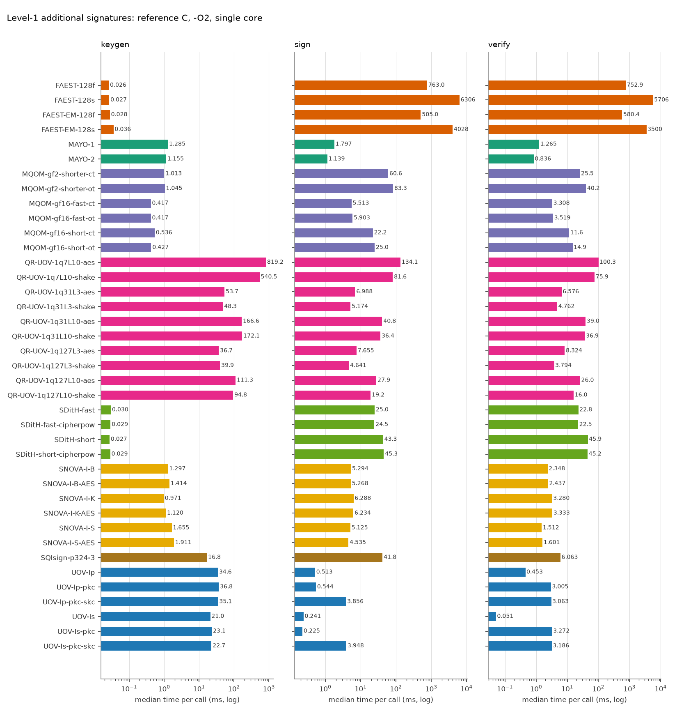
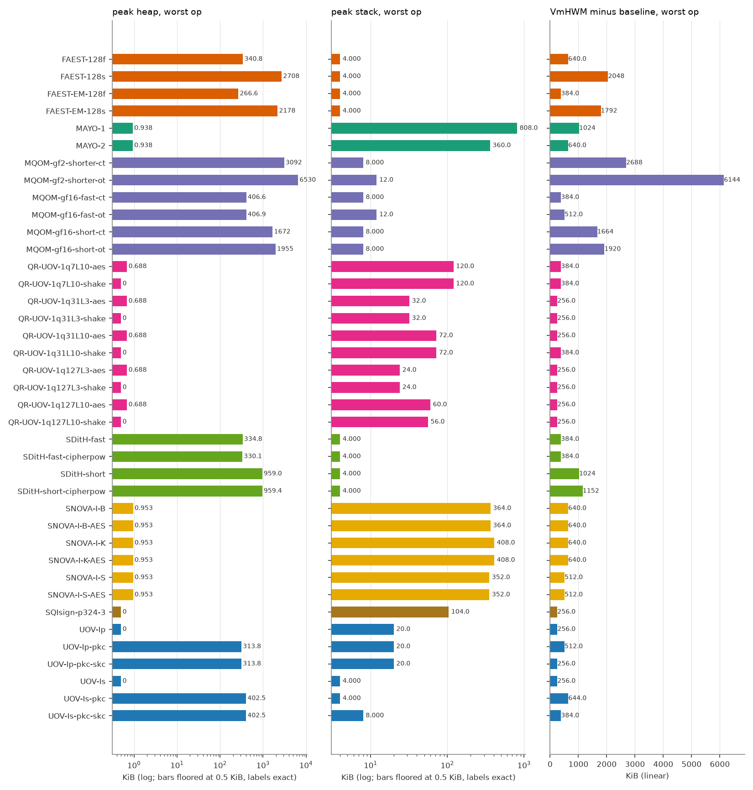
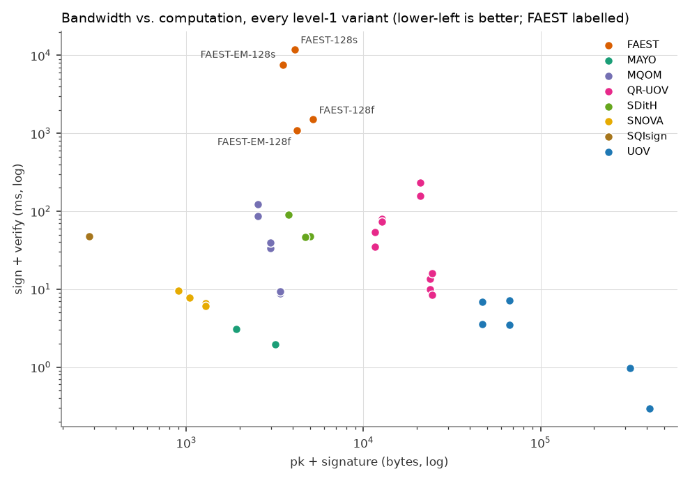

# FAEST vs. the other on-going NIST additional-signature candidates (level 1)

All numbers are produced by `tools/bench/run_bench.py` + `tools/bench/report.py` from the reference implementations in `original/Additional-DS/` (static-test folders, portable C, no SIMD/AES-NI). Regenerate with `make bench-l1`.

## Setup

| | |
|---|---|
| CPU | Intel(R) Core(TM) Ultra 7 155H |
| OS | Linux AlessandraYOGA 6.6.87.2-microsoft-standard-WSL2 #1 SMP PREEMPT_DYNAMIC Thu Jun  5 18:30:46 UTC 2025 x86_64 |
| Compiler | gcc (Ubuntu 13.3.0-6ubuntu2~24.04.1) 13.3.0, `CFLAGS=-O2 -std=gnu11 -w -Wno-psabi` (warnings suppressed), identical for every variant; the static KAT tests were built with `-std=c11` |
| Pinning | single core (CPU 2), one process per operation |
| Message | 1000 bytes (`hello world ` repeated), as in the reference paper |
| Iterations | up to 1000 per operation, within a 3.0 s budget (min 5); median reported |
| Date | 2026-10-14 18:19:07 |

Metrics: **time** = wall clock (`CLOCK_MONOTONIC`) per call; **cycles** = raw TSC ticks; **heap** = peak bytes live in `malloc/calloc/realloc` (requested size, via link-time wrapping, key/message buffers of the harness excluded); **stack** = deepest touched page of a dedicated 1 GiB mmap'ed thread stack (4 KiB granularity); **VmHWM-base** = growth of the process peak resident set during the operation, `vmhwm_kb - vmhwm_base_kb` (the raw VmHWM, in `results.csv`, also contains a 2.0-2.4 MiB baseline of libc and harness pages that depends on the operation, because the preparation thread has already run sign/verify and its freed heap stays resident; pages reused from it are not counted, so this column under-reports sign/verify of heap-heavy variants and is only indicative); **code/data/bss** = `size` of the algorithm objects only (harness excluded).

> **Note on FAEST timings.** FAEST sign/verify medians moved between two back-to-back runs by 0-22 % (FAEST-128f and -128s: second run slower by 17-22 %, while most other schemes were faster by about 25 %; FAEST-EM-128f/-128s within 6 %). The sign/verify anomalies seen in an earlier run under foreign load (EM-128f verify above sign, EM-128s verify far below sign) did not reproduce on the idle reruns: verify is at or below sign for all four variants in both runs (128s: 41.8 vs 41.8 ms in run 2). Keygen of FAEST (1.6-2.4 us) is near the timer resolution and varies by up to 45 %. Read FAEST/other ratios within about 1.5x with caution. No number has been altered.

## Key and signature sizes (bytes)

| Scheme | Variant | pk | sk | signature |
|---|---|---:|---:|---:|
| FAEST | FAEST-128f | 32 | 32 | 5170 |
| FAEST | FAEST-128s | 32 | 32 | 4066 |
| FAEST | FAEST-EM-128f | 32 | 32 | 4170 |
| FAEST | FAEST-EM-128s | 32 | 32 | 3466 |
| MAYO | MAYO-1 | 1456 | 24 | 464 |
| MAYO | MAYO-2 | 2928 | 24 | 239 |
| MQOM | MQOM-gf2-shorter-ct | 52 | 72 | 2492 |
| MQOM | MQOM-gf2-shorter-ot | 52 | 72 | 2492 |
| MQOM | MQOM-gf16-fast-ct | 64 | 96 | 3316 |
| MQOM | MQOM-gf16-fast-ot | 64 | 96 | 3316 |
| MQOM | MQOM-gf16-short-ct | 64 | 96 | 2932 |
| MQOM | MQOM-gf16-short-ot | 64 | 96 | 2932 |
| QR-UOV | QR-UOV-1q7L10-aes | 20641 | 32 | 331 |
| QR-UOV | QR-UOV-1q7L10-shake | 20641 | 32 | 331 |
| QR-UOV | QR-UOV-1q31L3-aes | 23641 | 32 | 157 |
| QR-UOV | QR-UOV-1q31L3-shake | 23641 | 32 | 157 |
| QR-UOV | QR-UOV-1q31L10-aes | 12266 | 32 | 435 |
| QR-UOV | QR-UOV-1q31L10-shake | 12266 | 32 | 435 |
| QR-UOV | QR-UOV-1q127L3-aes | 24256 | 32 | 200 |
| QR-UOV | QR-UOV-1q127L3-shake | 24256 | 32 | 200 |
| QR-UOV | QR-UOV-1q127L10-aes | 11041 | 32 | 541 |
| QR-UOV | QR-UOV-1q127L10-shake | 11041 | 32 | 541 |
| SDitH | SDitH-fast | 70 | 147 | 4914 |
| SDitH | SDitH-fast-cipherpow | 70 | 147 | 4643 |
| SDitH | SDitH-short | 70 | 147 | 3721 |
| SDitH | SDitH-short-cipherpow | 70 | 147 | 3721 |
| SNOVA | SNOVA-I-B | 656 | 96 | 388 |
| SNOVA | SNOVA-I-B-AES | 656 | 96 | 388 |
| SNOVA | SNOVA-I-K | 376 | 96 | 528 |
| SNOVA | SNOVA-I-K-AES | 376 | 96 | 528 |
| SNOVA | SNOVA-I-S | 1016 | 96 | 272 |
| SNOVA | SNOVA-I-S-AES | 1016 | 96 | 272 |
| SQIsign | SQIsign-p324-3 | 83 | 270 | 200 |
| UOV | UOV-Ip | 321300 | 278087 | 135 |
| UOV | UOV-Ip-pkc | 46591 | 278087 | 135 |
| UOV | UOV-Ip-pkc-skc | 46591 | 32 | 135 |
| UOV | UOV-Is | 412160 | 348704 | 96 |
| UOV | UOV-Is-pkc | 66576 | 348704 | 96 |
| UOV | UOV-Is-pkc-skc | 66576 | 32 | 96 |

## Run time (median, ms) and TSC cycles (millions)

| Scheme | Variant | KeyGen ms | Sign ms | Verify ms | KeyGen Mcyc | Sign Mcyc | Verify Mcyc |
|---|---|---:|---:|---:|---:|---:|---:|
| FAEST | FAEST-128f | 0.026 | 763.0 | 752.9 | 0.08 | 2303.22 | 2204.16 |
| FAEST | FAEST-128s | 0.027 | 6306 | 5706 | 0.08 | 18560.24 | 16849.54 |
| FAEST | FAEST-EM-128f | 0.028 | 505.0 | 580.4 | 0.08 | 1525.03 | 1753.28 |
| FAEST | FAEST-EM-128s | 0.036 | 4028 | 3500 | 0.10 | 12150.17 | 10535.63 |
| MAYO | MAYO-1 | 1.285 | 1.797 | 1.265 | 3.88 | 5.43 | 3.82 |
| MAYO | MAYO-2 | 1.155 | 1.139 | 0.836 | 3.49 | 3.39 | 2.44 |
| MQOM | MQOM-gf2-shorter-ct | 1.013 | 60.6 | 25.5 | 2.97 | 178.29 | 75.85 |
| MQOM | MQOM-gf2-shorter-ot | 1.045 | 83.3 | 40.2 | 3.12 | 249.64 | 120.71 |
| MQOM | MQOM-gf16-fast-ct | 0.417 | 5.513 | 3.308 | 1.26 | 16.65 | 9.98 |
| MQOM | MQOM-gf16-fast-ot | 0.417 | 5.903 | 3.519 | 1.26 | 17.80 | 10.62 |
| MQOM | MQOM-gf16-short-ct | 0.536 | 22.2 | 11.6 | 1.62 | 67.20 | 34.89 |
| MQOM | MQOM-gf16-short-ot | 0.427 | 25.0 | 14.9 | 1.24 | 72.93 | 44.01 |
| QR-UOV | QR-UOV-1q7L10-aes | 819.2 | 134.1 | 100.3 | 2444.73 | 402.71 | 302.16 |
| QR-UOV | QR-UOV-1q7L10-shake | 540.5 | 81.6 | 75.9 | 1631.08 | 246.54 | 229.30 |
| QR-UOV | QR-UOV-1q31L3-aes | 53.7 | 6.988 | 6.576 | 158.86 | 20.60 | 19.54 |
| QR-UOV | QR-UOV-1q31L3-shake | 48.3 | 5.174 | 4.762 | 144.49 | 15.53 | 14.33 |
| QR-UOV | QR-UOV-1q31L10-aes | 166.6 | 40.8 | 39.0 | 502.85 | 123.20 | 117.86 |
| QR-UOV | QR-UOV-1q31L10-shake | 172.1 | 36.4 | 36.9 | 519.76 | 106.67 | 108.63 |
| QR-UOV | QR-UOV-1q127L3-aes | 36.7 | 7.655 | 8.324 | 108.70 | 22.84 | 24.97 |
| QR-UOV | QR-UOV-1q127L3-shake | 39.9 | 4.641 | 3.794 | 119.95 | 14.01 | 11.46 |
| QR-UOV | QR-UOV-1q127L10-aes | 111.3 | 27.9 | 26.0 | 336.65 | 84.25 | 77.02 |
| QR-UOV | QR-UOV-1q127L10-shake | 94.8 | 19.2 | 16.0 | 279.94 | 56.87 | 47.87 |
| SDitH | SDitH-fast | 0.030 | 25.0 | 22.8 | 0.09 | 74.91 | 68.52 |
| SDitH | SDitH-fast-cipherpow | 0.029 | 24.5 | 22.5 | 0.09 | 73.96 | 67.90 |
| SDitH | SDitH-short | 0.027 | 43.3 | 45.9 | 0.08 | 130.89 | 138.72 |
| SDitH | SDitH-short-cipherpow | 0.029 | 45.3 | 45.2 | 0.09 | 136.97 | 132.95 |
| SNOVA | SNOVA-I-B | 1.297 | 5.294 | 2.348 | 3.81 | 15.68 | 6.99 |
| SNOVA | SNOVA-I-B-AES | 1.414 | 5.268 | 2.437 | 4.23 | 15.78 | 7.32 |
| SNOVA | SNOVA-I-K | 0.971 | 6.288 | 3.280 | 2.92 | 18.94 | 9.94 |
| SNOVA | SNOVA-I-K-AES | 1.120 | 6.234 | 3.333 | 3.39 | 18.84 | 10.07 |
| SNOVA | SNOVA-I-S | 1.655 | 5.125 | 1.512 | 5.00 | 15.05 | 4.45 |
| SNOVA | SNOVA-I-S-AES | 1.911 | 4.535 | 1.601 | 5.64 | 13.49 | 4.78 |
| SQIsign | SQIsign-p324-3 | 16.8 | 41.8 | 6.063 | 50.33 | 125.93 | 18.29 |
| UOV | UOV-Ip | 34.6 | 0.513 | 0.453 | 104.65 | 1.55 | 1.37 |
| UOV | UOV-Ip-pkc | 36.8 | 0.544 | 3.005 | 111.36 | 1.64 | 9.07 |
| UOV | UOV-Ip-pkc-skc | 35.1 | 3.856 | 3.063 | 102.90 | 11.37 | 9.11 |
| UOV | UOV-Is | 21.0 | 0.241 | 0.051 | 62.78 | 0.72 | 0.15 |
| UOV | UOV-Is-pkc | 23.1 | 0.225 | 3.272 | 69.41 | 0.68 | 9.85 |
| UOV | UOV-Is-pkc-skc | 22.7 | 3.948 | 3.186 | 68.59 | 11.93 | 9.63 |

## Memory (KiB)

| Scheme | Variant | heap KG/S/V | stack KG/S/V | VmHWM-base KG/S/V | code | data+bss |
|---|---|---|---|---|---:|---:|
| FAEST | FAEST-128f | 0.0 / 340.8 / 163.5 | 0.0 / 4.0 / 4.0 | 256 / 640 / 384 | 583.6 | 1.2 |
| FAEST | FAEST-128s | 0.0 / 2708.0 / 1101.8 | 0.0 / 4.0 / 4.0 | 256 / 2048 / 512 | 583.6 | 1.2 |
| FAEST | FAEST-EM-128f | 0.0 / 266.6 / 135.8 | 0.0 / 4.0 / 4.0 | 256 / 384 / 384 | 583.6 | 1.2 |
| FAEST | FAEST-EM-128s | 0.0 / 2178.1 / 1089.3 | 0.0 / 4.0 / 4.0 | 256 / 1792 / 640 | 583.6 | 1.2 |
| MAYO | MAYO-1 | 0.9 / 0.9 / 0.7 | 156.0 / 236.0 / 808.0 | 384 / 512 / 1024 | 40.4 | 0.1 |
| MAYO | MAYO-2 | 0.9 / 0.9 / 0.7 | 124.0 / 152.0 / 360.0 | 384 / 384 / 640 | 40.4 | 0.1 |
| MQOM | MQOM-gf2-shorter-ct | 528.6 / 3091.8 / 704.6 | 0.0 / 8.0 / 8.0 | 640 / 2688 / 128 | 529.0 | 0.4 |
| MQOM | MQOM-gf2-shorter-ot | 528.6 / 6530.4 / 5152.6 | 0.0 / 12.0 / 8.0 | 640 / 6144 / 4736 | 546.5 | 0.4 |
| MQOM | MQOM-gf16-fast-ct | 132.1 / 406.6 / 132.1 | 0.0 / 8.0 / 8.0 | 384 / 256 / 128 | 512.2 | 0.3 |
| MQOM | MQOM-gf16-fast-ot | 132.1 / 406.9 / 249.1 | 0.0 / 12.0 / 8.0 | 512 / 384 / 128 | 530.1 | 0.4 |
| MQOM | MQOM-gf16-short-ct | 134.2 / 1672.5 / 352.6 | 0.0 / 8.0 / 4.0 | 384 / 1664 / 256 | 526.9 | 0.3 |
| MQOM | MQOM-gf16-short-ot | 134.2 / 1954.5 / 1488.6 | 0.0 / 8.0 / 4.0 | 384 / 1920 / 1408 | 545.9 | 0.4 |
| QR-UOV | QR-UOV-1q7L10-aes | 0.7 / 0.7 / 0.7 | 112.0 / 120.0 / 100.0 | 256 / 384 / 256 | 38.1 | 0.1 |
| QR-UOV | QR-UOV-1q7L10-shake | 0.0 / 0.0 / 0.0 | 112.0 / 120.0 / 100.0 | 256 / 384 / 256 | 38.3 | 0.1 |
| QR-UOV | QR-UOV-1q31L3-aes | 0.7 / 0.7 / 0.7 | 32.0 / 28.0 / 24.0 | 256 / 256 / 256 | 38.3 | 0.1 |
| QR-UOV | QR-UOV-1q31L3-shake | 0.0 / 0.0 / 0.0 | 32.0 / 28.0 / 24.0 | 128 / 256 / 256 | 38.4 | 0.1 |
| QR-UOV | QR-UOV-1q31L10-aes | 0.7 / 0.7 / 0.7 | 68.0 / 72.0 / 64.0 | 256 / 256 / 256 | 38.0 | 0.1 |
| QR-UOV | QR-UOV-1q31L10-shake | 0.0 / 0.0 / 0.0 | 68.0 / 72.0 / 64.0 | 256 / 384 / 256 | 38.1 | 0.1 |
| QR-UOV | QR-UOV-1q127L3-aes | 0.7 / 0.7 / 0.7 | 24.0 / 24.0 / 20.0 | 256 / 256 / 256 | 38.1 | 0.1 |
| QR-UOV | QR-UOV-1q127L3-shake | 0.0 / 0.0 / 0.0 | 24.0 / 24.0 / 20.0 | 256 / 256 / 256 | 38.2 | 0.1 |
| QR-UOV | QR-UOV-1q127L10-aes | 0.7 / 0.7 / 0.7 | 56.0 / 60.0 / 52.0 | 256 / 256 / 256 | 38.3 | 0.1 |
| QR-UOV | QR-UOV-1q127L10-shake | 0.0 / 0.0 / 0.0 | 56.0 / 56.0 / 48.0 | 256 / 256 / 256 | 38.4 | 0.1 |
| SDitH | SDitH-fast | 0.4 / 334.8 / 328.5 | 0.0 / 4.0 / 4.0 | 256 / 256 / 384 | 190.7 | 0.1 |
| SDitH | SDitH-fast-cipherpow | 0.4 / 330.1 / 323.7 | 0.0 / 4.0 / 4.0 | 256 / 384 / 256 | 190.7 | 0.1 |
| SDitH | SDitH-short | 0.4 / 959.0 / 952.7 | 0.0 / 4.0 / 4.0 | 384 / 1024 / 1024 | 190.7 | 0.1 |
| SDitH | SDitH-short-cipherpow | 0.4 / 959.4 / 953.1 | 0.0 / 4.0 / 4.0 | 384 / 1152 / 896 | 190.7 | 0.1 |
| SNOVA | SNOVA-I-B | 1.0 / 1.0 / 0.0 | 132.0 / 364.0 / 280.0 | 384 / 640 / 512 | 33.2 | 10.2 |
| SNOVA | SNOVA-I-B-AES | 1.0 / 1.0 / 0.7 | 132.0 / 364.0 / 280.0 | 384 / 640 / 512 | 31.7 | 10.2 |
| SNOVA | SNOVA-I-K | 1.0 / 1.0 / 0.0 | 144.0 / 408.0 / 360.0 | 384 / 640 / 640 | 32.9 | 15.3 |
| SNOVA | SNOVA-I-K-AES | 1.0 / 1.0 / 0.7 | 144.0 / 408.0 / 360.0 | 384 / 640 / 512 | 31.4 | 15.3 |
| SNOVA | SNOVA-I-S | 1.0 / 1.0 / 0.0 | 136.0 / 352.0 / 288.0 | 384 / 512 / 512 | 32.8 | 5.3 |
| SNOVA | SNOVA-I-S-AES | 1.0 / 1.0 / 0.7 | 136.0 / 352.0 / 288.0 | 384 / 512 / 512 | 31.3 | 5.3 |
| SQIsign | SQIsign-p324-3 | 0.0 / 0.0 / 0.0 | 56.0 / 104.0 / 40.0 | 256 / 256 / 256 | 250.9 | 0.4 |
| UOV | UOV-Ip | 0.0 / 0.0 / 0.0 | 20.0 / 12.0 / 4.0 | 256 / 256 / 256 | 41.6 | 0.1 |
| UOV | UOV-Ip-pkc | 0.0 / 0.0 / 313.8 | 20.0 / 12.0 / 4.0 | 256 / 256 / 512 | 41.8 | 0.1 |
| UOV | UOV-Ip-pkc-skc | 271.6 / 271.6 / 313.8 | 20.0 / 20.0 / 4.0 | 256 / 0 / 256 | 44.0 | 0.1 |
| UOV | UOV-Is | 0.0 / 0.0 / 0.0 | 4.0 / 4.0 / 0.0 | 256 / 256 / 256 | 37.1 | 0.1 |
| UOV | UOV-Is-pkc | 0.0 / 0.0 / 402.5 | 4.0 / 4.0 / 0.0 | 256 / 256 / 644 | 37.3 | 0.1 |
| UOV | UOV-Is-pkc-skc | 340.5 / 340.5 / 402.5 | 4.0 / 8.0 / 0.0 | 256 / 0 / 384 | 38.1 | 0.1 |

Stack legend: values of 0, 4 and 8 KiB are page-granularity floors (read them as "<= 4 KiB", "<= 8 KiB"), not measurements; the stack is the touched pages of the thread stack minus an empty thread.

## FAEST against the best variant of every other family

Fastest FAEST variant per operation vs. fastest variant of each other scheme (ratio > 1: FAEST slower).

| Scheme | best KeyGen | best Sign | best Verify | smallest pk+sig |
|---|---|---|---|---|
| MAYO | MAYO-2 (1.155 ms): x0.0226 | MAYO-2 (1.139 ms): x443.4 | MAYO-2 (0.836 ms): x694.6 | MAYO-1 (1920 B): x1.8 |
| MQOM | MQOM-gf16-fast-ct (0.417 ms): x0.0627 | MQOM-gf16-fast-ct (5.513 ms): x91.6 | MQOM-gf16-fast-ct (3.308 ms): x175.5 | MQOM-gf2-shorter-ct (2544 B): x1.4 |
| QR-UOV | QR-UOV-1q127L3-aes (36.7 ms): x0.000713 | QR-UOV-1q127L3-shake (4.641 ms): x108.8 | QR-UOV-1q127L3-shake (3.794 ms): x153.0 | QR-UOV-1q127L10-aes (11.6 K B): x0.3 |
| SDitH | SDitH-short (0.027 ms): x0.953 | SDitH-fast-cipherpow (24.5 ms): x20.6 | SDitH-fast-cipherpow (22.5 ms): x25.8 | SDitH-short (3791 B): x0.9 |
| SNOVA | SNOVA-I-K (0.971 ms): x0.0269 | SNOVA-I-S-AES (4.535 ms): x111.4 | SNOVA-I-S (1.512 ms): x383.9 | SNOVA-I-K (904 B): x3.9 |
| SQIsign | SQIsign-p324-3 (16.8 ms): x0.00156 | SQIsign-p324-3 (41.8 ms): x12.1 | SQIsign-p324-3 (6.063 ms): x95.7 | SQIsign-p324-3 (283 B): x12.4 |
| UOV | UOV-Is (21.0 ms): x0.00124 | UOV-Is-pkc (0.225 ms): x2243.8 | UOV-Is (0.051 ms): x11277.9 | UOV-Ip-pkc (46.7 K B): x0.1 |

FAEST reference points: FAEST-128f keygen 0.026 ms, FAEST-EM-128f sign 505.0 ms, FAEST-EM-128f verify 580.4 ms; smallest pk+sig FAEST-EM-128s (3498 B).

## Caveats

- Portable *reference* C for every scheme; schemes whose submission relies on AVX2/AES-NI/GFNI ship considerably faster optimized packages (not measured here), so absolute numbers are not comparable with optimized-implementation papers; the comparison among them is like-for-like.
- Cycles are TSC ticks of an x86 laptop CPU under WSL2, shown for relative comparison only.
- Stack figures have 4 KiB granularity; heap counts requested bytes only.
- Level 1 only (the lowest NIST category); variants per scheme are all Round-3 level-1 parameter sets that build in this tree. KAT status differs by family: MAYO, SNOVA, MQOM, SDitH and SQIsign match the official KAT record #0; UOV, QR-UOV (16 of the 39 variants) matched only the package's own generator on records 0-1 (no official KAT available offline); FAEST is the round-3 (v3) port (FAEST-R3) and matches the official v3 KAT on 100 records.
